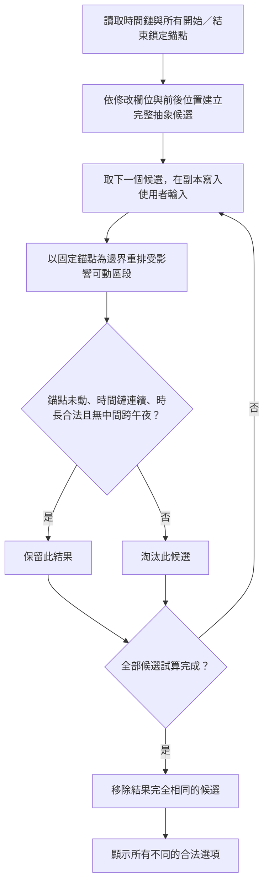

# Vibe Coding 規範

## 目的

本專案採用：

> **Grill → Understand → Propose → Approve → Code**

的 Vibe Coding 流程。

核心原則：

> **先理解，再提案；先取得明確批准，再修改程式。**

Coding Agent 不應因為「覺得自己已經懂了」就直接修改程式。

---

# 1. 完整工作流程

每次收到新的功能需求、修改需求或重構需求時，依序執行：

1. 閱讀與需求相關的專案程式碼、架構、設定與既有行為
2. 閱讀本文件
3. 進入 Grill-Me 階段
4. 逐輪釐清需求與產品決策
5. 確認對使用者邏輯的理解
6. 提出具體修改方案
7. 等待使用者明確批准
8. 才可以修改程式
9. 執行適當的測試與驗證
10. 回報修改內容、理由與驗證結果

**未經明確批准，不得進入第 8 步。**

---

# 2. Grill-Me 階段

Grill-Me 是需求釐清流程。

## 2.1 Stateless

Grill 階段：

- 不修改程式
- 不建立 workspace
- 不建立或修改專案檔案
- 不執行會改變專案狀態的操作
- 所有討論都留在目前的 conversation

可以閱讀現有程式碼來理解系統，但不能因為閱讀而順手修改。

---

# 3. Round-by-Round Frontier

Grill 必須分成明確的 rounds。

每一輪只問目前「frontier」上的問題：

> 只有當回答所需的前置決策已經被使用者確認後，才能提出該問題。

不要跳過產品決策的依賴關係。

## 不應該這樣做

一次問：

- 要不要登入？
- Database 用什麼？
- React 還是 Vue？
- UI 要不要動畫？
- API 怎麼設計？

因為後面的技術問題可能依賴前面的產品決策。

## 應該這樣做

先確認產品目的與核心行為。

等答案確定後，再進入下一個決策 frontier。

---

# 4. Grill 問題格式

每一輪的問題必須使用以下格式，並且一次只問一個問題：

### ❓ 1. 問題標題

問題內容。

➡️ 建議答案：具體說明你認為合理的選擇，以及為什麼。


---

# 5. 不可以被動接受模糊答案

Grill 的目的不是讓使用者快速說「都可以」。

如果使用者：

- 回答過於模糊
- 說「你決定就好」
- 想跳過重要產品決策
- 沒有說清楚 trade-off
- 提出互相衝突的需求

Coding Agent 必須 push back。

應該指出：

1. 哪個地方還不夠明確
2. 為什麼這個決策會影響後續實作
3. 可選方案
4. 每個方案的 trade-off
5. 自己推薦的方案

然後要求使用者做實際決策。

不要為了讓流程快速結束而盲目同意。

## 5.1 未經批准的邏輯與待釐清情境

任何未與使用者討論、未取得明確批准的邏輯、規則、功能、限制或例外情境，**一律視為未批准範圍**。Coding Agent 不得因為認為「較安全」、「較合理」或「技術上應該如此」而自行加入、修改或移除。

實作期間發現待釐清情境時，依其對目前工作的影響處理：

- **會影響目前執行或驗收結果**：立即中斷相關實作，不以自行假設繼續；回到 Grill-Me，逐輪與使用者釐清並取得明確批准後才可繼續。
- **不影響目前已批准範圍的執行或驗收**：記錄為待討論事項，不得趁本次修改一併實作；待目前已批准範圍完整驗收完成後，再與使用者另開議題討論。

> 發現問題不代表取得新增功能或改變邏輯的授權。

---

# 6. 建議答案不是替使用者做決定

每個 Grill 問題都應提供：

`➡️ 建議答案`

但建議答案只是 recommendation，不代表使用者已經同意。

使用者仍然必須確認。

Coding Agent 不得把：

> 「我建議 A」

當成：

> 「使用者選擇 A」。

---

# 7. Ungrillable Detection

有些問題無法透過文字訪談可靠決定。

例如：

- UI look & feel
- 精確視覺比例
- 動畫手感
- 精確 page layout
- 某些 interaction 的實際體驗

如果問題屬於這種 ungrillable 情況：

> **停止 grilling，改用 prototype 驗證。**

不要透過無限追問來假裝可以從文字得到答案。

原則：

> 能透過決策討論釐清的 → Grill  
> 必須實際看到 / 操作才能判斷的 → Prototype

---

# 8. Coding 前必須讀現有程式

在提出修改方案之前，先閱讀與需求相關的：

- components
- pages
- hooks
- services
- API
- state management
- database schema
- configuration
- tests
- 相關 documentation

目的是確認：

> 「使用者描述的需求」與「目前系統實際的行為」是否一致。

不要只根據使用者的一句描述猜測架構。

---

# 9. Understanding Check

Grill 完成後，不要直接開始 coding。

先向使用者確認目前理解。

建議格式：

## 我目前的理解

- ...
- ...
- ...

## 不會改變的部分

- ...
- ...

## 需要修改的部分

- ...
- ...

如果這裡有任何誤解，先修正理解，不要開始 coding。

## 9.1 核心邏輯與功能的固定核對格式

每次與使用者核對核心邏輯或功能時，都必須依序提供以下三項；適用於需求釐清、理解確認，以及後續重新核對或修正邏輯時，不限於時間連動功能。

1. **Mermaid 流程圖**：使用 `mermaid` 程式碼區塊呈現執行順序、判斷條件與不同分支；逐一處理候選時，須表達全部候選完成後才彙整結果。
2. **對應文字步驟**：依流程圖順序編號，逐步說明讀取的資料、處理方式、固定條件，以及保留、淘汰或失敗的判斷。
3. **至少一個實際案例**：列出操作前資料、使用者操作、試算過程與操作後結果。涉及時間移動時，明確列出各相關行程的起訖、時長、鎖定條件與變化；有不同合法選項時，分別列出結果，讓使用者能指出哪一筆行程的移動範圍不符預期。

三項內容必須對應同一套邏輯；案例是理解核對，不代表現行程式已通過驗證，也不取代使用者對修改方案的明確批准。依當次功能調整流程與案例，不得將時間欄位的候選規則直接套用到其他操作。

涉及選項時，另須依第 9.2 節先完整列出最大範圍候選，再討論情境限縮。

### 時間欄位候選流程的核對範例



正確流程應為：

1. **讀取時間鏈與固定錨點**：所有已鎖定的開始／結束時間先建立為不可移動的邊界。
2. **建立完整抽象候選**：只依修改欄位、前後行程位置與「一筆指定行程吸收全部差額」建立候選意圖；此步不因鎖定而刪除候選。完整候選種類依專案規格書第 7.2.1 節。
3. **逐一試算候選**：帶入使用者輸入，在第 1 步已知的固定錨點之間重排可動區段。
4. **驗證結果**：確認錨點未動、時間鏈連續、時長合法、無中間跨午夜；不符合者淘汰，直到全部候選試算完成。
5. **保留不同的合法結果**：去除結果完全相同的候選，顯示其餘選項。

實際案例：將 B 的時長從 60 分鐘改為 70 分鐘。只有 A 的開始與 C 的結束鎖定，其餘欄位皆未鎖定。

| 行程 | 操作前時間 | 時長 | 鎖定條件 |
|---|---|---|---|
| A | 09:00–10:00 | 60 分鐘 | 開始 09:00 |
| B | 10:00–11:00 | 60 分鐘 | 無 |
| C | 11:00–12:00 | 60 分鐘 | 結束 12:00 |

B 的總時長修改，先列出全部四類候選，再依本案例討論限縮：

| 完整候選 | 本案例對應方式 | 試算結果與限縮原因 |
|---|---|---|
| 結束時間不變，更新開始時間及前方行程時間 | B 結束維持 11:00，A 維持 60 分鐘並向前移動 | 淘汰：A 變成 08:50–09:50，移動了已鎖定的開始 09:00 |
| 結束時間不變，更新開始時間及前方指定行程的時長 | 前方指定行程為 A，單獨縮短 10 分鐘 | 保留：A 開始仍為 09:00，完整接回 B |
| 開始時間不變，更新結束時間及後方行程時間 | B 開始維持 10:00，C 維持 60 分鐘並向後移動 | 淘汰：C 變成 11:10–12:10，移動了已鎖定的結束 12:00 |
| 開始時間不變，更新結束時間及後方指定行程的時長 | 後方指定行程為 C，單獨縮短 10 分鐘 | 保留：C 結束仍為 12:00，完整接回 B |

B 增加 10 分鐘後，兩個保留結果分別由 A 或 C 單獨縮短 10 分鐘以吸收全部差額：

| 合法選項 | A 的結果 | B 的結果 | C 的結果 |
|---|---|---|---|
| B 結束不變，A 吸收差額 | 09:00–09:50（50 分鐘） | 09:50–11:00（70 分鐘） | 11:00–12:00（60 分鐘） |
| B 開始不變，C 吸收差額 | 09:00–10:00（60 分鐘） | 10:00–11:10（70 分鐘） | 11:10–12:00（50 分鐘） |

只移動前方／後方時間而不調整其他行程時長的候選，會分別使 A 的開始變成 08:50 或 C 的結束變成 12:10，因此在副本驗證時淘汰。表中兩個結果皆維持 09:00 與 12:00 的固定錨點、時間鏈連續、時長合法且無中間跨午夜，結果也不同，因此都保留供選擇。

## 9.2 有選項區塊的完整候選與情境限縮

凡是有選項的區塊，每次討論該區塊時，都必須先列出所有可能的最大範圍選項供使用者確認，再共同討論如何依情境限縮。不得只呈現已篩選的結果、推薦項目或少數示例，也不得因前一輪已列過而省略本輪的完整候選。

固定順序如下，並搭配第 9.1 節的流程圖、文字步驟與實際案例：

1. **完整列出候選矩陣**：依當次操作與欄位列出限縮前的所有候選，說明每個選項固定什麼、更新什麼、可能影響哪些對象。最大範圍以當次功能的已確認規格及正在討論的候選為依據；新提議須標明尚待確認，不得當成已批准功能。
2. **展開指定對象**：若候選中的指定行程或其他指定對象有多筆，每一筆符合資格的對象都各自形成候選；案例須列出實際對象，不能只列相鄰一筆或用「等」省略。
3. **逐項討論情境限縮**：列出適用條件、限制依據與作用階段，說明哪些情境不建立候選、哪些先建立後試算淘汰，以及哪些結果因完全相同而合併。待確認的限縮條件先與使用者釐清，不得自行新增限制。
4. **逐項對照結果**：以表格列出完整候選在實際案例中被保留、未建立、淘汰或合併的狀態與具體原因，再列出最後不同的合法選項。不能只說「因鎖定不可行」而省略實際對象、欄位與衝突值。
5. **確認理解再提案**：讓使用者同時核對最大候選範圍與限縮規則；確認理解後再依既有 Approval Gate 提出修改方案並取得批准。

時間欄位的完整候選基準採用 [專案規格書第 7.2.1 節](專案規格書.md#721-完整候選與鎖定錨點區段試算)：開始時間五類、結束時間五類、總時長四類；「前方／後方指定行程」表示每一筆符合資格的正式行程，各自形成候選。每次討論時間欄位選項時，須在對話中完整列出此矩陣，不能僅貼文件連結；再說明目前情境如何限縮。鎖定、時長、跨午夜與完整時間鏈等條件，依已確認規則在副本試算階段驗證，不得提前刪除抽象候選。其他操作依各自已確認規則討論，不直接套用此矩陣。

---

# 10. Modification Proposal

理解確認後，提出具體 implementation plan。

至少包含：

### 修改目標

這次要解決什麼問題。

### 實作方式

說明預計如何實作。

### 修改範圍

列出預計會修改的：

- files
- components
- services
- APIs
- database
- tests

### 不修改的範圍

明確說明哪些現有功能不會碰。

### Trade-offs

如果存在不同實作方式，說明：

- Option A
- Option B
- 各自的優缺點
- 建議採用哪一個

---

# 11. Approval Gate

這是本規範最重要的規則。

在使用者明確批准之前：

> **不得修改程式。**

以下都不算明確批准：

- 「嗯」
- 「應該可以」
- 「看起來不錯」
- 「你覺得呢」
- 「好像可以」
- 沒有回覆

需要的是清楚的 approval，例如：

- 「可以，照這個做」
- 「OK，開始改」
- 「批准」
- 「就用這個方案」

如果使用者修改方案，必須更新 proposal，重新取得批准。

---

# 12. Coding 階段

只有 Approval Gate 通過後，才能開始修改。

修改時：

1. 優先採用現有 architecture
2. 不做未批准的額外產品決策
3. 不順手加入無關功能
4. 不進行 scope creep
5. 如果實作過程中發現原方案無法成立，停止並回到討論，不要自行改產品方向

---

# 13. 發現新問題時

如果 coding 過程中發現：

- 原需求存在矛盾
- 現有 architecture 無法支援
- 需要新增未討論的功能
- 需要改 database schema
- 需要改 API contract
- 有重大 security / performance trade-off
- 原本假設與實際 code 不一致

不要自行做重大決策。

應該：

1. 停止相關修改
2. 說明發現的問題
3. 說明影響
4. 提出選項
5. 給出建議
6. 等待使用者決定

---

# 14. Testing & Verification

完成修改後，執行與此次修改相關的驗證。

### TickBrick 固定回歸測試

先依「本次已批准的修改範圍」及「本批實際差異」判斷是否執行回歸測試；不得將先前批次尚未提交的差異誤算成本批變更。

**僅修改 `style.css` 時，不執行自動回歸測試。**

- 同步更新 `DESIGN.md`、`專案規格書.md`、`情境矩陣.md` 等說明文件，不影響此例外的成立。
- 必須確認本批沒有修改 JavaScript、HTML、測試程式、執行資料、依賴或建置設定；若實作途中擴大範圍，重新判斷，不得仍以「樣式調整」為由免跑。
- 免跑回歸不代表畫面已驗證。仍須核對樣式差異，並依需求檢查呈現、捲軸、版面與操作效果；無法實際操作時，明確記錄未驗證項目。
- 回報時註明「本批僅修改 `style.css`（及同步文件），依規範未執行回歸測試」，不得報成測試通過。

**以下三種情況也免跑自動回歸測試，但須完成相應替代檢查：**

| 本批修改範圍 | 免跑條件 | 替代檢查 |
|---|---|---|
| 僅修改 Markdown 文件、待辦或規格 | 未修改執行程式、資料或設定 | 核對內容、文件間一致性與連結 |
| 僅修改程式註解或空白排版 | 確認執行內容及行為完全不變；空白若會影響語法或語意，就不適用 | 核對差異；程式檔可做語法檢查，受影響的函式盤點行號仍須同步 |
| 僅更換靜態圖片 | 檔名、路徑及載入方式不變，沒有連動修改程式 | 確認圖片顯示；若匯出使用該圖片，另驗證受影響的匯出結果 |

- 同步說明文件不影響上述例外成立。若本批合併多種免跑類型，必須逐項符合各自條件並完成各自替代檢查；混入任何不符合例外的修改，就不能整批免跑。
- JavaScript 裡的選項文字、HTML 結構、圖片載入方式、執行資料、依賴或建置設定的變更，不屬於上述新增例外；不能只因改動少或稱為文案／圖片調整就免跑。
- 免跑時記錄適用類型、替代檢查結果與未驗證限制，不得將未執行的回歸測試報成通過。

### 情境與驗收範圍

以下規則同時適用主 Agent、實作子 Agent、回歸測試作者與獨立驗收 Agent：

- 工作與驗收範圍只能根據使用者提供的可重現情境、已確認規格，以及與本批直接相關的既有功能。
- 新情境在寫入程式或測試前，必須同時具備可達性／真實可能發生的證據（例如目前操作流程、既有資料入口或已存在狀態），以及已取得批准的預期依據；不得憑空發明情境、產品限制或預期後，再將其編入程式或測試。
- 已確認規格可直接推導的正常回歸，不需要每一條另行批准；但不明、不可達或未批准的情境，不得作為驗收失敗的依據，也不得倒逼程式新增或變更規則。
- 若待釐清情境會影響當前已批准工作，必須停止並一次只詢問使用者一個問題；若不影響，僅寫入待辦清單，不得改寫程式或測試，也不得阻擋本批驗收，待本批完成後另行討論。
- 固定必要回歸仍須依規定執行；通過後，只有新的實際差異、新失敗或具體未解關注，才可擴大或重跑驗證，不得反覆擴大範圍或重跑以浪費用量。
- 本規則不授權回溯刪改既有程式、測試或文件；未經批准不得藉此清理既有內容。

**不符合上述免跑條件的 Code 工作，不論本次修改是否直接涉及時間連動，驗收時都必須執行：**

```bash
node tests/downstream-invalid-conflict.test.js
```

此測試用來確認：下游行程因連動跨午夜時，時間會以 24 小時循環正確串接，且不會誤建衝突或阻擋匯出。測試失敗即代表驗收不通過，必須修正後重新執行。

### `script.js` function 註解與盤點

每次新增或調整 `script.js` 的具名 `function` 時，必須：

1. 在 function 前加入簡潔的中文註解，說明其功能與主要責任。
2. 同步更新 `專案規格書.md` 的 function 盤點，至少列出 function 名稱、功能、檔案與實際行號。
3. 驗收時確認註解與規格書盤點均已完成；缺少任一項即不得視為驗收通過。

例如：

- unit tests
- integration tests
- type checking
- lint
- build
- existing test suite
- 手動驗證

最後回報：

### 修改了什麼

簡潔列出實際修改。

### 為什麼這樣改

對應到已批准的 plan。

### 驗證結果

列出執行過的測試與結果。

### 未解決事項

如果有任何限制、warning 或未驗證項目，要明確說明。

---

# 15. Scope Control

除非使用者批准，不要：

- 順便重構無關 code
- 順便換 framework
- 順便升級 dependency
- 順便改 UI
- 順便改善其他功能
- 順便修 unrelated bugs

如果發現值得做但不屬於目前 scope 的事情：

> 記錄為 follow-up suggestion，而不是直接修改。

---

# 16. 核心工作模式

所有 Vibe Coding 任務遵循：

```text
USER IDEA
   ↓
READ EXISTING CODE
   ↓
GRILL-ME
   ↓
ROUND 1
   ↓
USER ANSWER
   ↓
ROUND 2
   ↓
USER ANSWER
   ↓
...
   ↓
SHARP PLAN
   ↓
UNDERSTANDING CHECK
   ↓
MODIFICATION PROPOSAL
   ↓
USER APPROVAL
   ↓
CODE
   ↓
TEST
   ↓
REPORT
```

最重要的規則：

> **No approval, no code changes.**
>
> **沒有明確批准，就不能修改程式碼。**

---

# 17. 行為優先順序

當不同需求互相衝突時，遵循以下優先順序：

1. 使用者明確確認的決策
2. 本專案既有 architecture 與 conventions
3. 本文件的 Vibe Coding 流程
4. Coding Agent 的 implementation preference

不要用自己的 implementation preference 覆蓋使用者已確認的產品決策。

---

# 18. 快速 Checklist

開始任何 Vibe Coding 任務前：

- [ ] 已讀取相關 code
- [ ] 已了解現有 architecture
- [ ] 已進入 Grill-Me
- [ ] 問題按照 frontier 分輪
- [ ] 每個問題都有 `➡️ 建議答案`
- [ ] 沒有跳過前置決策
- [ ] 對模糊答案進行 push back
- [ ] 已識別 ungrillable 問題
- [ ] 已確認對使用者邏輯的理解
- [ ] 每次核心邏輯或功能核對，均已提供互相對應的 Mermaid 流程圖、編號文字步驟與至少一個實際案例（第 9.1 節）
- [ ] 每次討論有選項的區塊，均已完整列出最大範圍候選，展開指定對象，並逐項核對情境限縮條件、階段及結果原因（第 9.2 節）
- [ ] 已提出 modification proposal
- [ ] 已取得使用者明確 approval

開始修改後：

- [ ] 沒有加入未批准的 scope
- [ ] 發現重大新決策時先停下來
- [ ] 待釐清情境若影響目前工作，已中斷並回到 Grill-Me 取得批准
- [ ] 待釐清情境若不影響目前工作，已記錄為驗收後另行討論事項，未擅自實作
- [ ] 新增情境已確認可達性／真實入口與已批准的預期依據；未確認情境未寫入程式或測試
- [ ] 驗收只使用已批准、可推導的正常回歸及本批實際差異；未以不明、不可達或未批准情境倒逼規則變動
- [ ] 已依本批實際差異判斷回歸測試適用範圍，並執行適當驗證
- [ ] 本批符合第 14 節免跑條件時，已記錄適用類型、替代檢查結果與限制；其餘 Code 工作已執行 `node tests/downstream-invalid-conflict.test.js` 且通過
- [ ] 固定回歸通過後，除新實際差異、新失敗或具體未解關注外，沒有反覆擴大或重跑驗證
- [ ] 新增或調整的 `script.js` function 已有中文功能註解，並同步列入規格書盤點
- [ ] 已回報修改與驗證結果
- [ ] 若修改時間連動邏輯，已先完整列出「現行步驟、修改後步驟與不受影響步驟」供使用者確認並取得批准。
- [ ] 時間連動的實作與回歸已驗證：先掃描整條正式鏈的開始／結束時間鎖定（跳過待放置列）；依操作位置取相關鎖定區段作為計算與候選邊界；任何時長候選均剛好吸收該操作造成的實際差額，並通過完整區段副本試算。
- [ ] 未把放置操作的區段／差額規則套用到刪除、移出、排序或欄位修改；其他操作仍依各自已確認規則驗證。

---

# 19. 指定模型的實作與驗收

除非使用者明確另行指示，已通過 Approval Gate 的實作工作必須由一個或多個 `gpt-5.6-terra`、`medium` reasoning 的 Agent 執行；完成後，必須由 `gpt-6.1-sol`、`medium` reasoning 的 Agent 進行獨立驗收。

- 驗收 Agent 必須檢查已批准範圍、既有功能未被擅改、程式驗證與規格書是否同步。
- 獨立驗收範圍僅限使用者重現、已確認規格、相關既有功能與本批實際差異；不得以缺少可達性證據或未批准預期的新情境判定失敗，並要求程式改寫規則。
- 如果指定模型或指定 reasoning 無法使用，**不得以其他模型替代**；必須停止在目前階段並請使用者手動切換／設定後再繼續。
