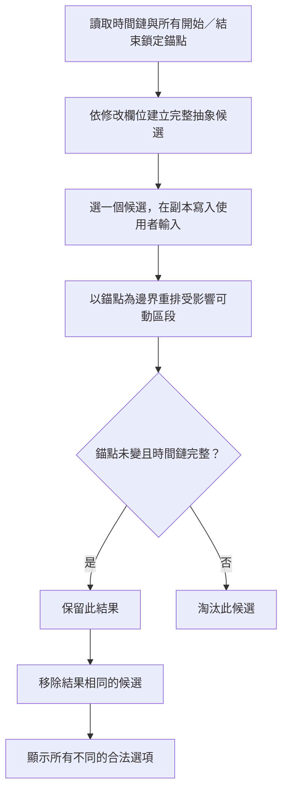

# TickBrick 專案規格書

## 文件資訊

- 文件版本：1.3.40
- 更新日期：2026-10-20
- 適用專案：行程樂高 TickBrick
- 固定核對流程：每次核對核心邏輯或功能，必須提供 Mermaid 流程圖、對應文字步驟及至少一個實際案例；完整規範與範例見 [VIBE_CODING_RULES.md 第 9.1 節](VIBE_CODING_RULES.md#91-核心邏輯與功能的固定核對格式)，並由 `AGENTS.md` 列為必要流程。
- 選項核對流程：有選項的區塊，每次討論先完整列出最大範圍候選，再逐項討論情境限縮條件、作用階段與結果原因，依 [VIBE_CODING_RULES.md 第 9.2 節](VIBE_CODING_RULES.md#92-有選項區塊的完整候選與情境限縮) 執行；時間欄位完整候選以本文件第 7.2.1 節為基準。
- 欄位查詢：[第 2.2 節「畫面欄位定義與基本規範」](#22-畫面欄位定義與基本規範) 集中整理欄位用途、格式、預設值、編輯條件及詳細流程的查詢位置。
- 提示查詢：[第 10 節「燈箱與 toast 分類盤點」](#10-燈箱與-toast-分類盤點) 列出現行提示、使用情境、按鈕及操作結果。
- 記錄方式：每次功能或邏輯新增、修改、刪除時，於下方版本紀錄追加一筆簡短說明。
- 情境文件：[情境矩陣.md](情境矩陣.md) 整理拖曳排序、一般未鎖定、時間鎖定、時長鎖定、輸入修改與交叉條件，區分已確認規則、待驗證及待討論事項；列入矩陣不代表已實作或已驗證。
- 後續維護：討論若新增情境、確認規則或修改預期結果，視情況更新情境矩陣；涉及業務邏輯、功能或驗證紀錄時同步更新本規格書。待討論建議不得當成已批准規則。
- 選項預期：情境矩陣盤點開始／結束／總時長的全鏈與動態吸收候選，以及相關燈箱按鈕，記錄本列鎖定、正式行程、時間完整性與各情境的選項文字、順序及自動執行條件。選項清單與呈現方式也是預期結果，待討論情境仍不得視為已批准規則。

## 版本紀錄
| 版本 | 日期 | 異動摘要 |
|---|---|---|
| 1.3.40 | 2026-10-20 | 依批准修正開始／結束時間超限輸入：小時大於 `23` 或分鐘大於 `59` 時不再壓成上限值，而是提示「請輸入有效時間」，不保存、不連動、不開燈箱或重繪；輸入框保留使用者文字並顯示黃色背景，合法再次送出後移除黃底並走既有流程。補上半形／全形超限、`23:59` 上限及 handler 黃底回歸；相關時間欄位與下游回歸、語法及差異檢查通過。 |
| 1.3.39 | 2026-10-20 | 依批准修正 Grid 行程列的欄位內層寬度：`.content-editor` 與 `.row-actions` 填滿各自欄位，使行程內容輸入欄及移動按鈕使用完整可用寬度；按鈕保留既有 `.button.small` 內距。未改欄寬、時間滾輪、互動與資料邏輯。將與 1.3.38 的匯出選單背景修正合併進行本機瀏覽器視覺核對；本批僅修改 `style.css` 與同步文件，依規範未執行自動回歸測試。 |
| 1.3.38 | 2026-10-20 | 依批准移除頁首匯出／匯入展開選單誤套的淡紫中央色帶，選單清單改維持純白背景；按鈕、間距、圓角、邊框、陰影與匯出／匯入功能不變。未改動時間或結構性調整燈箱的滾輪樣式。以本機瀏覽器展開選單核對色帶已消失，並核對 CSS 差異與文件一致性；本批僅修改 `style.css` 與同步文件，依規範未執行自動回歸測試。 |
| 1.3.37 | 2026-10-20 | 修正 B 階段獨立驗收發現的既有窄畫面呈現差異：共用八欄 Grid 最小寬度調整為 `1000px`，使橫向捲動完整包住表頭與資料列背景；排序欄改為垂直 flex，恢復待放置標記在拖曳圖示下方的既有排列。補上兩項靜態回歸斷言，修正 Grid 觸控函式盤點行號；未變更業務邏輯。十個 Node 回歸、`node --check script.js` 及 `git diff --check` 全數通過。 |
| 1.3.36 | 2026-10-20 | 依批准完成行程表結構重構 B 階段：當日行程與暫存區由 `table`／`tr`／`td` 改為共用八欄 `div + CSS Grid`，保留排序、開始時間、結束時間、總時長、類別、行程內容、移動、刪除順序與桌面／既有窄畫面橫向捲動呈現。表頭與資料列共用欄位配置；補上 `table`、`rowgroup`、`row`、`columnheader`、`cell` ARIA 角色。`renderDay`、`renderStaging`、`rowMarkup`、`bindRows`、觸控拖曳命中與完整列預覽皆改用 Grid selector；列印框線改套用 Grid 欄位。未改時間計算、衝突、資料格式、Canvas／PDF 匯出。新增結構靜態斷言並執行十個 Node 回歸、`node --check script.js` 及 `git diff --check` 全數通過；未執行真實瀏覽器或觸控裝置視覺驗收。 |
| 1.3.35 | 2026-10-19 | 修正時間欄位與結構性時長調整燈箱的套用順序：所有仍掛載的滾輪會在燈箱關閉前，依前至後的相容關係確認並固定完整選項；關閉後直接套用已固定的副本結果或調整候選，不再讀取可能已歸零的捲動位置。前段改變時後段仍依既有規則更新候選。新增回歸，模擬關閉後 `scrollTop` 歸零，確認「更新之前行程時間」不會誤套用為前方行程吸收時長，且結構性燈箱的指定行程不會回退到第一筆。執行相關時間連動與必要下游回歸、`git diff --check` 均通過。 |
| 1.3.34 | 2026-10-15 | 依使用者要求新增有選項區塊的固定討論流程：每次完整列出最大範圍候選、展開指定對象，再逐項核對情境限縮條件、作用階段及結果原因；時間欄位沿用第 7.2.1 節完整矩陣。同步 AGENTS.md、VIBE_CODING_RULES.md 第 9.2 節、案例與 Checklist。僅修改 Markdown，已核對內容、引用與版本一致性，依純文件規範未執行自動回歸測試。 |
| 1.3.33 | 2026-10-15 | 依批准將核心邏輯與功能的固定核對格式寫入 VIBE_CODING_RULES.md 第 9.1 節：每次提供 Mermaid 流程圖、對應文字步驟與至少一個實際案例，附時間欄位候選範例；同步更新 AGENTS.md、快速 Checklist 及本文件引用。僅修改 Markdown 文件，已核對內容、引用與版本一致性，依純文件規範未執行自動回歸測試。 |
| 1.3.32 | 2026-10-15 | 依批准補齊 `script.js` 的具名 function 中文功能註解，並為 `index.html` 的主要畫面區塊加上結構註解；補列先前 function 盤點遺漏的時間鏈與指定吸收 helper。僅修改註解與文件，未變更執行行為；已核對差異、function 註解覆蓋與 JavaScript 語法。 |
| 1.3.31 | 2026-10-14 | 文件一致性修正：拆開結構性時長調整燈箱的候選滾輪與紅色結果摘要名稱規則。候選維持前 20 字加 `...` 並以 title 保留完整名稱；紅色結果摘要改明確記錄為固定前 5 字、第 6 至第 20 字依寬度收合，僅超過 20 字才顯示 `...`，時間內容完整保留。1.3.27 的完整名稱顯示變更已由 1.3.28 撤回。 |
| 1.3.30 | 2026-10-14 | 依批准將結構性時長調整燈箱 `.pending-duration-dialog` 的桌面寬度上限由 `640px` 調整為 `900px`；窄螢幕仍維持視窗寬度減 `30px` 的上限，候選、預覽、按鈕與時間調整邏輯不變。 |
| 1.3.21 | 2026-10-14 | 依批准擴充手動時間欄位候選：開始／結束時間新增固定另一端、重排前方／後方時間鏈的候選；全鏈與指定吸收候選不再因其他列時間鎖定於建立階段消失。前方指定吸收後會順延下游時間鏈，後方指定吸收前會重排上游時間鏈；實際副本仍以鎖定欄位、完整串接、時長範圍與跨午夜檢核淘汰。相同行程結果去重。刪除舊的相鄰單筆捷徑 key，測試改直接覆蓋現行指定單筆吸收與全鏈重排。完整 Node 測試通過。 |
| 1.3.20 | 2026-10-14 | 記錄已確認、待實作的手動時間欄位候選重整流程與完整候選矩陣：開始／結束時間鎖定先作為固定錨點，完整抽象候選不因鎖定預先刪除，而是在副本中於錨點間重排可動區段並驗證。指定吸收候選一次只由一筆行程吸收全部差額；總時長修改只提供固定開始或固定結束的方向。附 SHIRO 案例與候選試算流程圖，尚未修改程式。 |
| 1.3.29 | 2026-10-14 | 依確認將時間欄位燈箱紅色多筆預覽的行程名稱上限由 10 字改為 20 字；固定前 5 字與 `...`，第 6 至第 20 字依寬度收合，時間內容完整保留。 |
| 1.3.28 | 2026-10-14 | 修正 1.3.27 的誤解：結構性時長調整燈箱的結果區名稱不使用獨立截斷或完整顯示規則，改與時間欄位預覽一致，固定前 5 字與 `...`，第 6 至第 20 字依可用寬度收合；時間內容完整保留。 |
| 1.3.27 | 2026-10-14 | **已撤回的錯誤變更，請以 1.3.28 為準。** 當時誤將結構性時長調整燈箱結果區改為一律顯示完整名稱；候選滾輪與衝突原因的 20 字截斷維持不變。 |
| 1.3.26 | 2026-10-14 | 依批准將觸控板像素滾動改為原生容器捲動：不再攔截事件或手動改寫 `scrollTop`；原生 `scroll` 持續更新中央文字與快速預覽，`scrollend` 才對齊最近候選並重建。滑鼠行模式、點選、拖曳與鍵盤仍即時。測試改以原生 `scroll`／`scrollend` 序列驗證，完整 Node 回歸通過。 |
| 1.3.25 | 2026-10-14 | 依批准將候選滾輪的快速預覽與最終對齊拆開：滑動後 `16ms` 僅更新預覽與中央文字，不重建正在滑動的滾輪；瀏覽器觸發 `scrollend` 時才對齊最近一列並重建候選，避免慢滑時反覆置中造成抖動。 |
| 1.3.24 | 2026-10-14 | 依批准將時間燈箱候選滾輪的停止判定由 `30ms` 縮短為 `16ms`；滑動中穿過固定中央選取槽的文字立即顯示深紫，原本已確認但已離開中央的文字淡化。此視覺狀態不更新預覽或實際選取，停止對齊後才確認。補強兩種滾輪的計時與中央文字樣式回歸。 |
| 1.3.23 | 2026-10-14 | 依批准將時間燈箱的淡紫選取底改為固定於滾輪中央的 `34px` 選取槽；候選文字隨觸控板位移穿過選取槽，停止對齊後才落入中央，避免底色跟著候選捲走。兩種滾輪維持相同外觀，新增對應樣式回歸。 |
| 1.3.22 | 2026-10-14 | 依批准將時間燈箱觸控板滾輪調整為網頁式平順滑動：每個事件累積清單位移，停止 `30ms` 後才對齊最近候選並更新預覽與後段選項；首尾停止、不循環與套用一致性維持。新增細小位移累積回歸。 |
| 1.3.19 | 2026-10-14 | 依批准取消時間欄位唯一合法候選的自動套用。唯一候選改開啟既有時間調整燈箱，顯示結果預覽與「我知道了、保留衝突、復原」；按「我知道了」才套用。多候選、無候選、鎖定、跨午夜與時長限制規則不變。補強唯一候選確認、保留衝突與復原回歸。 |
| 1.3.18 | 2026-10-14 | 依批准修正手動時間修改的候選檢核：開始或結束時間修改時，中間正式行程若輸入值已接回相鄰時間鏈，可提供「結束／開始時間不變，更新本時長」方案；完整副本會同時檢查每列起訖與時長一致及相鄰正式行程完全串接，故仍有空檔或重疊的候選不顯示。以「旅館 → 北海道大學」10:05 接「北海道大學」10:05–12:30 為例，本列可改為 145 分鐘而不改動其他行程。補強中間列自身修復、殘留空檔排除、候選文案與下游衝突回歸。 |
| 1.3.13 | 2026-10-13 | 依批准補齊手動修改開始／結束時間時正式時間鏈外側的本列時長候選：首筆改開始時間可「結束時間不變，更新本時長」，末筆改結束時間可「開始時間不變，更新本時長」。正式相鄰判斷跳過待放置列，故單筆同時適用兩種外側候選；中間正式列與本列總時長鎖定時均不列入。候選仍經完整副本試算並維持鎖定、時長範圍與跨午夜檢核；多個可行結果開啟既有選項燈箱。新增首尾、待放置、鎖定與截圖案例回歸，並執行時間欄位、候選文案、跨午夜、下游衝突回歸及差異檢查。 |
| 1.3.12 | 2026-10-13 | 觸控板操作時間燈箱滾輪時，細小 `wheel` 位移改累積至一列高度才切換一格；切換後短暫忽略同一手勢的慣性事件，避免連續跳動。滑鼠滾輪、拖曳、點選與鍵盤操作維持原行為。 |
| 1.3.14 | 2026-10-14 | 觸控板滾輪改以手勢結束判定：首次切換後，後續事件只延長 `160ms` 的等待時間，直到完全停止才接受下一次手勢；因此輕滑與用力滑一次都只切換一格。 |
| 1.3.15 | 2026-10-14 | 依使用回饋將觸控板手勢結束判定由 `160ms` 縮短為 `120ms`；一次手勢只切換一格的規則不變。 |
| 1.3.16 | 2026-10-14 | 依批准將時間欄位與結構性操作燈箱的觸控板滾輪改為平順累積位移：滑動中不重建候選、預覽或後段選項，停止 `120ms` 後對齊最近一列並確認選取；首尾停止、不循環。套用前會先確認仍在滑動的最近選項。滑鼠的行模式滾動、點選、拖曳及鍵盤操作維持即時切換。新增首尾停止與停止後選取回歸，並執行時間欄位、結構性時間錨點、下游衝突及差異檢查。 |
| 1.3.17 | 2026-10-14 | 依批准改為每個觸控板 `wheel` 事件後立即對齊最近候選，並立即更新預覽與後段選項；不再等待停止 `120ms`。首尾停止、不循環與套用一致性維持。更新兩種滾輪回歸並執行完整測試。 |
| 1.3.11 | 2026-10-13 | 依批准調整兩種時間燈箱文案與預覽：手動時間修改標題顯示修改前後值，加入調整方式說明，預覽僅列出滾輪提及的欄位；結構操作燈箱的待放置情境可在「調整／固定時長」間切換，第二段顯示可調整行程或「所有時程」，並依選項顯示時長變更或連動摘要。行程候選只有內容含「前方／後方：」時改為 350px 寬，否則維持 180px。候選計算與時間連動規則不變；相關 Node 回歸、必要下游回歸與差異檢查通過。 |
| 1.3.10 | 2026-10-13 | 依批准改造手動修改「總時長」的多方式候選：保留「結束時間不變，更新開始時間及之前行程的時間」與「開始時間不變，更新結束時間及之後行程的時間」全鏈連動；原本固定上一／下一項時長吸收改為完整副本試算的動態候選，前者只取前方、後者只取後方正式行程。開始、結束與總時長三種欄位的指定行程候選，第三滾輪統一只顯示「前方／後方：行程名稱」，固定句尾才加上「的時長」；全鏈候選不加此句尾。候選計算仍沿用鎖定、時長上限、跨午夜與共用衝突檢核。完整 Node 回歸及 `git diff --check` 通過。 |
| 1.3.09 | 2026-10-13 | 依批准將「開始時間」多方式燈箱改為與結束時間對稱的動態吸收候選：正式時間鏈沒有開始／結束鎖定時保留全鏈平移；「時長不變」可由前方或後方指定正式行程吸收並更新本列結束時間；「結束時間不變」只可由前方指定正式行程吸收並更新本列時長。候選以「前方／後方：行程名稱」顯示，試算沿用既有鎖定、跨午夜、時長上限與共用衝突檢核；全鏈平移不顯示預覽，指定吸收仍顯示本列與目標列預覽。另保留雙側鎖定且輸入剛好重新串接時的開始時間直接修正入口。更新開始時間動態候選、句中滾輪、跨午夜與鎖定情境回歸；完整 Node 回歸及 `git diff --check` 通過。 |
| 1.3.08 | 2026-10-13 | 對稱修正最後一筆正式行程修改總時長時的句中候選文案：`duration-down` 沒有後方正式行程時，改顯示「開始時間不變，更新結束時間來完成安排。」；非最後一筆維持「及之後行程的時間」。候選計算與套用行為不變，新增末筆文案回歸。 |
| 1.3.07 | 2026-10-13 | 修正第一筆正式行程修改總時長時的句中候選文案：`duration-up` 沒有前方正式行程時，改顯示「結束時間不變，更新開始時間來完成安排。」；非第一筆維持「及之前行程的時間」。候選計算與套用行為不變，新增首筆／非首筆文案回歸。 |
| 1.3.06 | 2026-10-13 | 時間衝突改採共用的正式時間鏈原子檢核：每次正式時間資料變動、結構操作完成、載入或匯入正規化時，皆依目前資料重建「單列開始／結束／時長不一致」與「相鄰正式行程未串接」兩類衝突；時長範圍與中間列跨午夜規則仍為獨立衝突。直接手動保留的來源欄位仍維持黃色，只有其實際相關原子衝突全數解除才移除；紅框與匯出阻擋以當前原子衝突為準。 |
| 1.3.05 | 2026-10-13 | 依現行程式同步四項規格：初始類別加入「其他」；結束時間選項改為全鏈平移與依正式行程動態產生的吸收候選，不再以固定 14 個 key 表示；時間欄位多方式燈箱尺寸改為第一段滾輪 150px、第二／三段 350px、桌面寬度上限 900px；中間正式行程直接輸入跨午夜值可保留為未解衝突，但系統自動計算與匯入不得接受。同步修正相關函式與測試用途說明；僅更新文件。 |
| 1.3.04 | 2026-10-13 | 依批准開放待放置行程編輯總時長；開始／結束時間仍停用，放置前仍不參與時間連動。移除欄位盤點與待辦中的規格／畫面差異註記，新增輸入狀態回歸斷言；執行語法與相關輸入／時間欄位回歸測試。 |
| 1.3.03 | 2026-10-13 | 依確認新增第 2.2 節畫面欄位定義與基本規範，以欄位表整理用途、格式、新增預設及編輯條件，移動與連動流程引用第 3、7 章。註明待放置總時長的現行停用狀態與第 3 章可編輯敘述差異，列入待辦而未改功能。僅修改 Markdown，已核對原始碼、內容與連結，未執行自動回歸或瀏覽器互動驗證。 |
| 1.3.02 | 2026-10-13 | 新增「燈箱與 toast 分類盤點」，依目前主程式整理 18 種燈箱情境及 31 種 toast 訊息／動態模板，記錄觸發入口、文案、按鈕、結果與共用行為。本批僅更新規格文件，以原始碼交叉核對及文件差異／連結檢查驗證，依純文件規範未執行自動回歸，未進行瀏覽器互動驗證。 |
| 1.3.01 | 2026-10-13 | 依批准將時間欄位多方式選項燈箱的桌面寬度上限由 `750px` 調整為 `900px`；窄螢幕上限與其他燈箱不變。更新 CSS 寬度回歸。 |
| 1.3.00 | 2026-10-12 | 依批准將時間欄位多方式選項燈箱的桌面寬度上限由 `640px` 調整為 `750px`；窄螢幕仍維持視窗寬度減 `30px` 的上限，其他一般與結構性燈箱不變。更新 CSS 寬度回歸。 |
| 1.2.99 | 2026-10-12 | 修正本列開始時間鎖定後修改結束時間時，遭鎖定排除的動態候選仍被後續存取而中斷輸入流程的問題；只保留「開始時間不變」的合法後方吸收候選，燈箱可正常顯示。開始或結束時間清空時，欄位畫面保留空白、僅提示「請輸入有效時間」，不保存、不開燈箱、不連動或重繪；下次重繪才回顯原保存值。新增鎖定候選與雙時間欄位清空回歸。 |
| 1.2.98 | 2026-10-12 | 修正保留直接修改值後的紅框檢核：來源列紅框只表示其開始、結束與總時長本身不一致；相鄰時間未串接時，只標紅受影響的前方或後方行程，來源欄位維持黃色直到整個衝突解開。新增結束、開始及總時長來源的自我修正與雙側不連續回歸。 |
| 1.2.97 | 2026-10-12 | 修正手動修改結束時間的動態吸收候選預覽：指定吸收行程時，固定依序顯示本列與該被選取行程，而非最近前／本／後列；吸收行程的開始、結束與總時長實際變更均列出。未列出的中間或其他連動行程仍以「＊其餘行程自動連動」提示。全鏈平移維持不顯示預覽。新增遠端吸收列與中間連動摘要回歸。 |
| 1.2.96 | 2026-10-12 | 統一所有燈箱中的行程名稱顯示：只取行程內容第一行並去除前後空白；首行空白時顯示「此行程」。主畫面內容欄位、匯出與列印仍保留完整多行文字。套用於時間候選、預覽、衝突／鎖定原因及結構性操作燈箱，並新增多行內容回歸。 |
| 1.2.95 | 2026-10-12 | 時間欄位多方式燈箱的句中滾輪改依段落定寬：第一段 `150px`，第二、第三段 `350px`，高度仍為 `102px`；結構性操作的時長候選滾輪維持原 `180px`。同步更新設計規範與 CSS 回歸；未進行真實瀏覽器視覺驗證。 |
| 1.2.94 | 2026-10-12 | 依批准改造手動修改「結束時間」的多方式燈箱：保留無開始／結束鎖定時間鏈的「時長不變，更新前後行程時間」，其餘改為完整副本試算的動態吸收候選。時長不變時可由前／後方正式行程吸收；開始時間不變時可由後方正式行程吸收；候選以「前方／後方：行程名稱」呈現，時長鎖定列不列為候選，且鎖定、時長範圍與中間跨午夜結果皆淘汰。全鏈平移不顯示預覽，指定行程吸收仍顯示預覽。開始時間、總時長及結構性操作規則不變。新增圖例鏈、鎖定淘汰與預覽回歸，完整 Node 回歸通過；未進行真實瀏覽器互動驗證。 |
| 1.2.93 | 2026-10-12 | 實作跨午夜核心規則：正式行程跳過待放置列後，只有首筆與末筆可跨午夜；中間列結束早於開始會成為可保存衝突、標紅並阻擋匯出。時間欄位的副本試算會排除會產生此結果的手動或系統連動候選；無解仍沿用「保留衝突／復原」與第二層實際衝突警告，明示「結束時間不可早於開始時間」。排序、放置、刪除與移動等結構操作若無候選，完整回復並顯示核定單鍵文案。匯入拒絕新增中間跨午夜資料，既有 localStorage 資料保留並等待修復。新增核心規則回歸，並更新既有跨午夜回歸預期。 |
| 1.2.92 | 2026-10-12 | 明確重申跨午夜核心規則：正式行程的結束時間不得早於開始時間；只有第一筆及最後一筆正式行程可作為跨午夜特例。任何後續時間連動、排序、放置、移除、匯入與驗證規則均不得違反此優先順序。本次僅同步文件，不變更程式或測試。 |
| 1.2.91 | 2026-10-12 | 補齊時間鏈邊界規則的適用範圍註解：單次手動修改只有一個黃色來源不等同未解衝突期間禁止所有後續編輯；不可跨越只適用排序，不適用刪除、移至暫存、移至其他日期或手動欄位修改；鎖定優先只適用結構操作；P 歸屬只適用於置於同筆邊界端點之間；來源移除基準與完成後新衝突提示只適用原始黃色來源的三種移除操作。僅更新情境與規格文件，不變更程式或測試。 |
| 1.2.90 | 2026-10-11 | 正式行程直接修改後保留的時間衝突，新增可保存的不可跨越「時間鏈邊界」資料；舊備份依黃色直接修改欄位與實際不連續的相鄰正式行程自動補齊。排序不可跨越邊界，並以紅底「我知道了」燈箱說明「時間無法連動修改，請先解決目前衝突\n＊行程移動將復原」。刪除、移至暫存、移至其他日期只重算所在側時間鏈；移除原始黃色來源時，依兩側鎖定狀態顯示唯一鎖定告知或基準選擇滾輪，完成移除後若另一側仍衝突，保存為新的邊界並以「已完成移除；部分行程時間仍有衝突，請確認紅色標示。」單鍵燈箱提示。待放置列插在邊界間時，依黃色來源所屬側接入另一側，邊界隨之移動。無時間鎖的排序改以該時間鏈原首筆開始時間重建。本批新增邊界、原始來源移除、待放置接鏈與跨邊界排序回歸；九項 Node 回歸及 `git diff --check` 全數通過，未進行真實瀏覽器互動驗證。 |
| 1.2.89 | 2026-10-11 | 通用 `openConflictModal` 的一般與直接修改「行程時間衝突警告」標題，改為安全 DOM 的 Font Awesome `fa-triangle-exclamation` 加上「行程時間衝突警告」；圖示沿用既有 `--color-yellow`。不再使用文字 `⚠️` emoji，衝突原因、提示、回復／保留邏輯與按鈕行為均不變。補強直接與一般通用衝突標題 DOM／圖示回歸；已執行語法、時間欄位、下游無效衝突與時間操作衝突測試，未進行真實瀏覽器視覺或互動驗證。 |
| 1.2.88 | 2026-10-11 | 僅在結構性操作找不到任何單筆時長候選時，燈箱改為安全 DOM 的「時間衝突警告」：標題含黃色 `fa-triangle-exclamation`；有實際開始／結束時間鎖定時，顯示「下方行程已鎖定，造成時間衝突：」及逐行深粉紅 `fa-thumbtack` 原因，沒有時省略整個原因區；兩種情況皆顯示獨立的復原說明與紅底「我知道了」，並沿用既有取消／回復操作。可行候選燈箱不變。「確認時間連動」的「我知道了」亦改用紅底，取消移動維持灰底。已執行語法、下游無效衝突、結構性排序／時長、時間操作與時間欄位回歸；未進行真實瀏覽器視覺或互動驗證。 |
| 1.2.87 | 2026-10-11 | 「保留直接修改值」的行程時間衝突警告，將實際不一致原因改為安全 DOM 的逐行呈現；每行行首加入 `fa-thumbtack`，使用 `--color-pink-heavy`，原因文字仍維持既有深紫色。直接衝突提示改為「＊提示將保留直到衝突解決。」；非直接修改衝突的內容與邏輯不變。新增直接衝突逐行原因、圖示與提示文案回歸；已執行語法、時間欄位、下游無效衝突與時間操作衝突測試，未進行真實瀏覽器視覺或互動驗證。 |
| 1.2.86 | 2026-10-11 | 修正長名稱容器可縮到固定前五字與 `...` 以下、可能壓迫時間明細的窄寬度邊界：改以內容 grid 推導固有最小寬度，前五字與省略號維持實際字元寬度且不可收縮，僅第六至第十字可收合；不足時外層預覽維持橫向捲動。此結構不使用固定 `em/ch` 字寬，純數字、英文及中文仍不會產生人為空白。回歸改驗證 grid／`min-content` 結構；未進行真實瀏覽器視覺或互動驗證。 |
| 1.2.85 | 2026-10-11 | 進一步修正時間欄位多方式燈箱長名稱的精確收合結構：名稱容器不保留任何固定字寬；固定前五個實際字元與獨立 `...` 不可收縮，只有第六至第十字可收合。預覽列僅在 tag 與名稱間保留 `8px`，名稱／省略號與 `：時間變更` 之間為零額外間距，確保純數字、英文與中文皆緊接排列；極窄時仍保留完整時間內容並以橫向捲動呈現。新增 CSS 結構回歸，驗證無固定字寬與精確間距；未進行真實瀏覽器視覺或互動驗證。 |
| 1.2.84 | 2026-10-11 | 修正時間欄位多方式燈箱長名稱容器仍以固定 `10em` 作為 flex 基準所造成的數字／英文名稱後空白：改依名稱實際內容寬度排列，不撐開或預留固定字寬，時間變更內容緊接名稱；十字上限、前五字加省略號下限、第六至第十字收合及不足時橫向捲動均不變。回歸測試新增禁止固定 `10em` flex 基準斷言；未進行真實瀏覽器視覺或互動驗證。 |
| 1.2.83 | 2026-10-11 | 時間欄位多方式燈箱的固定單行結果預覽，長名稱容器不再撐滿剩餘寬度，時間變更內容會緊接名稱或省略號；名稱正常最多顯示十個實際字元加 `...`，版面變窄時固定保留前五字與 `...`，僅第六至第十字可收合。低於此下限仍沿用既有橫向捲動，完整時間變更內容、固定預覽高度、摘要與時間連動邏輯不變。已更新相關預覽名稱／樣式回歸；未進行真實瀏覽器視覺或互動驗證。 |
| 1.2.82 | 2026-10-11 | 修正時間欄位多方式燈箱預覽的名稱下限為實際字元語意：超過八字時，安全 DOM 固定保留前五個字元與 `...`，只有第六至第八字可隨空間收合；八字內名稱保留完整文字。預覽仍不足時橫向捲動，完整時間變更內容不裁切。固定預覽高度額外預留傳統水平捲軸空間，避免三筆行程、空行與摘要被捲軸壓縮。已補強 DOM 結構及捲軸高度回歸；未進行真實瀏覽器視覺或互動驗證。 |
| 1.2.81 | 2026-10-11 | 時間欄位多方式燈箱的固定單行結果預覽，行程名稱改為正常最多八字、版面變窄時只在最少五字（省略號不計）與八字之間縮短；若仍無法容納完整時間變更內容，預覽區改提供橫向捲動，不再縮短名稱或裁切時間內容。固定三行行程、一行空白、最下方摘要與時間連動計算不變。已新增 RWD 階段重新規劃窄螢幕預覽的待辦；已執行語法、時間欄位滾輪、下游無效衝突與時間選項文案回歸測試；未進行真實瀏覽器視覺或互動驗證。 |
| 1.2.80 | 2026-10-11 | 時間欄位多方式燈箱的結果預覽固定保留三行行程、一行空白及最下方自動連動摘要的高度，內容頂端對齊，避免預覽筆數或摘要有無改變燈箱高度。每筆預覽改為安全 DOM 的名稱與時間變更節點、固定單行；名稱先顯示最多八字，空間不足只再截斷名稱並以 `...` 表示，時間變更內容完整保留。已執行語法、時間欄位滾輪與下游無效衝突回歸測試；未進行真實瀏覽器視覺或互動驗證。 |
| 1.2.79 | 2026-10-11 | 時間欄位多方式燈箱的 `.time-option-wheel` 與結構性「時間衝突」燈箱的 `.pending-duration-wheel` 固定寬度皆由 200px 改為 180px；兩者維持 102px 高及既有候選截斷、滾輪互動、時間連動與其他版面規則。本批僅修改 CSS／文件，已核對目標樣式與差異，未執行自動回歸測試；未進行真實瀏覽器視覺或互動驗證。 |
| 1.2.78 | 2026-10-11 | 時間欄位多方式燈箱的 `.time-option-wheel` 與結構性「時間衝突」燈箱的 `.pending-duration-wheel` 固定寬度皆由 220px 改為 200px；兩者維持 102px 高及既有候選截斷、滾輪互動、時間連動與其他版面規則。本批僅修改 CSS／文件，已核對目標樣式與差異，未執行自動回歸測試；未進行真實瀏覽器視覺或互動驗證。 |
| 1.2.77 | 2026-10-11 | 時間欄位多方式連動燈箱的句中滾輪文案改為：兩段式「請選擇 [滾輪]不變，更新[滾輪]來完成安排。」；三段式「請選擇 [滾輪]不變，更新[滾輪]及[滾輪]來完成安排。」。僅更新前後固定文案與第三段連接詞呈現，不改 14 個 key、候選篩選、滾輪互動、按鈕、預覽或時間連動計算；補強兩／三段式精確文案與空白回歸。 |
| 1.2.76 | 2026-10-11 | 時間欄位多方式連動燈箱（「開始／結束時間／總時長」已修改）改用專用 640px 寬度，窄螢幕仍不超出視窗；其他燈箱不變。紅色結果預覽移除「預覽：」，每筆行程以安全 DOM 節點固定一行並在行首加入 `fa-tag` 深粉紅圖示。前／後方遠端自動連動摘要合併為一次 `＊其餘行程自動連動`，固定置於所有行程預覽後方、空一行、字級小 2px。時間運算、候選、滾輪、按鈕與預覽範圍不變；補強專用寬度、逐行圖示與摘要合併回歸。 |
| 1.2.75 | 2026-10-11 | 開始時間、結束時間與總時長欄位在提交輸入時支援全形、半形及混合數字；全形冒號一併轉為半形，時間統一保存為既有 `HH:MM` 格式、時長保存為數字。總時長欄位改為數字鍵盤提示的文字輸入，以避免瀏覽器原生 number 欄位先行拒絕全形字元；0–1,440 分鐘上限、時間連動、鎖定與衝突處理不變。新增混合字元、上限與欄位設定回歸測試。 |
| 1.2.74 | 2026-10-11 | 移至暫存及移至其他日期的來源側，改與刪除一致：受影響區段有任一開始／結束時間鎖定時完全以鎖定欄位為錨點，無鎖定才保留原首筆開始時間，多鎖定不相容時維持單筆時長調整或取消。移至其他日期後一律清空開始／結束時間、解除鎖定、設為待放置並插到目標日期最上方；正式行程的日期選擇燈箱停用目前日期且未選其他日期前停用主要動作，暫存區則允許選目前日期。補強來源單一鎖定、無鎖定、多鎖定衝突、目標清空／置頂與選擇限制回歸；完整 8 項自動回歸測試皆通過。 |
| 1.2.73 | 2026-10-11 | 修正單筆正式行程刪除的時間錨點：受影響邊界區段只要存在開始／結束時間鎖定，即完全以鎖定欄位推算，不再把刪除前首筆開始時間當成額外約束；完全無時間鎖定時才保留該首筆開始時間。多個鎖定不相容時維持單筆時長補足候選與取消。移除端點刪除的「只刪除不連動」，不再允許刻意留下不一致時間鏈。補強單一右側鎖定、無鎖定、多鎖定衝突與按鈕移除回歸；完整 8 項自動回歸測試皆通過。排序、移至暫存、移至其他日期與放置待放置行程未變更。 |
| 1.2.72 | 2026-10-11 | 共用系統提示 `#toast`（含「已新增行程」）背景改用既有 `--color-yellow-bg`；文字色、位置、尺寸、圓角、陰影、動畫與顯示時間維持不變。此批僅為 CSS／文件更新，已核對 CSS 目標與差異，未執行自動回歸測試；亦未進行真實瀏覽器視覺或互動驗證。 |
| 1.2.71 | 2026-10-11 | 僅調整結構性操作（放置、排序、刪除、移至暫存／其他日期）的單列時長候選「時間衝突」燈箱：新增專用 class，桌面寬度為 640px、窄螢幕仍不超出視窗；其他共用燈箱維持 520px。紅色結果預覽改以安全 DOM 節點逐筆輸出，開頭加入 `fa-solid fa-tag`，圖示使用 `--color-pink-heavy`；既有預覽文字、截斷、title、候選、時間計算與互動不變。補強結構性燈箱的 class、寬度與圖示回歸。 |
| 1.2.70 | 2026-10-10 | 情境矩陣在保留原情境、詳細預期、確認狀態、案例與測試／視覺限制記錄的前提下，補上 50 筆 U／D／T／L／E／X 情境的「系統邏輯（現行實作步驟）」及 P1–P6 共用流程。保留 14 key 適用條件、相鄰選項排除與情境選項對照；被後續批准取代的舊敘述明列歷史／現行差異。校正排序確認、結構無候選、先備份再操作與放置試算順序；放置沒有獨立全鏈掃描的現行差異僅記錄，不撤回已確認規則。本次僅更新文件，不變更程式、測試或業務邏輯，依純文件規範免跑回歸。 |
| 1.2.69 | 2026-10-10 | 補強 Vibe Coding 的情境與驗收範圍規範：主 Agent、實作／回歸／獨立驗收均須以使用者重現、已確認規格、相關既有功能及可達性證據為依據；本次僅更新流程文件，不變更程式、測試或業務邏輯。 |
| 1.2.68 | 2026-10-10 | 放置縮短候選限於嚴格小於原時長；可用區間有餘裕或差額為零時不得產生增加／不變的偽縮短候選。補強雙側鎖定有餘裕的回歸，未定義的多餘分鐘分配列入待討論。 |
| 1.2.67 | 2026-10-10 | 放置的單筆縮短候選改為剛好吸收操作造成的實際差額並通過區段試算，不再枚舉任意較短值；補強左側開始鎖定航班 `275→215`、待放置 `60→0` 與區段內其他候選回歸。同步三項時間連動檢查規則。 |
| 1.2.66 | 2026-10-10 | 「放置此處」改依放置位置的開始／結束時間鎖定邊界區段試算，不越界改寫。需要調整時，同一滾輪列出可行單筆縮短及「既有時長不變，更新相關行程時間」；選取只預覽、確認才套用，取消回到放置前。補強 TEST／123／A／B／C 核心回歸與 Vibe 時間邏輯確認規則。 |
| 1.2.65 | 2026-10-10 | 結構性刪除、移至暫存與移至其他日期的時長候選燈箱原因，改只列出實際重算邊界區段內的開始／結束時間鎖定，不再把邊界外既有鎖定帶入說明；候選與時間試算不變。補強三種操作的真實燈箱原因回歸。 |
| 1.2.64 | 2026-10-10 | 重新逐項核對新 helper 插入後的後半段 function 盤點行號；僅同步文件中的實際位置，不變更程式或業務邏輯。 |
| 1.2.63 | 2026-10-10 | 「只刪除不連動」改用既有 `minor` 次要按鈕樣式，順序與行為不變。移至暫存與移至其他日期的來源側改只重算移出位置到最近開始／結束時間鎖定邊界的區段；候選同樣限該區段，總時長鎖定略過但不中斷搜尋，邊界外行程不變且不阻擋。補強截圖來源資料的兩個移出回歸。 |
| 1.2.62 | 2026-10-10 | 依實際 `script.js` 全檔重新核對 function 盤點行號，並為本批調整的 `importJSON` 補上直接中文功能註解；不變更任何資料、匯入或時間連動邏輯。 |
| 1.2.61 | 2026-10-10 | 修正舊資料超過 1,440 分鐘時的自我修復入口：使用者在同一行程輸入合法總時長，該次正式 `handleTimeEdit` 試算可先套用本列修正，其他超上限列仍阻擋連動；成功後移除本列時長上限衝突並恢復正常連動。刪除結構性時間鏈重算也先檢查受影響區段，不會覆寫或以超過 1,440 分鐘時長參與自動試算。補強真實 handler 修正回歸。 |
| 1.2.60 | 2026-10-10 | 單一行程總時長改明確限制為 0–1,440 分鐘（含）。直接輸入超過上限不套用、保留原有效值並提示「單一行程最長為 1440 分鐘」；匯入備份任一正式或暫存行程超過上限時拒絕整份，不覆蓋現有資料。自動時間連動、放置、拖曳與刪除補時候選一律不得超過上限，撤回先前允許 1,500／1,560 分鐘候選的未批准規則。既有 localStorage 超上限資料不自動修改或刪除，會建立時長上限衝突、阻擋匯出且不參與連動；使用者修正回範圍內即解除此衝突，其他既有衝突不受影響。補強輸入、舊資料衝突、候選上限及匯出阻擋回歸。 |
| 1.2.59 | 2026-10-09 | 修正刪除正式行程的時長候選與試算範圍：從刪除位置向兩側搜尋，只有開始／結束時間鎖定形成不可跨越邊界；總時長鎖定列不列為候選但不中斷搜尋。試算同樣只重算此邊界區段，左側無時間鎖定時保留刪除前首筆正式行程開始時間，因此邊界後既有不一致不會阻擋或被改動。待放置列刪除直接移除、不加入正式鏈；刪除第一或最後正式列遇結構衝突時，燈箱在「套用調整」與「取消」間提供「只刪除不連動」，只移除該列且不改其他列。刪除增加候選必須剛好吸收被刪行程的分鐘差額，故允許既有跨 24 小時時長正常增加，且排除只靠取模補 1,440 分鐘的偽候選。補強刪除邊界、總時長鎖定、端點直接刪除、待放置刪除、1,590 分鐘與跨日增加回歸。 |
| 1.2.58 | 2026-10-09 | 新增行程維持最上方插入及 60 分鐘預設；只以第一筆非待放置正式行程的開始時間向前推算新列起訖，不再串接或重算既有行程。新增成功只保存、重繪與提示，保留所有既有未解衝突，不因新增誤清除或建立衝突。補強鎖定、不完整／空日期、待放置前置、跨午夜與既有衝突回歸。 |
| 1.2.57 | 2026-10-09 | 正式列改開始／結束時間時，僅在最近前列鎖定結束、最近後列鎖定開始、輸入接回該側邊界且另一端已接另一邊界的雙側情境，於完整副本排除任何受影響正式列起訖、時長或相接不一致的試算；剩餘結果完全相同且只改本列輸入與未鎖定時長時直接套用，時長變更提示「已更新本行程時長」。其餘可行結果維持句中滾輪，零個維持既有衝突流程且不偽稱鎖定。句中滾輪移除位置引號、Hover 與焦點外框；預覽改每筆一行。補強雙側開始／結束、錯誤鄰列時長、鎖定、待放置與 1,500 分鐘回歸。 |
| 1.2.56 | 2026-10-09 | 正式行程修改總時長時，若最近前一正式列鎖定結束、最近下一正式列鎖定開始，且三列既有起訖完整串接並使輸入時長依 24 小時循環仍等於本列既有結束，只更新本列時長、不顯示選項燈箱；沿用成功後實際衝突重檢，僅清除已解開項目。待放置列跳過相鄰搜尋且待放置本列不適用；不符合條件維持既有選項流程。補強 1,500 分鐘、待放置、無關衝突保留與非符合情境回歸。 |
| 1.2.55 | 2026-10-09 | 時間欄位無可行調整方式的合併原因，僅將每段實際鎖定的「行程名稱＋行程的＋欄位」以安全 DOM 節點套用 `--color-purple-700` 與 `500` 字重，連接詞及其餘文案、去重與時長不足文字不變；所有時間欄位選項燈箱的「保留衝突」統一改用既有 `danger` 紅底白字。補強強調節點、無結果預覽與 danger class 回歸。 |
| 1.2.54 | 2026-10-09 | 時間欄位無可行調整方式的燈箱改為單一合併原因：依實際阻擋的鎖定列與欄位去重，時長不足獨立描述；首次／補齊時間入口共用文案，且無解不再建立結果預覽節點。補強去重、單一鎖定、時長不足、混合原因、首次失敗與保留／復原回歸。 |
| 1.2.53 | 2026-10-09 | 時間欄位多方式調整改為完整副本試算後的句中連動滾輪；選取只預覽，套用才寫入。無解列出各方式阻擋原因並保留衝突／復原入口；Esc／遮罩等同保留衝突。首次與補齊時間同樣先試算。補強 14 key 句段、試算與對話框行為回歸。 |
| 1.2.52 | 2026-10-08 | 排序的單列時長候選改明確依兩端時間鎖定欄位界定：開始→開始取前端開始鎖定列與中間列，開始→結束再含尾端結束鎖定列，結束→開始只取中間列，結束→結束含中間與尾端結束鎖定列；全部仍排除總時長已鎖定列。補四組端點候選與套用後完整鏈回歸。 |
| 1.2.51 | 2026-10-08 | 補齊鎖定區間尾端「結束時間」列可作為單列時長候選；刪除、移出與排序均可由該列吸收差額。排序候選方向改依衝突鎖定點相對錨點的位置判定，避免以增加 1,440 分鐘掩蓋區間超額；silent 試算成功不再保存、重繪或顯示提示。補強尾端邊界與 silent 副作用回歸。 |
| 1.2.50 | 2026-10-08 | 結構性時間鎖定衝突改共用單列時長候選流程：放置只縮短；刪除、移至暫存與移至其他日期只增加來源列；排序依鎖定區間超額／不足縮短或增加。候選須未鎖定總時長且可保留完整時間鏈與所有時間鎖定；確認才套用操作，取消或無候選都回復且不保存本次衝突／阻擋匯出。雙列分配規則另列待辦。補強排序、刪除、暫存、跨日期與無候選回歸。 |
| 1.2.49 | 2026-10-08 | 新增 `--color-purple-50`，待放置滾輪選取列改用此更淡的紫色背景。外層調整行以 border-box 的 `150px` 高度包含上下各 `24px` 固定留白並保留中央 `102px` 滾輪；固定高度結果區改從頂端排列，避免一、兩行結果文字上下跳動。補強對應色彩與幾何回歸。 |
| 1.2.48 | 2026-10-08 | 待放置滾輪取消自身可捲動的上下 padding，改為內容首尾各一列 spacer；wheel 固定完整顯示上／中／下三個候選並維持首尾置中。外層調整行以 border-box 的 `174px` 高度包含上下各 `36px` 固定留白，切換任何候選均不改變視覺留白。 |
| 1.2.47 | 2026-10-08 | 待放置鎖定條件改為深紫 `500` 字重並完整呈現，移除下底線與原因區高度限制；燈箱內距改為 40px。滾輪改為 `102px` 高、上下各一列 `34px` 留白，完整顯示上／中／下三個候選且保留首尾置中與既有互動。補強樣式幾何回歸。 |
| 1.2.46 | 2026-10-08 | 待放置衝突原因的每段「行程」的「開始／結束時間」改為下底線，連接詞／標點維持原樣；滾輪與「請調整 [滾輪] 時長，以便放置行程。」同列。移除滾輪外框與選取列上下框，選取列只保留淡紫底；結果移除前綴並以紅色 token 顯示；共用燈箱內距由 24px 加倍為 48px。補強對應文案與樣式回歸。 |
| 1.2.45 | 2026-10-08 | 待放置時長候選燈箱改用「時間衝突」標題及實際開始／結束鎖定原因；滾輪嵌在「請調整 [滾輪] 時長」句型，使用固定寬度與內容／結果區高度。候選及結果名稱最多 20 字、完整名稱保留 title；「套用調整」「取消放置」固定同列靠右。補強文案、截斷、title、固定版面與按鈕順序回歸。 |
| 1.2.44 | 2026-10-08 | 待放置候選滾輪不再於 pointerdown 立即捕捉指標；僅在跨過拖曳門檻時才捕捉，確保子候選按鈕的一般點選仍可切換選取列。補上點選與拖曳捕捉時機的事件模擬回歸。 |
| 1.2.43 | 2026-10-08 | 待放置時長候選滾輪改以 `126px` 邊界盒與上下各 `46px` 留白，初始選取在燈箱掛載後定位；第一筆、最後一筆與中間候選皆可固定於中央選取列。補強首尾置中幾何與掛載時機的回歸斷言。 |
| 1.2.42 | 2026-10-08 | 結構性時間重算改搜尋整條受影響正式時間鏈的開始／結束鎖定並同時滿足；排序、放置、刪除、移至暫存與其他日期不再只以相鄰鎖定判斷。待放置行程原時長無法成立時，提供可單獨縮短一列時長的單欄 iOS 式候選滾輪與前後分鐘預覽；支援滾輪、拖曳、點選、鍵盤切換，主要動作為「套用調整」，取消不保存此次衝突。補強排序／待放置回歸測試。 |
| 1.2.41 | 2026-10-07 | 待確認核取方塊改為 scoped 自訂外觀：未勾選使用 `--color-gray-heavy` 邊框，勾選維持 `--color-pink-heavy` 背景／邊框與白色勾，保留鍵盤紫色焦點框、原生 HTML checkbox 語意與既有資料行為；強制色彩模式使用系統原生外觀。本批僅變更 CSS 與同步文件，依 Vibe 規範未執行自動回歸，且未進行真實瀏覽器視覺驗證。 |
| 1.2.40 | 2026-10-07 | 行程內容上方的待確認核取方塊標籤精簡為「待確認」，標籤文字使用 `--color-gray-heavy`；保留 confirmed 資料、深粉紅內容框外框、核取方塊 accent、既有行為與欄位寬度。同步更新內容／待確認回歸斷言、設計規範與 function 盤點版本。 |
| 1.2.39 | 2026-10-07 | 類別下拉選單改以已載入的 Font Awesome `fa-chevron-down` 作為純裝飾箭頭：`rowMarkup` 以包裝容器保留可操作 select，圖示使用 `aria-hidden="true"`、`pointer-events: none`、深紫 token，且維持距右側 10px 與足夠右內距；移除舊 CSS SVG 箭頭。新增精準靜態回歸斷言，並同步 function 盤點與設計規範。 |
| 1.2.38 | 2026-10-07 | 補齊行程內容 textarea 的共用控制項樣式：與 input／select 一致使用 `1px solid #d6dce3` 邊框、`6px` 圓角、`6px` 內距、`--color-purple-900` 文字與白底；待確認的深粉紅外框、多行與自動增高行為不變。同步修正 function 盤點版本與回歸測試數量。 |
| 1.2.37 | 2026-10-07 | 同步使用者確認的行程表欄位寬度：排序／刪除各 50px、開始／結束各 120px、總時長 140px、類別 100px、移動 150px，行程內容維持彈性欄。 |
| 1.2.36 | 2026-10-07 | 行程內容改為可輸入換行並自動增高的 textarea，補上中文／英文優先單字折行與超長單字安全折行；類別箭頭改為距右 10px。新增可保存、可匯入舊資料的待確認標記，勾選時內容框使用深粉紅外框，正式／暫存／跨日期移動均保留；圖片與 PDF 匯出於內容上方顯示較小的「待確認」。新增內容與待確認回歸測試，並執行固定下游與觸控拖曳回歸。 |
| 1.2.35 | 2026-10-07 | 擴充回歸免跑規則：純 Markdown 文件、執行內容不變的註解／空白排版、檔名／路徑／載入方式不變的靜態圖片替換；分別要求文件核對、差異／語法檢查及圖片顯示／受影響匯出驗證，並保留範圍擴大時重新判斷與如實回報限制的要求。 |
| 1.2.34 | 2026-10-07 | 更新 Vibe Coding 回歸測試判斷：本批僅修改 style.css 及同步說明文件時免跑自動回歸，仍需核對樣式與記錄畫面驗證限制；其他 Code 工作維持固定時間衝突測試要求。判斷以本批差異為準，不混入先前未提交修改。 |
| 1.2.33 | 2026-10-06 | 行程列拖曳插入提示恢復為列內陰影：插前使用上緣、插後使用下緣的 `3px` inset 陰影；移除列偽元素與列外偏移，避免由提示造成垂直捲軸。本次依指示未執行回歸測試，僅核對 CSS 範圍與文件；未進行真實瀏覽器視覺驗證。 |
| 1.2.32 | 2026-10-06 | 桌面與觸控列拖放統一以目標列上半部插前、下半部插後，並共用紫色插入線；第一列上半部與最後列下半部可放到清單兩端。桌面列僅在自身處理有效放置時停止冒泡，保留日期列拖回暫存區的既有流程；補強隔離事件回歸測試。 |
| 1.2.31 | 2026-10-06 | 補充情境矩陣的完整時間選項盤點、鎖定／相鄰條件篩選表、例外入口及各情境的燈箱選項預期；依現行程式核對，未變更程式或測試。 |
| 1.2.30 | 2026-10-06 | 新增情境矩陣.md，記錄已討論的排序、時間／時長鎖定、一般未鎖定、相鄰吸收及零分鐘等情境，保留未確認決策，並建立與規格書的同步維護原則；未修改程式或新增測試。 |
| 1.2.29 | 2026-10-06 | 新增四個本列時長不變、由單一相鄰行程吸收差額的開始／結束時間選項；時長允許 0 分鐘但不可為負，吸收後不足 0 分鐘改走既有直接輸入衝突保存與匯出阻擋。0 分鐘以深紅顯示，補強跨午夜與零分鐘回歸測試。 |
| 1.2.28 | 2026-10-06 | 同日排序遇到拖曳列自身或插入位置相鄰列鎖定開始／結束時間時，改以該鎖定時間為錨點補齊另一端並向前後重算正式時間鏈；拖曳鎖定開始／結束的列前先顯示確認燈箱，桌面與觸控共用入口。第二個不相容鎖定仍完整回復並保存衝突。擴充排序、跨午夜、待放置與確認／取消回歸測試。 |
| 1.2.27 | 2026-10-05 | 頁首 `LOGO_橫_字.png` 以維持原裁切比例的方式改為可見高度 80px，副標仍緊接於下方。圖片／PDF 匯出以解析後的同站絕對 URL 載入 `LOGO_橫.png`，只快取成功結果；載入失敗會清除快取、顯示文字備援「行程樂高 TickBrick」並完成匯出。同步更新 `.button`、`.button.small` 與匯出選單 `summary` 的實際圓角／內距規格與 function 盤點；本次依指示未執行固定回歸測試。 |
| 1.2.26 | 2026-10-05 | 頁首以裁切透明留白後、可見高度 50px 的 `LOGO_橫_字.png` 取代文字標題，保留 h1 語意與副標。圖片／PDF 匯出改繪製可見高度 60px 的 `LOGO_橫.png`，日期維持左對齊於 LOGO 下方 30px；匯出流程會等待 LOGO 載入，原有日期來源、表格內容、檔名與 PDF 分頁語意不變。 |
| 1.2.25 | 2026-10-05 | 補強十個時間連動 key 的鎖定衝突回歸測試，改由 `executeTimeOption`、`preserveDirectConflict` 與 `recordConflict` 的完整路徑確認 `state.conflicts` 實際保存正確的 operation 名稱；未變更 operation 對照或時間連動邏輯。 |
| 1.2.24 | 2026-10-05 | 確認時間連動燈箱在行程內容空白時一律使用「此行程」作為標題與單一選項鎖定提示的代稱；同步回歸測試與文件，未改動時間選項按鈕文字。 |
| 1.2.23 | 2026-10-05 | 將規格書 `end-down` 說明統一為「更新之後行程的時間」。新增實際觸發十個時間連動 key 鎖定衝突的回歸測試，確認保存正確 operation 名稱；未改變連動邏輯、選項文字、operation 名稱或衝突燈箱句型。 |
| 1.2.22 | 2026-10-05 | 更新時間連動十個選項的顯示文字；總時長選項排列改為「上一項、之前、下一項、之後」。不變更選項 key、鎖定篩選、可用條件或時間連動邏輯，補強十個文案與排列的回歸斷言，並同步四個回歸測試盤點。 |
| 1.2.21 | 2026-10-05 | 調整時間連動多選項燈箱文案：以有內容的行程顯示「內容」的「欄位」已修改，空白內容顯示「此行程」的「欄位」已修改；不再把 `lock: "none"` 視為鎖定，且問題只顯示於標題、不重複寫入內文。新增三欄位、空白內容、無重複內文，以及真實鎖定篩選為單一選項時正確自動執行的回歸測試。 |
| 1.2.20 | 2026-10-05 | 統一鎖定按鈕為不可縮小的 `24px × 24px` 正方形，以 `inline-flex` 將既有 10px Font Awesome 鎖頭水平、垂直置中並移除內距；保留原配色、邊框、圓角與鎖定邏輯。同步更新 DESIGN.md 與樣式盤點。 |
| 1.2.19 | 2026-10-05 | 鎖定按鈕改用已載入的 Font Awesome 6.5.1 圖示：已鎖定為 `fa-lock`，未鎖定為 `fa-lock-open`；保留既有按鈕 class、資料屬性與鎖定切換行為，未調整 CSS。 |
| 1.2.18 | 2026-10-05 | 修正實際時間鏈的時長一致判定，改依既有 24 小時循環以「開始時間加總時長是否等於結束時間」檢查，不為時長新增 1,440 分鐘上限。補強 1,500 分鐘行程遇鎖定衝突、經相關時間欄位修正後可解除的回歸測試。 |
| 1.2.17 | 2026-10-05 | 修正直接輸入時間造成鎖定衝突的重檢：不再於資料副本重播連動後判定，而是檢查實際保存資料中直接輸入列至衝突鎖定列的正式時間鏈。每列須有完整起訖時間、符合自身時長且與相鄰列串接；使用者可修改任一相關時間欄位或鎖定狀態解決衝突，僅解除鎖定不會自動清除。補強 A／B 解鎖後仍阻擋、修正 A 後解除及三種匯出阻擋回歸測試。 |
| 1.2.16 | 2026-10-05 | 補充 tests 三個回歸測試的實際用途、測試情境、執行方式、驗證限制及執行結果。僅更新文件，未調整程式、測試或樣式。 |
| 1.2.15 | 2026-10-04 | 時間連動多選項燈箱的可執行調整選項改用 `minor`；取消維持基礎 `button`。僅調整 `handleTimeEdit` 的多選項建立路徑，不影響單一自動選項、焦點、排列或其他對話框。同步更新 DESIGN.md 與按鈕 class 盤點。 |
| 1.2.14 | 2026-10-04 | 調整時間連動多選項燈箱：開啟時焦點先落在 dialog 本身，Tab 後才依序進入選項並顯示既有紫色鍵盤焦點框；選項依內容寬度垂直靠左排列，取消獨立下一行靠右，窄螢幕維持相同規則。其他共用對話框維持原排列與焦點行為。同步更新 DESIGN.md。 |
| 1.2.13 | 2026-10-04 | 調整 `primary` Hover／按下狀態：保留黃色背景並使用 `brightness(.96)`，不再改用 `--color-yellow-hover`；`minor` 維持白底、`--color-yellow-hover` 的黃色 2px 內邊框與不調整亮度。同步更新 DESIGN.md。 |
| 1.2.12 | 2026-10-04 | 統一一般按鈕規格：移除 `secondary` 分類，新增基礎／`primary`／`minor`／`danger`／`small` 的分類、尺寸、焦點、停用與 `.15s` 互動狀態；`minor` 改為黃色 2px 內邊框，新增 `--color-yellow-hover`。行程列依待放置／正式狀態套用已核定 class；窄螢幕沿用共用按鈕尺寸。同步更新 DESIGN.md 與按鈕 class 盤點。 |
| 1.2.11 | 2026-10-04 | 修正直接輸入時間衝突的重檢順序：含 `directContext` 的衝突會先在資料副本完整重播原本連動，再判斷原先衝突列是否仍鎖定。解除原本衝突列後，若後方鏈結仍遇到另一個鎖定欄位，黃／紅提示與三種匯出阻擋會繼續保留；所有實際阻擋解除且重播成功後才清除。補強 C、D 連續鎖定回歸測試。 |
| 1.2.10 | 2026-10-04 | 修正直接輸入時間後的下游／上游鎖定衝突重檢：保存原本選擇的連動方式，並在資料副本完整重播直接輸入及受影響時間鏈；不再只因鎖定列和原本鄰居相接就錯誤清除黃框、紅框與匯出阻擋。解除實際阻擋的鎖定或使完整重播可成立後才解除。補強 JSON、圖片與 PDF 匯出阻擋回歸測試。未恢復任何跨午夜或開始／結束時間先後檢核。 |
| 1.2.9 | 2026-10-04 | 補齊本次未提交 `script.js` 調整函式的緊鄰中文功能註解，並重整 function 盤點；全部行號以 1.2.9 的實際原始碼為準。未改變任何功能行為。 |
| 1.2.8 | 2026-10-04 | 撤回未經需求確認而加入的「開始時間必須早於結束時間／不可跨午夜」全域檢核。時間推算恢復為 24 小時循環：加總越過 24:00 會回到 00:00、向前反推早於 00:00 會回到前一日時間，結束時間早於開始時間可代表跨午夜時長。排序、首次輸入、新增、待放置與上下連動不再因跨午夜回復或建立衝突；鎖定欄位衝突、其保存與匯出阻擋維持不變。更新固定回歸測試為循環時間驗證。 |
| 1.2.7 | 2026-10-04 | 修正排序重算與衝突保存：最上方插入向上反推後，會從原首列持續向下重算所有正式行程；排序因鎖定或跨午夜而回復時，保存原插入意圖並在副本中重新模擬，只有排序確實可成立才解除紅框與匯出阻擋。補強四列最上方、鎖定與跨午夜排序回歸測試，並校正函數盤點行號。 |
| 1.2.6 | 2026-10-04 | 修正同日正式行程排序的時間錨點：插入位置前方有正式行程時，保留其時間並向下重算；拖至最上方時保留後方原首列開始時間並向上反推拖曳列。鎖定與跨午夜仍完整回復排序並保留衝突。新增排序時間錨點回歸測試。 |
| 1.2.5 | 2026-10-04 | 修正觸控拖曳驗收問題：拖曳入口改以 `touch-action: none` 取得 Pointer Events，候選期間手動維持垂直捲動、啟動後鎖住手勢；每次命中判定清空舊目標；桌面原生排序維持三參數舊語意。新增觸控隔離回歸測試。 |
| 1.2.4 | 2026-10-04 | 新增手機／平板 Pointer Events 觸控拖曳：支援日期頁籤、正式行程排序、移入暫存與暫存拖回待放置；補上 function 註解與規格書盤點規範。 |
| 1.2.3 | 2026-10-04 | 修正下游連動跨午夜衝突：衝突資料改記錄實際失敗的下游行程與必要鏈結；重新檢查僅在直接輸入與整段下游時間鏈皆恢復同日、串接且時長一致時才解除匯出阻擋與黃／紅提示。 |
| 1.2.2 | 2026-10-04 | 修正衝突重檢：時長鎖定須同時確認相鄰鏈結，跨午夜時長須驗證同日結束，且排序／移動／暫存／放置成功後會清除實際已解決的衝突。 |
| 1.2.1 | 2026-10-04 | 補強時間連動驗收修正：相鄰時長鎖定、待放置入口跳過、跨午夜阻擋、衝突重新判定、單一選項提示與跨日期移動完整回復。 |
| 1.2.0 | 2026-10-04 | 重構時間連動決策、鎖定衝突保存與匯出阻擋；新增 DESIGN.md 與指定模型實作／驗收規範。 |
| 1.1.7 | 2026-10-03 | 為 `style.css` 補上功能區塊與次區塊註解，並以 selector 優先順序取代全部 9 個 `!important`。 |
| 1.1.6 | 2026-10-02 | 拖曳完整行程列時，預覽圖改依滑鼠實際按住的列內位置對齊，避免固定置中造成向左偏移。 |
| 1.1.5 | 2026-10-02 | 行程從排序欄位開始拖曳時，改以完整行程列作為拖曳預覽，並將來源列淡化。 |
| 1.1.4 | 2026-10-02 | 將行程的可拖曳屬性直接移至排序儲存格，確保僅排序欄位可啟動拖曳，且不受整列事件來源差異影響。 |
| 1.1.3 | 2026-10-02 | 修正行程拖曳起點判斷：改於滑鼠按下時辨識排序欄位，避免瀏覽器將拖曳事件來源回報為整列而誤擋拖曳。 |
| 1.1.2 | 2026-10-02 | 限制行程僅能由排序欄位拖曳；新增日期頁籤插入位置標示；修正月末日期切換月份時可能跳過月份的問題。 |
| 1.1.1 | 2026-10-02 | 彙整 `script.js` 所有具名 function 的名稱、用途、檔案與行號。 |
| 1.1.0 | 2026-10-02 | 盤點目前按鈕 class，記錄各 class 組合的用途、檔案與行號，作為後續按鈕樣式整理依據。 |
| 1.0.9 | 2026-10-02 | 修正 GitHub Pages 帳號網址拼字，將 head metadata 與預覽圖片網址改為 `irenewhc.github.io`。 |
| 1.0.8 | 2026-10-02 | 補充頁面 description、canonical、Open Graph 與 Twitter 預覽 metadata，並使用 TickBrick_LOGO.jpg 作為分享縮圖。 |
| 1.0.7 | 2026-10-02 | 修正「移動」欄位將版面容器直接套用於表格儲存格所造成的框線視覺落差；按鈕群組改置於儲存格內部容器。 |
| 1.0.6 | 2026-10-01 | 調整類別空白顯示、日期頁籤 Hover 效果，以及頁首日期與備份匯出控制項的 Hover／收合行為。 |
| 1.0.5 | 2026-10-01 | 修正向上時間連動時，上方原本雙空白行程只補結束時間、未依時長反推開始時間的問題。 |
| 1.0.4 | 2026-10-01 | 修正已放置且原本時間皆空白的行程，首次輸入時間後未啟動後續時間連動的問題。 |
| 1.0.3 | 2026-10-01 | 修正頁籤 Hover 外框、行程操作按鈕排版，以及暫存區時長編輯與拖回行程表的待放置流程。 |
| 1.0.2 | 2026-10-01 | 完成兩批介面、匯出、拖放、時長與頁籤調整；新增備份與匯出選單，並記錄觸控日期顯示為後續項目。 |
| 1.0.1 | 2026-10-01 | 復原原有的分欄時間編輯、新增列標示、鎖定衝突提示與標示、刪除確認細節，以及時間推算與排序完成提示。 |
| 1.0.0 | 2026-10-01 | 新增每日日期頁籤、共用暫存區、自動保存、JSON 備份、類別顏色設定及圖片／PDF 匯出規格。 |

## 1. 畫面與日期

- 行程按日期分頁，一次顯示所選日期的行程表。
- 日期頁籤順序可以拖曳調整，並保存於瀏覽器。桌面保留原生 HTML Drag and Drop；手機／平板以頁籤本身長按 250ms 啟動 Pointer Events 觸控拖曳。拖曳入口以 `touch-action: none` 確保長按後 Pointer Events 不被瀏覽器垂直平移取消；按住前移動超過 10px 時取消候選並手動維持頁面垂直捲動，短按仍切換日期；拖曳開始後不切換日期且鎖住該手勢。拖曳至頁籤左／右半部時，分別顯示左／右側插入線；來源頁籤降低透明度，並以跟隨手指的半透明頁籤預覽表示，放下後依插入線位置排序。每次命中判定都先清除前一個放置目標，無效位置放下絕不沿用舊目標。插入提示統一使用 `--color-purple-700`。頁籤過多時會平均縮短並以省略號顯示；桌面游標 Hover 時該頁籤展開完整日期並顯示紫色下框線，作用中頁籤維持既有淡紫背景、深紫文字與下框線，不提供水平捲動。
- 「📅 選擇／新增日期」使用日期選擇器建立日期頁籤；某日期是否「已有行程」以是否已有日期頁籤判斷，頁籤可暫時沒有行程項目。
- 右上角日曆用來跳轉至已有頁籤或建立新日期；日曆以不同顏色標示已有頁籤與尚未建立頁籤。
- 日曆月份切換以每月 1 日作為內部月份狀態，避免目前日期為月末時，因下個月沒有相同日期而跳過月份。
- 刪除日期頁籤前二次確認；確認後該日期及其行程一併刪除。
- 每個日期頁籤右側提供刪除入口；點擊不會切換頁籤，仍會要求二次確認。
- 頁首右側集中「📅 選擇／新增日期」與「＋新增行程」；日期選擇按鈕使用 `minor`，Hover 時維持白底並將黃色 2px 內邊框改為 `--color-yellow-hover`（`#cab300`）。
- 頁首標題使用 `LOGO_橫_字.png`，以 h1 的替代文字「行程樂高 TickBrick」保留標題語意。圖檔透明留白由容器按既有比例裁切，LOGO 實際可見高度為 80px；副標「怎麼玩、怎麼動，行程都由你掌握！」維持左對齊並緊接於其下方。

## 2. 行程欄位與操作

- 每筆行程包含排序、開始時間、結束時間、總時長、類別、行程內容及刪除操作。日期由所在頁籤決定；未選類別時不顯示任何文字。時長內部以分鐘記錄與編輯，畫面同時顯示「X時X分」的可讀格式。一般行程的「移至其他日期」與「移至暫存」操作由儲存格內部容器垂直排列、等寬且文字置中；儲存格本身維持表格排版與框線。
- 桌面與暫存區共用欄位寬度：排序 `50px`、開始時間 `120px`、結束時間 `120px`、總時長 `140px`、類別 `100px`、行程內容為彈性欄、移動 `150px`、刪除 `50px`。
- 行程內容在正式區、待放置列與暫存區皆使用可 Enter 換行、依內容自動增高的 textarea；中文自然折行，英文優先於單字間折行，只有超長單字或網址可字元間折行，內容框不產生水平捲動。
- 每筆內容上方靠左有預設未勾選的「待確認」核取方塊，標籤文字使用 `--color-gray-heavy`。核取方塊維持原生 HTML checkbox 語意與行為，但在一般模式採 `14px` 自訂外觀：未勾選為 `--color-gray-heavy` 邊框，勾選為 `--color-pink-heavy` 背景／邊框及白色勾；鍵盤焦點顯示紫色外框，強制色彩模式改用系統原生外觀。勾選只改用 `--color-pink-heavy` 作為內容框外框，文字和所有既有可編輯狀態不變；取消勾選立即還原。類別 select 保留既有底色，以外層包裝的 Font Awesome `fa-chevron-down` 作為純裝飾箭頭；圖示為 `aria-hidden="true"`、不攔截點擊，固定距右側 10px，select 右內距避免重疊。

### 2.1 目前按鈕 class 盤點

以下列出目前程式中實際使用的按鈕 class 組合；共用 `.button` 為 `20px` 圓角、`12px 24px` 內距；`.button.small` 為 `8px 12px` 內距並繼承 `20px` 圓角。匯出選單 `.export-menu summary` 為 `20px` 圓角、`12px 24px` 內距、`14px` 字級與 `1.5` 行高（窄螢幕另依既有規則縮為 `12px`／`9px`）。行號以 **1.2.27** 的實際原始碼為準。

| class 組合 | 用途 | 所在檔案與行號 |
|---|---|---|
| `button` | 灰底深紫字的一般按鈕；取消、匯出／匯入四入口及動態對話框的預設操作 | `style.css:113-180`、`index.html:35-38`、`script.js:346,383,418,427,452,513,515` |
| `button primary` | 黃底主要操作；新增行程、建立並前往、移至所選日期、匯出所選日期與待放置行程的放置 | `style.css:113-128,152-158`、`index.html:31`、`script.js:151,418,427,452,513` |
| `button minor` | 白底、黃色 2px 內邊框；日期選擇、時間連動多選項燈箱的可執行調整選項與待放置行程的「移至暫存」 | `style.css:113-128,161-169`、`index.html:30`、`script.js:151,346,513` |
| `button danger` | 紅底白字；刪除、匯入覆蓋及衝突燈箱的「我知道了」 | `style.css:113-128,172-175`、`script.js:383,386,513,515` |
| `button small` | 小尺寸修飾；正式行程的「移至暫存」與所有「移至其他日期」 | `style.css:113-128,177-180`、`script.js:151` |
| `button small primary` | 待放置行程的「放置此處」 | `style.css:113-128,152-158,177-180`、`script.js:151` |
| `button small minor` | 待放置行程的「移至暫存」 | `style.css:113-128,161-169,177-180`、`script.js:151` |
| `icon-button` | 行程列刪除按鈕 | `script.js:152`、`style.css:658-670` |
| `lock-btn` | 開始時間、結束時間、總時長的鎖定按鈕；不可縮小的 24px 正方形，未鎖定顯示 Font Awesome `fa-lock-open` | `script.js:142`、`style.css:598-612` |
| `lock-btn locked` | 已鎖定狀態的鎖定按鈕，顯示 Font Awesome `fa-lock` | `script.js:142`、`style.css:614-618` |
| `date-tab-select` | 日期頁籤切換按鈕 | `script.js:117`、`style.css:221-256,1079-1082` |
| `date-tab-close` | 日期頁籤刪除按鈕 | `script.js:118`、`style.css:258-279,1084-1087` |
| `calendar-day has-date` | 日曆中已有日期的按鈕 | `script.js:416,425`、`style.css:801-814` |
| `calendar-day no-date` | 日曆中尚未建立日期的按鈕 | `script.js:416,425`、`style.css:801-808` |
| `calendar-day ... selected` | 日曆目前選取日期的狀態 class，可與 `has-date` 或 `no-date` 並存 | `script.js:416,425`、`style.css:816-819` |
| 無自訂 class 的 `button` | 月曆上一月／下一月控制按鈕 | `index.html:43`、`script.js:422,520-521`、`style.css:778-786` |
- 行程僅能從「排序」欄位（含拖曳 icon）開始拖曳；桌面保留原生 HTML Drag and Drop，三參數的桌面排序呼叫維持既有「放到目標列即置於其後」語意。手機／平板從該欄長按 250ms 進入 Pointer Events 拖曳；拖曳入口以 `touch-action: none` 取得手勢控制，開始前移動超過 10px 則取消候選並手動維持頁面垂直捲動，啟動後鎖住手勢。拖曳時顯示跟隨手指的完整半透明行程列預覽，來源列淡化；目標列上半部插在前、下半部插在後，並用 `--color-purple-700` 插入線標示。每次命中判定先清空前一個目標，無效位置放開時不改資料。調整同一天或暫存區的順序後，按時間連動規則重算；正式行程可拖到暫存區，暫存行程可拖回正式行程的任一前／後位置並建立待放置項目。
- 每個行程可選擇「移至其他日期」或「移至暫存」。
- 刪除行程前二次確認。待放置行程刪除後直接移除，不參與正式時間鏈；刪除正式行程後才嘗試依相鄰行程重新串接時間。
- 保留開始時間、結束時間及總時長的鎖定概念。連動若會改動鎖定時間，取消該次連動並提示。
- 一般行程時間連動以相鄰行程為基礎：有可用的上一筆結束時間時，下一筆從該時間開始，結束時間依總時長計算；原本開始與結束時間皆空白的正式行程，首次輸入開始或結束時間後，同樣會啟動後續時間連動與鎖定衝突檢查。向上連動遇到開始時間空白的相鄰正式行程時，會依其總時長從結束時間反推開始時間。
- 時間以 HH:MM 顯示，時長以分鐘記錄。時間連動採 24 小時循環：例如 `23:30 + 60 分 = 00:30`、`00:30 - 60 分 = 23:30`；正常時間鏈中，結束時間早於開始時間只可用於跳過待放置列後的第一筆或最後一筆正式行程。中間正式行程的直接輸入若出現此結果，只能依第 7 章保留為未解衝突。

### 2.2 畫面欄位定義與基本規範

本節是畫面欄位的查詢入口：定義欄位本身與目前編輯條件，不重述完整操作流程。日期管理見[第 1 章](#1-畫面與日期)；跨日期、暫存及放置造成的資料變化見[第 3 章](#3-日期間移動與共用暫存區)；修改時間後的連動、鎖定約束、跨午夜及衝突處理見[第 7 章](#7-時間連動選項與鎖定衝突)。欄位視覺規範沿用本章既有說明與 [DESIGN.md](DESIGN.md)。

「新增預設」指按「新增行程」建立的列，不是既有資料載入或移動後的值。下表的「正式」為日期表中非待放置的列；「待放置」與「暫存」為目前畫面狀態。

| 欄位／控制項 | 用途與資料 | 格式／呈現 | 新增預設 | 可編輯條件與基本限制 | 詳細規則位置 |
|---|---|---|---|---|---|
| 日期（頁籤，非列內輸入欄） | 決定行程所屬日期；資料為 `date`，頁籤以 `YYYY-MM-DD` 日期識別。 | 畫面顯示日期與星期；行程列內沒有日期文字輸入框。 | 目前作用中的日期。 | 日期透過頁籤選擇與移動操作管理，不能在行程列直接改日期；暫存項目不屬於某個日期頁籤。 | 第 1、3 章 |
| 排序 | 調整清單中的排列位置，以陣列順序保存，沒有獨立可輸入的序號資料。 | 拖曳把手；待放置列另有「待放置」標記。 | 新列插入目前日期最上方。 | 正式、待放置與暫存列皆有拖曳入口；僅從排序欄啟動。排序是否允許及如何重算須依時間鏈／邊界規則。 | 本章拖曳操作、第 3、7 章 |
| 開始時間 | 行程起點，資料為 `start`。 | 文字輸入，提示 `HH:MM`；有效值保存為 24 小時制 `HH:MM`。支援全形、半形及混合數字與冒號；小時只接受 `00–23`、分鐘只接受 `00–59`，超限不會自動改寫為上限。 | 若首筆正式行程有開始時間，新列由該時間往前推 60 分鐘；否則空白。 | 正式列未鎖定此欄時可輸入；待放置與暫存停用。空白／無有效時間輸入不覆蓋原保存值，詳見第 10 節 T20；與其他列的關係依第 7 章處理。 | 第 3、7 章；第 10 節 T20 |
| 結束時間 | 行程終點，資料為 `end`。 | 輸入與保存格式同開始時間。 | 若首筆正式行程有開始時間，新列結束時間取該開始時間；否則空白。 | 正式列未鎖定此欄時可輸入；待放置與暫存停用。無效輸入處理同開始時間；與開始時間的先後、首尾跨午夜例外及時間一致性由第 7 章定義。 | 第 3、7 章；第 10 節 T20 |
| 總時長 | 行程長度，資料為數字 `duration`，單位分鐘。 | 分鐘文字輸入框，使用數字鍵盤提示，支援全形／半形數字；下方換算為可讀時長，例如 `0分`、`30分`、`1時`、`1時30分`。 | `60` 分鐘。 | 有效範圍 `0–1440` 分鐘（含），超出範圍不套用；0 分鐘以深紅色顯示。正式、待放置及暫存列未鎖定總時長時皆可編輯；待放置列修改只保存時長，按「放置此處」前不參與時間連動。舊超上限資料不在顯示時自動改寫。 | 第 3、7 章；第 10 節 T19 |
| 類別 | 分類及對應底色，資料為 `category`。 | 下拉選單，選項取自目前類別設定；未選類別時顯示空白。 | 空字串，未選類別。 | 正式、待放置與暫存皆可選；時間鎖定不影響此欄。類別名稱管理與顏色設定見第 5 章。 | 第 5 章 |
| 行程內容 | 保存行程文字，資料為 `content`。 | 可換行並自動增高的文字框；保留完整多行內容，折行規範見本章。 | 空字串，提示「輸入行程內容」。 | 正式、待放置與暫存皆可編輯；時間鎖定不影響此欄。目前未設定必填或字數上限。燈箱引用名稱的截斷／首行規則不限制主畫面可輸入內容。 | 本章、第 6、10 章 |
| 待確認（內容上方） | 標記該行程內容仍待確認；資料鍵為布林 `confirmed`，勾選代表「待確認」。 | 核取方塊；勾選後內容框使用深粉紅外框。 | `false`，未勾選。 | 正式、待放置與暫存皆可切換。只改標記及呈現，不停用內容編輯，也不改動時間；舊資料缺此值時預設未勾選。 | 本章、第 4、6 章 |
| 時間鎖定（時間／時長欄旁） | 以 `lock` 指定本列鎖定欄位：`none`、`start`、`end` 或 `duration`。 | 鎖定／解鎖圖示按鈕。 | `none`，未鎖定。 | 日期表列顯示鎖定按鈕，暫存不顯示。每列最多鎖定一個欄位；再點同欄解除，點另一欄改鎖另一欄。鎖定欄位禁止直接輸入，連動不得自行改寫鎖定值。 | 第 3、7 章 |
| 移動／放置 | 操作控制項，沒有獨立輸入值。 | 正式列：「移至其他日期」「移至暫存」；待放置：「放置此處」「移至暫存」；暫存：「移至其他日期」。 | 依新列的正式狀態顯示。 | 可用動作依所在區域與狀態決定；日期選擇限制、時間清空、鎖定解除、待放置及來源重算均依第 3 章。 | 第 3 章；第 10 節相關燈箱 |
| 刪除 | 移除單筆行程的操作控制項，沒有獨立輸入值。 | 刪除 icon，操作名稱為「刪除行程」。 | 各列皆有刪除入口。 | 正式、待放置與暫存皆須先確認；正式列的時間重算、衝突或調整流程依既有規則。 | 本章、第 3、7 章；第 10 節 D04 |

維護時，欄位用途、輸入格式、預設值與編輯條件集中更新本節；移動造成的資料變化更新第 3 章；時間連動計算及衝突決策更新第 7 章。本節透過引用連到流程，避免複製各流程的候選與例外條件。

## 3. 日期間移動與共用暫存區

- 共用暫存區固定位於當日行程表下方，以獨立區塊呈現，不使用頁籤。
- 暫存行程保留類別、內容、待確認標記與可編輯的總時長；開始及結束時間清空。暫存行程不參與日期行程的時間連動。
- 除「移至暫存」按鈕外，行程可直接拖曳至共用暫存區；移入後清空開始與結束時間，並依既有規則重新串接來源日期的時間。
- 暫存行程可直接拖曳回目前日期的行程表；放入目標位置後成為待放置項目，須按「放置此處」才加入時間連動。
- 從日期移至另一日期時，來源日期移除該行程並重新串接其後行程；受影響區段有任一開始／結束時間鎖定時完全以鎖定欄位為錨點，沒有時間鎖定才保留原首筆開始時間。多個鎖定不相容時才保留來源安排並提示時長調整或取消。
- 移到已有或新建立的日期後，行程一律清空開始／結束時間、解除鎖定、成為待放置並插入目標日期最上方；可拖曳排序及修改總時長。
- 行程進入待放置或暫存狀態時清除其時間鎖定；放置後可依當日需要重新鎖定時間欄位。
- 待放置行程提供「放置此處」與「移至暫存」。在確認放置前不參與時間連動。
- 放置時先掃描整條正式鏈的開始／結束時間鎖定（跳過待放置列），再以位置前後最近鎖定界定正式區段，只重算該區段，區段外既有時間與衝突不改也不阻擋。區段有時間鎖定且保留原時長會改到既有正式時間時，先開候選燈箱；可行單筆縮短必須剛好吸收放置造成的實際差額、嚴格小於原時長，並通過完整區段副本試算（不得任意增減一分鐘）；另列「既有時長不變，更新相關行程時間」（以鎖定錨點重排）但也必須先試算可行。差額為零或可用分鐘有餘裕時，不產生增加候選；多餘分鐘分配尚未定義。無時間鎖定時，若前方有已排定且有時間的行程，開始時間接續上一筆結束時間；若位於最前且後方有已排定行程，結束時間接續下一筆開始時間，再依時長往前推算開始時間。
- 目標日期沒有可連接的已排定時間時，放置後開始與結束時間維持空白。
- 確認放置後若連動會改動鎖定欄位，保留原安排並提示，待放置項目仍可調整。
- 結構性動作（排序、放置、刪除、移至暫存或其他日期）會搜尋整條受影響正式時間鏈中所有開始／結束時間鎖定，將它們視為共同約束後重算；所有鎖定相容時必須一次成立。移至暫存或其他日期時，來源側只重算移出位置到最近開始／結束時間鎖定邊界的區段；邊界外行程保持原樣且不阻擋來源操作。若原時長不相容，才開啟共用時長候選燈箱，不直接保存本次結構操作衝突。
- 時間欄位與結構操作的所有候選滾輪，觸控板每個滑動事件都會持續累積實際位移，連續事件只重設 `16ms` 的短暫停止計時。滑動中穿過固定中央選取槽的文字立即顯示深紫，但不更新預覽或實際選取；停止後才對齊最近的 `34px` 列，並更新選取、後段選項與預覽。首筆與末筆是邊界，清單停在邊界而不循環；套用仍以目前最近候選為準。滑鼠的行模式滾動、點選、拖曳與鍵盤切換維持即時。
- 共用燈箱只列出單一未鎖定「總時長」且能同時保留全部時間鎖定與完整時間鏈的候選；滾輪只選候選行程，不允許手動輸入分鐘數，並顯示系統以循環時間算出的原／新分鐘預覽。放置待放置行程只提供縮短候選（包含待放置列）；移至暫存、移至其他日期只提供來源邊界區段中增加時長的候選；總時長鎖定列不可選但不會停止區段內搜尋。排序依鎖定區間的超額或不足提供縮短或增加候選。刪除正式行程時，候選從刪除位置向兩側搜尋，遇開始／結束時間鎖定即停止並可納入該邊界列；總時長鎖定列本身不可選，但必須繼續向外搜尋。刪除、移至暫存與移至其他日期的燈箱原因也只列出各自實際重算區段內的開始／結束時間鎖定，邊界外資料既不參與試算，也不出現在原因文字。短於 24 小時的刪除候選不得為了循環同值而加上 1,440 分鐘。確認才套用原操作與時長，取消或無候選皆完整回復操作前資料，不保存本次衝突或阻擋匯出。跨多個鎖定區間需同時調整兩列時長的分配規則尚未定義，列於待辦。待放置行程同時可選調整與固定時長時，第一段以「調整／固定」滾輪選擇，並顯示「調整時長，更新〔行程〕的時間。」或「固定時長，更新所有時程的時間。」；其他結構操作固定顯示「調整」與候選行程。唯一候選以靜態文字呈現。淡紫選取槽固定在滾輪中央並使用 `--color-purple-50`，候選本身只改變文字強調，因此滑動時底色不會跟著候選移動。wheel 本身固定完整顯示上／中／下三個候選，其內容首尾各有一列高 spacer，因此既有依列高定位仍讓首尾與中間候選位於中央。觸控板的細小滑動須累積至 `34px` 才切換一格，切換後 `90ms` 內忽略同一手勢的慣性事件。外層調整行以 border-box 的 `150px` 高度包含上下各 `24px` 固定留白，切換候選不會改變留白。候選滾輪名稱最多顯示前 20 字，超過時顯示 `...`，並以 title 保留完整名稱；紅色結果摘要固定顯示前 5 字，第 6 至第 20 字依可用寬度收合，僅超過 20 字才顯示 `...`，時間內容完整保留。結果不顯示「顯示結果：」；調整行與結果區高度固定，結果區從頂端排列，切換不改變燈箱尺寸。共用燈箱內距為 `40px`。「套用調整」與取消按鈕同列靠右。

- 本段前述觸控板「累積一列才切換、冷卻忽略慣性」、每事件立即對齊及 `30ms` 停止判定規則，已由版本 1.3.24 取代：每個事件持續累積位移，停止 `16ms` 後才對齊最近候選、更新預覽；滑動中只有中央候選文字顯示深紫，並在首尾停止而不循環。

- 版本 1.3.25 取代前項的「停止 `16ms` 後對齊」：`16ms` 僅用於快速預覽，最終對齊與候選重建由瀏覽器的 `scrollend` 觸發，滑動期間不重建正在滑動的滾輪。

- 版本 1.3.26 取代前項仍由程式搬動位移的實作：觸控板像素滾動交給瀏覽器原生處理；程式只監聽 `scroll` 與 `scrollend`，不攔截該事件也不手動寫入 `scrollTop`。

- 版本 1.3.27 曾誤將本節結果區改為不截斷；該錯誤變更已由 1.3.28 撤回，不能作為現行規則。現行為候選維持前 20 字與 title，紅色結果摘要與時間欄位預覽共用 5～20 字收合規則，時間內容完整保留。

- 刪除、移至暫存與移至其他日期的候選試算與實際套用，只重算同一個開始／結束時間邊界內的正式區段；區段存在任一開始／結束時間鎖定時，完全以鎖定欄位為錨點向前或向後推算，不將操作前第一筆正式行程的開始時間視為額外約束。只有區段完全沒有時間鎖定時，才保留該首筆開始時間。多個時間鎖定無法同時成立時，才開啟時長候選燈箱；刪除不提供「只刪除不連動」，取消或無候選即完整回復操作前資料。邊界後的既有時間或時長不一致必須保留，既不能阻擋候選，也不能因這次操作被改動。刪除的增加候選必須剛好等於被刪行程的總時長，且所有自動候選一律不得超過 1,440 分鐘；不可為了循環同值產生不等於此差額的 +1,440 分鐘候選。

## 4. 保存與資料備份

- 行程、日期頁籤順序、暫存區、類別顏色與每筆行程的布林 `confirmed`（待確認）自動保存至目前瀏覽器的 localStorage；缺少此欄位的舊資料和舊 JSON 匯入後一律視為 `false`。
- 自動保存不顯示提示狀態，不提供容易令人誤以為要手動保存的儲存按鈕。
- JSON 匯出是完整備份，包含日期、各日行程、暫存項目、頁籤順序、目前選取日期、類別顏色與待確認標記。
- JSON 匯入前顯示警告；確認後以匯入資料取代瀏覽器內現有行程資料。匯入資料若有中間正式行程的結束早於開始，整份資料不覆蓋現有資料並提示原因。
- 匯入舊版單一行程清單時，依每筆行程原有日期整理成日期頁籤。
- 不提供 CSV 匯出；完整備份以 JSON 為主。
- 匯出備份 JSON、匯入備份 JSON、匯出圖片與匯出 PDF 收納於頁首的「備份與匯出」選單；選單不顯示箭頭，Hover 效果比照日期按鈕，點擊選單外任一位置時收起。

## 5. 類別

- 初始類別為交通、逛街、景點、用餐、其他。
- 使用者可調整現有類別顏色；顏色會自動保存並包含於 JSON 備份。
- 類別新增、改名、刪除不屬於目前版本。

## 6. 圖片與 PDF 匯出

- 匯出前先勾選日期；清單只列出已有日期頁籤的日期。空白日期頁籤仍可選取。
- 圖片可匯出目前或多個所選日期；每天一張 PNG，多張圖片打包為 ZIP。
- PDF 可匯出目前或多個所選日期。選擇兩日以上時可合併成一份 PDF，或每天各一份 PDF；只選一日時合併選項不可選，多份 PDF 打包成 ZIP。
- 合併 PDF 依日期先後排列，每個日期從新頁開始。每日版面以 A4 直式、易讀為優先。
- 行程內容較長時，PDF 會在該日期下延伸到後續頁；圖片仍以該日一張完整長圖輸出。
- 日期檔案以該日日期命名；合併 PDF 使用所選日期範圍命名。
- 匯出欄位包含時間／時長、類別及行程內容；總時長以「X時X分」放在時間下方，不獨立成欄。類別顏色顯示於圖片與 PDF。待確認行程會在內容上方以較小字級顯示「待確認」，畫布與 PDF 分頁會同步預留其高度。
- 尚未按「放置此處」的浮動行程不算正式日程，不納入圖片與 PDF 匯出。
- 匯出畫布優先使用 `LOGO_橫.png`，裁切其透明留白後的可見高度為 60px；日期仍取各自 `date` 參數，左對齊於 LOGO 下方 30px。每次以 `new URL("LOGO_橫.png", document.baseURI)` 解析同站絕對 URL，僅快取成功載入的圖片；失敗時清除快取讓後續匯出重試，並以「行程樂高 TickBrick」文字備援完成 PNG／PDF 匯出並提示使用者。表格內容、檔名與 PDF 分頁規則維持不變。

## 7. 時間連動、選項與鎖定衝突

### 7.1 核心連動規則

- **跨午夜核心規則（優先於所有後續時間規則）：**正式行程的結束時間不得早於開始時間。唯一特例是第一筆正式行程可由前一天跨到當天，以及最後一筆正式行程可由當天跨到隔天；首尾判定跳過待放置列。當天只有一筆正式行程時，該列同時是首尾，因此可適用此特例。時間連動、排序、待放置放置、刪除或移出後重算不得自動產生不符合此規則的正常時間鏈；匯入也拒絕此類中間跨午夜資料。使用者直接輸入若使中間正式行程的結束早於開始，可依第 7.3 節選擇保留為未解衝突；系統必須標示衝突並阻擋匯出，直到資料修正。
- 2026-10-11 使用者定案（本次僅同步規則，未修改或驗證程式）：一旦正式行程的開始時間或結束時間被輸入，所有時間連動規則即啟動，依本列總時長補齊另一端並串接正式時間鏈，跳過待放置行程；不得將部分正式時間已填或鎖定時間欄位為空白另立為正常排序情境。仍須遵守鎖定值不可自動改動、時長限制及衝突處理規則；連動無法成立時不能自行覆寫鎖定值。全部正式行程起訖皆空白且沒有時間鎖定時，排序只改順序，保留時長與空白起訖，不自行指定時間或建立新時間衝突。
- 正式行程以相鄰的正式行程串接；待放置行程不參與計算，向上或向下連動時必須**跳過待放置行程並繼續尋找下一筆正式行程**。
- 若重新計算的入口正好是待放置行程，系統同樣會跳至可用的正式行程後繼續串接，不得因此中斷上下兩側的時間鏈。
- 連動其他正式行程時，其他行程的總時長維持不變，系統調整其開始／結束時間。
- 桌面與觸控將指標落在目標列上半部時插到該列前方，落在下半部時插到該列後方；第一列上半部即清單最上方，最後列下半部即清單最下方。有效目標以共用紫色插入線提示，離開、放下或結束拖曳即清除。舊有三參數 `reorderRow` 呼叫仍保留其相容語意，不作為桌面操作預期。
- 手動保留直接修改造成的實際相鄰不連續，會保存為不可跨越的時間鏈邊界，記錄左右端點及黃色直接修改來源所屬側；舊備份沒有此資料時，載入會依黃色來源和最接近的實際不連續相鄰行程補齊。排序不得跨越未解邊界；嘗試時維持原排序，顯示「時間無法連動修改\n時間無法連動修改，請先解決目前衝突\n＊行程移動將復原」並提供紅底「我知道了」。
- 同日排序只重算拖曳列所在時間鏈。該鏈有任一開始／結束鎖定時，以鎖定欄位向前或向後推算；完全無時間鎖時，以該鏈操作前第一筆正式行程的既有開始時間重建。待放置行程一律跳過，不可作為錨點或中斷重算。
- 排序重算若須修改鎖定欄位，完整回復排序並沿用既有衝突提示與保存規則；跨午夜推算是正常的 24 小時循環，不構成衝突。
- 拖曳列自身鎖定開始或結束時間時，桌面與觸控均先顯示確認燈箱：「由於「內容」的「開始時間／結束時間」已鎖定，因此時間連動會以該行程的「開始時間／結束時間」為基礎更新其他行程。」內容空白時以「此行程」替代。按「我知道了」才套用排序與重算；按「取消移動」保留原排序與時間，也不得建立衝突。總時長鎖定不顯示此燈箱。
- 初次在開始與結束皆空白的正式行程輸入開始或結束時間時，先依本行程總時長補齊另一端，接著直接依時間鏈連動；此情境不出現選項燈箱。
- 所有會推算開始或結束時間的路徑（首次輸入、選項、上下串接、新增與放置待放置行程）都可使用 24 小時循環計算，但不得以此繞過跨午夜核心規則：只有第一筆或最後一筆正式行程可作為正常跨午夜結果；任何自動推算使中間正式行程結束早於開始時，該候選不可成立，不得套用或視為正常時間鏈。使用者直接輸入造成相同結果時，則依第 7.3 節處理為可保留的未解衝突。
- 新增行程一律插在當日清單最上方，預設總時長為 60 分鐘。僅當第一筆非待放置正式行程有開始時間時，新增列結束時間採該開始時間、開始時間以 24 小時循環向前推 60 分鐘；沒有可用開始時間時起訖維持空白。此操作只建立新列，不重新串接、重算、修改或回復任何既有行程、鎖定、待放置資料或衝突；成功後只保存、重繪並顯示既有提示，所有既有未解衝突原樣保留。

### 7.2 修改欄位時的選項

系統先依修改欄位建立完整抽象候選矩陣，再依本行程已鎖定的欄位移除會修改該鎖定欄位的候選；指定吸收候選在該方向沒有其他正式行程時不建立。其他行程的開始／結束鎖定不會在此階段刪除候選，而是留待錨點副本試算。

| 修改欄位 | 選項 |
|---|---|
| 開始時間 | 1. 時長不變，更新前後行程時間（完整抽象候選，須經錨點副本試算成立）。 2. 結束時間不變，更新本列時長（本列未鎖定總時長，且完整副本試算後本列與相鄰正式行程完全串接）。 3. 時長不變，更新結束時間及前方或後方指定正式行程的時長（每一筆非待放置、未鎖定總時長的正式行程各自為動態候選，須經副本試算成立）。 4. 結束時間不變，更新本列時長及前方指定正式行程的時長（限前方非待放置、未鎖定總時長的正式行程，且須經副本試算成立）。 5. 結束時間不變，更新本列時長及前方行程時間（完整抽象候選，須經錨點副本試算成立）。 |
| 結束時間 | 1. 時長不變，更新前後行程時間（完整抽象候選，須經錨點副本試算成立）。 2. 開始時間不變，更新本列時長（本列未鎖定總時長，且完整副本試算後本列與相鄰正式行程完全串接）。 3. 時長不變，更新開始時間及前方或後方指定正式行程的時長（每一筆非待放置、未鎖定總時長的正式行程各自為動態候選，須經副本試算成立）。 4. 開始時間不變，更新本列時長及後方指定正式行程的時長（限後方非待放置、未鎖定總時長的正式行程，且須經副本試算成立）。 5. 開始時間不變，更新本列時長及後方行程時間（完整抽象候選，須經錨點副本試算成立）。 |
| 總時長 | 1. 結束時間不變，更新開始時間及前方指定正式行程的時長（限前方非待放置、未鎖定總時長的正式行程，且須經副本試算成立）。 2. 結束時間不變，更新開始時間及之前行程的時間。 3. 開始時間不變，更新結束時間及後方指定正式行程的時長（限後方非待放置、未鎖定總時長的正式行程，且須經副本試算成立）。 4. 開始時間不變，更新結束時間及之後行程的時間。 |

- 系統先對依修改欄位篩選出的固定或動態候選在完整副本試算，試算期間不得保存、重繪或改動正式資料；試算後只要有一個或以上可成立方式都開啟本燈箱，零個則顯示本燈箱的三個固定動作及單一合併阻擋原因。原因只納入實際阻擋的 `lockedRowId + lockedField`，同列同欄去重；鎖定以「行程」的「欄位」已鎖定呈現，負吸收以「行程」的時長不足呈現，兩種原因混合時以「且」連接。無解原因的每段實際鎖定「行程名稱＋行程的＋欄位」以安全 DOM `span` 套用紫色與 `500` 字重，連接詞、時長不足與其他文字維持原樣。首次輸入與補齊時間的試算失敗共用此文案。
- 時間欄位多方式燈箱的標題在行程內容非空白時為「內容」的「開始時間／結束時間／總時長」已從〔原值〕修改為〔新值〕；空白內容以「此行程」替代。標題下固定顯示「請選擇一項您希望的調整方式來完成安排。」；兩段式句中滾輪為「[開始時間／結束時間／時長]不變，更新[XX]。」，三段式為「[開始時間／結束時間／時長]不變，更新[XX]及[XX]的時長。」。第三段僅必要時顯示。只列可成立方式，選取只預覽。即使只剩一個合法候選，也必須開啟本燈箱；主按鈕顯示「我知道了」，按下才寫入該候選。多個候選時主按鈕維持「套用變更」。兩種情況皆提供「保留衝突、復原」；所有「保留衝突」使用既有 `danger` 紅底白字，Esc／遮罩等同保留衝突。無可行方式只顯示合併原因，套用按鈕隱藏保留版位且不可操作。候選不顯示 Hover 效果或焦點外框，但保留鍵盤操作與選取底色；桌面寬度上限為 `900px`，窄螢幕仍受視窗寬度減 `30px` 上限約束。紅色預覽不顯示「預覽：」，僅列出每一個滾輪明確提及、且實際變更的欄位；未列出的行程仍可用「＊其餘行程自動連動」摘要提示。預覽區固定為三行行程、一行空白及最下方摘要的高度並從頂端排列，且額外預留傳統水平捲軸空間，避免內容筆數、摘要有無或捲軸出現改變燈箱高度。每筆強制單行，超過 20 字的名稱正常顯示前 20 字加 `...`；名稱依實際內容寬度排列、不撐滿或預留固定字寬，時間變更內容緊接名稱。空間不足時名稱容器以內容 grid 保留前五個實際字元及 `...` 的固有最小寬度，只有第六至第 20 字收合，時間變更內容完整保留；預覽列僅 tag 與名稱間保留 `8px`，名稱／省略號與時間變更間不加額外間距；仍不足時預覽區提供橫向捲動，不再縮短名稱或裁切時間內容。20 字內名稱保留完整文字，無法容納時同樣改由橫向捲動。
- 開始、結束與總時長三種欄位的指定吸收候選，第三段滾輪只顯示「前方／後方：行程名稱」，「的時長」是滾輪外固定句尾；更新之前／之後行程時間的全鏈候選不加此句尾。
- 修改開始時間時可保留本列結束時間並更新本列時長；修改結束時間時可對稱地保留本列開始時間並更新本列時長。首尾、中間與單筆正式行程皆可建立這些候選，但只有完整副本試算後每筆起訖與時長一致、相鄰正式行程完全串接時才可顯示；因此中間列只有輸入值接回前方或後方、且另一端仍接回另一側時才可選。本列鎖定總時長時不得建立候選。鎖定、`0–1,440` 分鐘與中間跨午夜限制仍透過既有副本試算淘汰不合法結果；一個或以上可行結果都必須開啟既有燈箱，唯一結果由「我知道了」確認後才套用。
- 句中時間滾輪的最新尺寸：第一段 `150px`、第二與第三段 `350px`、高度皆為 `102px`；只適用時間欄位多方式燈箱。結構性操作第一段「調整／固定」維持 `180px`；其行程候選第二段僅在內容帶有「前方／後方：」時使用 `350px`，其餘維持 `180px`。
- 時間欄位多方式選項燈箱與結構性時長調整燈箱的桌面寬度上限均為 `900px`，窄螢幕仍為視窗寬度減 `30px`；一般 `.app-dialog` 維持既有寬度。
- 開始、結束或總時長的動態吸收候選指定某一前方或後方行程時，預覽固定依序顯示本列與被選取的吸收行程，不受最近前／後列限制；只列出滾輪指名的欄位變更。任何未列出的連動行程（包括兩列之間）仍顯示一次「＊其餘行程自動連動」。全鏈平移維持不顯示預覽。
- 保留直接修改值後，來源列的紅框只代表該列開始、結束與總時長彼此不一致；來源已恢復自洽時立即移除紅框。相鄰正式行程未串接時，僅標紅另一側受影響行程：修改開始時間標紅前方、修改結束時間標紅後方、修改總時長可分別標紅前後兩側。直接修改的來源欄位黃底則保留至整個衝突解開。
- 本列的開始時間鎖定而修改結束時間時，僅保留不改開始時間的合法候選；任何因鎖定被排除的候選不得參與後續試算或阻斷燈箱。開始或結束時間輸入為空白／無效時，不寫入保存資料、不開燈箱、不觸發連動與不重繪；輸入框保留當下空白並提示「請輸入有效時間」，下次重繪回顯原保存值。
- 正式行程修改開始或結束時間時，僅在最近前一正式列鎖定結束、最近下一正式列鎖定開始、本列及兩側既有起訖完整，且輸入開始時間等於前列結束並已使本列結束等於後列開始，或輸入結束時間等於後列開始並已使本列開始等於前列結束時，才進入雙側鎖定試算篩選。每個候選先在完整副本取本列、兩側與實際受影響正式列（含其中間正式列）檢查完整起訖、`timeAfter(開始, 時長) === 結束` 及相鄰串接；不一致候選不列為選項。剩餘候選的完整相關資料相同，且結果只改本列輸入欄與未鎖定時長時直接套用；若更新時長，提示「已更新本行程時長」。不同結果仍以既有燈箱選擇；零個仍進既有衝突流程，不將不一致假稱為鎖定。不符合 gate、待放置本列、輸入欄已鎖定、跨午夜與超過 1,440 分鐘的既有規則均不變。
- 鎖定的輸入欄位本身不可直接修改；其他行程的鎖定欄位則在實際連動時計算，不能被靜默覆蓋。
- 正式行程修改總時長時，僅在最近前一正式列鎖定結束、最近下一正式列鎖定開始、本列與兩側既有起訖皆完整串接，且 `timeAfter(本列開始, 輸入分鐘) === 本列既有結束` 時，直接只更新本列總時長；不顯示選項燈箱，其他時間、鎖定與欄位均不變。此分支仍執行既有成功後衝突重檢，故只移除實際已解開衝突並保留無關未解衝突。相鄰搜尋跳過待放置列，待放置本列不適用；輸入與自動試算均限 0–1,440 分鐘，不符合任一條件時維持既有試算、選項或無解流程。
- 指定單筆吸收會檢查被指定行程的總時長鎖定；若所需時長變更遭鎖定，該候選在副本試算中淘汰。指定行程不限相鄰列。
- 總時長有效範圍為 0–1,440 分鐘（含）；0 分鐘在列表使用深紅色顯示。直接輸入超過上限不套用，保留原有效值並提示「單一行程最長為 1440 分鐘」。指定單筆吸收差額後低於 0 或高於 1,440 分鐘時，該候選不可成立；有效跨午夜仍依 24 小時循環計算。

#### 7.2.1 完整候選與鎖定錨點區段試算

> 本節為 1.3.21 起的現行手動時間欄位候選流程。

- 所有已鎖定的「開始時間」與「結束時間」都是不可移動的固定錨點；總時長鎖定是固定時長限制，不是時間錨點。
- 候選建立不得因其他行程的開始／結束時間鎖定而提前刪除。系統先依修改欄位建立完整抽象候選，再在副本中把錨點當作邊界，重排各個可動區段。
- 指定吸收候選一次只允許一筆指定正式行程吸收全部差額。每筆前方或後方、未鎖定總時長的正式行程各自形成候選；中間行程只移動時間，不分攤時長。
- 修改總時長只提供「結束時間不變」或「開始時間不變」兩個錨定方向，不提供開始與結束同時任意移動的分配方式。
- 每個副本結果都須保留所有時間錨點，並通過相鄰串接、起訖與時長一致、`0–1,440` 分鐘及中間正式行程不得跨午夜等檢核。結果完全相同的候選只保留一個；一個或以上合法結果都開 D08 確認燈箱。

完整候選矩陣（尚未以鎖定、時長與時間鏈檢核限縮）：

| 修改欄位 | 完整抽象候選 |
|---|---|
| 開始時間 | 1. 時長不變，更新前後行程時間。<br>2. 時長不變，更新結束時間及前方指定行程的時長。<br>3. 時長不變，更新結束時間及後方指定行程的時長。<br>4. 結束時間不變，更新本時長及前方行程時間。<br>5. 結束時間不變，更新本時長及前方指定行程的時長。 |
| 結束時間 | 1. 時長不變，更新前後行程時間。<br>2. 時長不變，更新開始時間及前方指定行程的時長。<br>3. 時長不變，更新開始時間及後方指定行程的時長。<br>4. 開始時間不變，更新本時長及後方行程時間。<br>5. 開始時間不變，更新本時長及後方指定行程的時長。 |
| 總時長 | 1. 結束時間不變，更新開始時間及前方行程時間。<br>2. 結束時間不變，更新開始時間及前方指定行程的時長。<br>3. 開始時間不變，更新結束時間及後方行程時間。<br>4. 開始時間不變，更新結束時間及後方指定行程的時長。 |

「指定行程」表示每一筆符合方向的正式行程都各自建立候選，不限相鄰一筆；該指定列吸收全部差額。候選套用時，系統在兩個錨點之間移動必要的中間行程時間；候選文字只點出使用者指定不變的欄位與唯一調整時長的行程，其他連動在結果預覽以「其餘行程自動連動」摘要呈現。首筆、末筆或單筆正式行程沒有對應方向時，該方向不建立候選；鎖定、時長、跨午夜及完整串接只在副本試算階段淘汰候選，不能提前縮減此矩陣。

候選試算流程：



SHIRO 例：將「SHIRO → 砂川站」開始時間從 `12:15` 改為 `13:15` 時，「時長不變，更新結束時間及前方『SHIRO CAFE』的時長」候選把 CAFE 從 `11:15–12:15` 改為 `11:15–13:15`，本列改為 `13:15–13:25`，後方可動行程順延 60 分鐘。較早「JR 砂川站 → SHIRO」的開始時間 `08:20` 若已鎖定，仍固定為錨點但不阻擋此候選，因該結果沒有改動 `08:20`。若後方存在鎖定錨點，試算必須剛好接回該錨點，否則只淘汰這個候選。

### 7.3 衝突處理與保存

- 需要改動其他行程已鎖定的開始或結束時間時，立即停止該次連動並顯示燈箱。燈箱須說明操作名稱、發生衝突的行程與欄位、目前鎖定值、時間串接所需值，以及系統保留／復原的結果。
- 因使用者直接修改開始、結束或總時長而衝突時：保留使用者直接輸入的值並以黃色標示；其他自動連動的修改復原；衝突行程持續紅框。保留衝突只在本筆及最近前後正式行程實際不一致時記錄；未鎖定不一致不可假稱鎖定。此類衝突警告的每個實際不一致原因各自一行，行首以安全 DOM 建立深粉紅 `fa-thumbtack` 圖示；提示固定為「＊提示將保留直到衝突解決。」。
- 一次手動時間欄位修改從提交第一個欄位到該流程的燈箱／結果完成，只會有一個黃色直接修改來源；發生衝突即先完成該次燈箱流程，不會在同一次流程產生第二個黃色來源。**不適用註解：**此規則不等同未解衝突期間禁止所有後續獨立時間欄位編輯，後者尚未由本規則定義。
- 未解決的直接修改衝突同時是時間鏈邊界。黃色來源在左端時，中間新增的待放置列歸右鏈、由右端開始時間反推；黃色來源在右端時則歸左鏈、由左端結束時間向後推。移除非來源的邊界端點時，邊界改接同側下一筆正式行程；不會因此自動消失或跨越另一側。
- 刪除、移至暫存與移至其他日期，遇到既有邊界時只重算被移除行程所在側。若移除黃色來源，先掃描兩側：一側有開始／結束鎖定時，先顯示「因為『XX』的『開始／結束時間』已鎖定，將以此更新所有行程時間。」及紅底「我知道了」才執行；兩側皆有或皆無鎖定時，顯示兩側基準滾輪。多個鎖定時，候選文字使用距來源最近的鎖定行程。移除完成後，原衝突結束；若另一側鎖定仍不相容，建立新的黃色／紅框衝突邊界並顯示「已完成移除；部分行程時間仍有衝突，請確認紅色標示。」。
- 直接輸入造成的衝突，會保存直接輸入列、衝突鎖定列與使用者當時選擇的連動方式；每次動作後，系統檢查目前實際資料中兩列之間的正式時間鏈。鏈中每列都必須有完整起訖時間、時長在 0–1,440 分鐘內、依 24 小時循環以開始時間加上自身時長推算後等於結束時間，且相鄰列的前一列結束時間必須等於下一列開始時間，才可清除衝突與匯出阻擋。舊資料若超上限，保留原值並以時長上限衝突阻擋匯出，且不加入連動；改回範圍內即清除該上限衝突。使用者可修改鏈中任一相關行程的開始時間、結束時間、總時長或鎖定狀態來解決衝突；單純解除鎖定但未使實際資料串接，仍須保留黃／紅提示與匯出阻擋。例如 A 為 06:00–07:00 且鎖定開始時間、B 由 07:00–08:00 改開始時間為 07:10 而衝突時，解除 A 鎖定後仍未解決；將 A 調整為 06:10–07:10 並使 B 為 07:10–08:10 後才解除。
- 因排序、刪除、移至暫存、移至其他日期或放置待放置行程而與時間鎖定不相容時：先開啟共用單列時長候選燈箱。待放置行程刪除不開啟此燈箱。確認候選才套用原操作；取消或無候選時完整回復操作前資料，不持續標示本次衝突，也不阻擋匯出。
- 排序以鎖定時間為錨點時，其他鎖定欄位若與所需重算值不相容，依鎖定區間判斷提供縮短或增加的候選；來源列移出時只可增加，待放置時只可縮短。
- 衝突燈箱的「我知道了」只關閉燈箱，不得清除黃色或紅框提示。多個未解決衝突可以同時存在；每次成功重算、排序、移動、移入／移出暫存或放置待放置行程後，重新檢查時間鏈與相鄰時長是否已恢復一致，只有確實不再被鎖定值阻擋的衝突才清除，不能只比較舊的推算值。
- 從來源日期移至未建立日期時，若來源重新串接發生衝突，整個移動操作（包含新建空白日期頁籤）都必須回復。
- 未解決衝突與其所需值會寫入 localStorage，也包含於 JSON 備份；舊版備份匯入時維持相容。

### 7.4 匯出限制

- 任一未解決時間衝突存在時，匯出圖片、匯出 PDF 與匯出 JSON 備份均不得執行，並提示：「請先解決本次衝突再執行匯出」。
- CSV 匯出與匯入皆不提供；完整備份以 JSON 為主。

## 8. JavaScript function 盤點

以下列出 `script.js` 中所有具名 function；行號以 **1.3.32** 的實際原始碼為準。事件處理中的匿名 callback 與箭頭函式歸入其所屬 function，不另列虛構名稱。

### 8.1 最近新增／調整 function

本次註解調整的函式均已在原始碼前附上中文功能註解；下表是全檔功能分類盤點。最新的實際行號補充於 8.2 節。

| function | 功能 | 所在檔案與行號 |
|---|---|---|
| `blankState`、`makeId`、`makeRow`、`loadState`、`normalizeState` | 建立、識別、載入與正規化含未解衝突及待確認欄位的狀態；舊資料的待確認預設為 false | `script.js:17,18,20,22,31` |
| `validDate`、`calendarMonthFor`、`saveState`、`persist`、`esc`、`dateLabel`、`showToast`、`activeRows` | 日期、保存、格式與畫面基礎工具 | `script.js:42,43,44,45,46,47,48,49` |
| `beginTouchDrag`、`createTouchPreview`、`positionTouchPreview`、`clearTouchDragVisuals`、`updateTouchDrag`、`clearTouchDropTarget`、`finishTouchDrag` | 250ms 長按、10px 捲動取消、觸控預覽與安全放置 | `script.js:52,75,81,83,85,98,100` |
| `render`、`renderTabs`、`renderDay`、`renderStaging`、`categoryOptions`、`rowMarkup`、`resizeContentTextarea`、`bindRows` | 繪製頁面、頁籤與清單；`rowMarkup` 輸出文字為「待確認」且使用灰色 token 的待確認核取方塊、多行內容欄與包裝在可存取 select 外的純裝飾性 Font Awesome 類別 chevron；待放置列僅停用開始／結束時間，未鎖定時可編輯總時長。`resizeContentTextarea` 自動增高；時間欄可按 Enter 重送同值，並避免隨後的 `change` 重複套用 | `script.js:114,116,128,134,138,140,157,159` |
| `getList`、`getRow`、`durationWithinLimit`、`durationLimitConflict`、`syncDurationLimitConflicts`、`middleEndBeforeStartConflicts`、`middleEndBeforeStartConflict`、`syncMiddleEndBeforeStartConflicts`、`backupHasMiddleEndBeforeStart`、`hasInvalidDurationInRows`、`fieldLabel`、`directConflictRowIds`、`hasConflictForRow`、`hasConflictForInput` | 取得資料列、判定 0–1,440 分鐘與首尾跨午夜例外、建立／同步舊資料的上限及中間跨午夜衝突、拒絕新增不合法匯入；直接保留衝突依實際左右接點標紅，並在其中一側修復後即清除對應黃底 | `script.js:180-241` |
| `isTimeBoundary`、`deriveConflictBoundary`、`hydrateConflictBoundaries`、`activeConflictBoundaries`、`conflictChainScope`、`crossesConflictBoundary`、`originConflictFor`、`originRemovalSides`、`nearestTimeLock`、`recalculateFromRemovalAnchor`、`chooseOriginRemovalAnchor`、`resolveOriginRemoval`、`boundaryForPendingRow`、`placePendingAtConflictBoundary`、`relocateConflictBoundariesAfterRemoval` | 保存／補齊舊備份的手動直接衝突邊界，限制排序跨越，界定每側重算範圍；處理原始黃色來源的基準選擇、移除後新衝突與待放置行程接入的鏈歸屬 | `script.js:204-265` |
| `formalIndexBefore`、`formalIndexAfter`、`findFormalBefore`、`findFormalAfter` | 跳過待放置行程，尋找相鄰正式行程 | `script.js:269,271,324,326` |
| `conflictFor`、`insufficientDurationConflict`、`setTimeValue` | 建立鎖定或時長不足的可保存衝突與安全寫入推算時間 | `script.js:273,275,277` |
| `reorderConflictStillBlocks`、`directConflictStillBlocks`、`conflictStillBlocks`、`refreshConflicts`、`recordConflict`、`clearConflictsAfterSuccess` | 排序在副本重播；直接輸入以實際時間鏈檢查每列時長、首尾跨午夜例外與相鄰串接，再重檢、保存與清除仍阻擋的衝突 | `script.js:318-382` |
| `lockedChainBases`、`recalculateLockedChain`、`recalculateStructuralChain`、`recalculateConflictChain` | 將鎖定換算為共同起點；在單一時間鏈內按鎖定或原首筆時間重算並偵測不相容約束 | `script.js:306,314,326,334` |
| `setDirectValue`、`updateRow` | 回復衝突後保留直接輸入，及更新非時間連動入口與待確認欄位 | `script.js:360,362` |
| `reorderTimeAnchorIndex`、`recalculateReorderedDayRow`、`requestReorder`、`offerStructuralDurationAdjustment`、`reorderRow` | 在同側時間鏈以鎖定或原首筆時間重算排序；跨未解邊界即復原並提示，桌面與觸控共用確認入口，鎖定衝突仍可提供單列時長候選 | `script.js:370,381,407,417,424` |
| `cascadeBackward`、`cascadeForward`、`cascadeFrom` | 跳過待放置行程，以循環時間向上、向下與雙向串接正式行程；雙向串接於兩側都完成後才檢查中間跨午夜 | `script.js:438,444,451` |
| `formatTime`、`timeToMin`、`minToTime`、`timeAfter`、`timeBefore`、`durationBetween`、`signedTimeDelta`、`durationValue`、`formatDuration` | HH:MM 格式、24 小時循環時間、跨午夜帶符號差值與非負時長換算；`formatTime` 遇到超過 `23:59` 的輸入回傳無效值，不壓成上限。 | `script.js:508-522` |
| `timeOptions`、`applyTimeOption`、`preserveDirectConflict`、`executeTimeOption`、`previewTimeOption`、`lockedBoundaryTimeEditScope`、`lockedBoundaryTrialScope`、`matchingLockedBoundaryTrial`、`previewCompanionTime`、`openNoTimeOptionDialog`、`appendNoTimeOptionMessage`、`noTimeOptionMessage`、`timeOptionBlockReason`、`keepTimeEditConflict`、`timeOptionParts`、`timeOptionPreviewFields`、`timeOptionPreviewSummary`、`timeEditDialogTitle`、`openTimeOptionWheel`、`handleTimeEdit` | 建立時間欄位的候選、完整副本試算與衝突流程；開始／結束時間超過 `23:59` 時，`handleTimeEdit` 將輸入框標示黃色並停止保存、連動與燈箱。開始／結束時間的本列時長候選可用於首尾或中間正式行程，但中間列必須在完整副本中接回前後兩側才會保留。`handleTimeEdit` 會以原子衝突檢核淘汰仍有自身不一致、空檔或重疊的候選。`openTimeOptionWheel` 的觸控板位移在連續事件中持續累積，滑動中只將穿過中央選取槽的文字顯示深紫，停止 `16ms` 後才對齊最近候選並更新預覽，首尾不循環；套用前會確認最近候選。完整副本試算會排除中間正式行程跨午夜；無解時可保留直接輸入為未解衝突或復原。 | `script.js:526-805` |
| `addRow`、`rowAction`、`moveRowToStaging`、`moveStagingRowToDay`、`confirmDeleteRow`、`deleteRowWithAdjustment`、`directConflictDescription`、`openConflictModal`、`presentOperationConflict`、`openCompletedRemovalConflict`、`moveToDate` | 刪除、移至暫存與跨日期只重算所在鏈；移除黃色來源先確認基準、完成後可保存新衝突並提示。`moveToDate` 仍會清空時間、解除鎖定並置頂待放置 | `script.js:641-694` |
| `placementTimeBoundaryScope`、`recalculatePlacedBoundaryScope`、`tryPlacePending`、`placementDurationDifference`、`pendingDurationTarget`、`durationAdjustmentTarget`、`deleteStructuralCandidateIds`、`deleteTimeBoundaryScope`、`timeBoundaryLockedRowIds`、`recalculateDeleteStructuralChain`、`recalculateMoveSourceChain`、`moveSourceCandidateIds`、`structuralAdjustmentMode`、`reorderCandidateIds`、`structuralCandidateIds`、`structuralDurationCandidates`、`openDurationAdjustmentDialog`、`openPendingDurationDialog`、`placementReflowChangesExistingRows`、`placePending` | 試算待放置與結構操作；放置只在位置相關時間鎖定邊界內試算，單筆縮短必須剛好吸收操作造成的實際差額並通過區段 trial，另提供試算成功的既有時長不變重排，選取不寫入資料。`openDurationAdjustmentDialog` 會在待放置的兩類候選同時可行時切換「調整／固定」，其他操作維持單筆時長調整；其觸控板候選滾輪在連續事件中持續累積位移，滑動中只將穿過中央選取槽的文字顯示深紫，停止 `16ms` 後才對齊最近候選，並在首尾停止。 | `script.js:869-991` |

版本 1.3.25 補充（優先於前兩列盤點的 `16ms` 對齊描述）：`openTimeOptionWheel` 與 `openDurationAdjustmentDialog` 在 `16ms` 後只更新預覽並保留正在滑動的輪盤；瀏覽器觸發 `scrollend` 後才對齊最近候選、重建輪盤，並同步選取文字與 `aria-selected`。
| `openCalendar`、`renderCalendar`、`openDateAction`、`chooseDate`、`draw`、`deleteDate` | 日期頁籤與日曆操作；`chooseDate` 依來源決定目前日期是否可選，正式行程須選其他日期才啟用主要動作，暫存區可選目前日期；`draw` 為 `chooseDate` 的內部函式 | `script.js:821-841` |
| `renderCategories`、`hasUnresolvedConflicts`、`exportJSON`、`backupHasOverLimitDuration`、`importJSON`、`todayString`、`downloadBlob` | 類別設定、衝突阻擋、JSON 備份與匯入前的 1,440 分鐘上限及中間跨午夜拒絕 | `script.js:872-884` |
| `openExportDialog`、`loadExportLogo`、`exportImages`、`exportPdfs`、`renderScheduleCanvas`、`wrapText`、`dataUrlBlob`、`dataUrlBytes`、`buildPdf`、`rowsByPdfPage`、`binaryString`、`crc32`、`zipFiles` | 圖片、PDF、畫布與 ZIP 匯出；待確認列在畫布內容上方顯示「待確認」且分頁預留高度；`wrapText` 優先在英文單字間換行；`loadExportLogo` 以解析後的同站絕對 URL 載入，僅快取成功圖片並在失敗後清除快取 | `script.js:787,797,806,808,810,823,832,833,835,846,850,853,854` |
| `openDialog`、`askConfirm` | 共用對話框、排序確認與二次確認；`openDialog` 可安全接收文字或已建立的標題節點，支援初始焦點、隱藏不可聚焦主要動作及可清理的 Esc／遮罩取消處理 | `script.js:863,868` |

### 8.2 1.3.32 註解與盤點補充

| function | 功能 | 所在檔案與實際行號 |
|---|---|---|
| `makeId`、`validDate`、`calendarMonthFor`、`saveState`、`persist`、`esc`、`dateLabel`、`showToast`、`activeRows` | 建立行程識別值、驗證與格式化日期、保存狀態、轉義畫面文字、提示訊息及取得目前行程列 | `script.js:19,44,46,48,50,52,54,56,58` |
| `renderDay`、`renderStaging`、`categoryOptions`、`getList`、`getRow` | 繪製正式／暫存清單、建立類別選項及依區域讀取行程資料 | `script.js:138,145,150,189,191` |
| `formatTime`、`timeToMin`、`minToTime` | 格式化時間，以及 HH:MM 與循環分鐘數的互轉 | `script.js:508,510,512` |
| `renderCalendar`、`openDateAction`、`chooseDate`、`draw`、`deleteDate` | 顯示月曆、建立／選擇／刪除日期頁籤；`draw` 為 `chooseDate` 的內部月曆繪製函式 | `script.js:1019,1027,1029,1037,1042` |
| `todayString`、`downloadBlob`、`dataUrlBlob`、`dataUrlBytes`、`binaryString`、`crc32`、`zipFiles`、`askConfirm` | 建立匯出檔名、下載與轉換匯出資料、組裝 ZIP、開啟二次確認燈箱 | `script.js:1061,1063,1113,1115,1133,1137,1139,1154` |
| `normalizeNumericInput`、`timelineAtomicConflicts`、`normalizeDirectConflictMarkers`、`isAutomaticTimelineConflict`、`rebuildAutomaticConflicts`、`atomicAdjacencyHasDirectSource` | 正規化全形數字輸入、重建時間鏈原子衝突、補齊舊資料的直接修改標記，並辨識與追查相鄰時間衝突來源 | `script.js:193,216,223,228,230,261` |
| `dialogRowName`、`applyEndAbsorbOption`、`applyStartAbsorbOption`、`applyDurationAbsorbOption` | 取得燈箱行程名稱，並在完整副本試算中套用結束、開始或時長的指定行程吸收方案 | `script.js:526,573,597,620` |

### 8.3 1.3.35 套用前選取確認

| function | 功能 | 所在檔案與實際行號 |
|---|---|---|
| `openTimeOptionWheel` | 時間欄位燈箱在關閉前依第一、第二、第三段順序確認所有仍掛載的滾輪，固定相容的完整副本候選；關閉後直接套用，不再讀取滾輪位置。 | `script.js:790` |
| `openDurationAdjustmentDialog` | 結構性時長調整燈箱在關閉前確認模式與仍掛載的指定行程滾輪，固定調整候選後才套用。 | `script.js:989` |
| `openDialog` | 共用按鈕支援可選的 `beforeClose`，供需讀取畫面狀態的動作在關閉燈箱前完成確認。 | `script.js:1148` |

### 8.4 1.3.36 行程 Grid 結構

| function | 功能 | 所在檔案與實際行號 |
|---|---|---|
| `createTouchPreview`、`updateTouchDrag` | 觸控拖曳預覽直接複製完整 Grid 行程列，並以 `.schedule-row[data-id]` 命中可放置的正式／暫存列。 | `script.js:84,94` |
| `renderDay`、`renderStaging`、`rowMarkup`、`bindRows` | 將正式與暫存資料寫入 Grid rowgroup；每筆行程維持八個獨立 `role="cell"` 欄位，桌面拖放、欄位編輯、鎖定、待確認與按鈕事件均綁定 `.schedule-row[data-id]`。 | `script.js:138,145,152,171` |

## 9. 回歸測試盤點

### 9.1 執行方式與共同機制

`tests` 目前有十個可獨立執行的 Node.js 回歸測試。它們使用內建的 `node:assert/strict`、`node:fs` 與 `node:vm`，讀取現有 `script.js` 的部分原始碼，在隔離環境中搭配測試資料及替代函式驗證；觸控與內容／待確認測試另讀取 `style.css`。不是啟動完整網頁的瀏覽器端到端測試。

請從專案根目錄執行，因為讀取 `script.js`、`style.css` 的路徑以執行時的工作目錄為準：

```bash
node tests/fullwidth-input-regression.test.js
node tests/cross-midnight-core-rule-regression.test.js
node tests/downstream-invalid-conflict.test.js
node tests/reorder-time-anchor-regression.test.js
node tests/touch-drag-regression.test.js
node tests/time-option-dialog-copy-regression.test.js
node tests/time-operation-conflict-regression.test.js
node tests/time-duration-zero-regression.test.js
node tests/content-confirmation-regression.test.js
node tests/time-field-wheel-regression.test.js
```

斷言失敗時會拋出錯誤並以非零狀態結束；全部斷言通過才印出該檔的成功訊息。依 `VIBE_CODING_RULES.md` 第 14 節，本批僅修改 `style.css`、Markdown 文件、執行內容不變的註解／空白排版，或僅更換檔名／路徑／載入方式不變的靜態圖片時，可依各類條件免跑自動回歸測試；仍須完成相應的樣式、文件、差異／語法或圖片顯示／受影響匯出檢查，並記錄未驗證限制。不符合免跑條件的 Code 工作必須執行第一個測試。判斷以本批實際差異為準，不能混入先前批次未提交修改；其餘八個測試依實際影響選擇，並非每次全跑。

### 9.2 跨午夜核心規則與直接輸入鎖定衝突

檔案：`tests/downstream-invalid-conflict.test.js`。

實際用途：`cross-midnight-core-rule-regression.test.js` 驗證首尾正式行程跨午夜例外、既有中間跨午夜衝突、手動及系統試算候選排除、第二層衝突文案與匯入拒絕。`downstream-invalid-conflict.test.js` 驗證直接輸入造成鎖定衝突後，重檢與匯出阻擋不會提早解除；下游連動若把中間行程推成跨午夜，也必須保留衝突。

- A、B 只有兩筆正式行程時，A 改結束為 23:30 後，B 接續為 23:30–00:30；B 為末筆，確認沒有未解衝突。
- A→B→C→D 中，C 鎖定結束時間、D 鎖定開始時間。A 改結束時間遇到衝突時，只保留 A 的直接輸入，其餘時間與時長回復；建立一筆未解衝突。
- 重檢必須依實際保存時間鏈判斷，不能因 C、D 的舊時間仍相接或僅解除鎖定就清除衝突；解除鎖定後仍須以相關時間欄位重新串接，才可解除。
- A 為 06:00–07:00 且鎖定開始時間、B 為 07:00–08:00 時，B 改開始時間為 07:10 選擇 `start-all` 後會建立衝突。解除 A 鎖定仍須阻擋 JSON、圖片與 PDF 匯出；將 A 改為 06:10 並選擇 `start-all`，使兩列實際成為 06:10–07:10、07:10–08:10 後才可清除。
- 舊資料 B 時長為 1,500 分鐘時，不自動改寫；`hasUnresolvedConflicts()` 必須建立時長上限衝突並阻擋匯出，改回 1,440 分鐘後解除該上限衝突。

驗證限制：未實際產生 JSON、圖片或 PDF 檔案，未檢查黃／紅框的畫面呈現或 localStorage 保存；無鎖定情境以 `hasUnresolvedConflicts()` 為 false 驗證不需阻擋匯出。

### 9.3 排序時間錨點、完整重算與衝突保存

檔案：`tests/reorder-time-anchor-regression.test.js`。

實際用途：隔離執行排序、放置與來源移出操作，驗證同側時間鏈重算、手動衝突邊界、原始來源移除、確認燈箱，以及共同單列時長候選的套用、取消與無候選回復。

- 兩列最上方插入：B 放到 A 前，完全無鎖定時保留原時間鏈首筆 07:30，重建為 B 07:30–08:30、A 08:30–09:30。
- 四列最上方插入：C 放到 A 前，得到 C、A、B、D；向上反推 C 後，繼續向下重算至 D。
- 中間插入與向下移動：保留前方正式行程時間，重算拖曳列與後續行程。
- 中間存在待放置列時，跳過該列且保留其空白時間，不中斷正式時間鏈。
- 未鎖定列移至鎖定開始／結束時間列的前後時，鎖定時間會成為錨點並分別向前、向後完整重算；核心案例驗證 D 插到 C（鎖定開始時間）前會得到 A 12:20–13:20、B 13:20–14:20、D 14:20–15:20、C 15:20–18:50。
- 中間存在待放置列時，錨點重算仍跳過該列；鎖定錨點跨午夜同樣依 24 小時循環處理。
- 排序鎖定區間超額時，會列出可縮短的單列候選；確認後保留排序並調整該列時長。取消時完整回復，不保存衝突或阻擋匯出。
- 排序候選依兩端鎖定欄位決定：開始→開始為前端開始鎖定列加中間列；開始→結束再加尾端結束鎖定列；結束→開始只取中間列；結束→結束為中間列加尾端結束鎖定列。四種組合確認套用後都必須維持每列時長及完整相接時間鏈。
- 刪除、移至暫存與移至其他日期造成來源鏈不足時，會列出只能增加的單列候選；移出操作的來源重算與候選只限移出位置至最近開始／結束時間鎖定邊界的正式區段，邊界外資料保持原樣且不阻擋，總時長鎖定列跳過但不阻斷區段內搜尋。刪除候選只延伸到兩側最近的開始／結束時間鎖定，總時長鎖定列跳過但不阻斷搜尋，短時長不會以加 1,440 分鐘充當候選。刪除第一或最後正式行程也只提供時長調整或取消；沒有未鎖定總時長候選時，只顯示原因與取消，資料和匯出阻擋均維持操作前狀態。
- 待放置行程刪除直接移除，沒有結構性時長候選燈箱。
- 移至暫存或其他日期的來源區段只有單一右側時間鎖定時，直接以該鎖定向前推算而不誤報衝突；完全無時間鎖定時才保留原首筆開始時間。正式行程移至其他日期時，目前日期在日期燈箱中不可選且主要動作先停用；目標行程會清空開始／結束時間、解除鎖定並置於目標日期最上方。暫存區移至目前日期則允許，並套用相同的目標待放置資料規則。
- 待放置列無候選時同樣維持待放置資料，不保存本次衝突。
- 拖曳列鎖定開始或結束時間時，確認「我知道了」才套用排序；取消移動保留原排序、時間且不建立衝突，空白內容確認文案使用「此行程」。
- 直接修改保存的 B/C 邊界不可跨越排序；B 嘗試移到 C 側時維持原排序並顯示核定的「時間無法連動修改」燈箱。移除 C 時邊界移為 B/D；在 B/C 中放置 P 時，黃色 B 結束來源令 P 歸右鏈，時間為 C 開始時間向前反推，邊界移為 B/P。移除黃色來源 B 時，依選定或唯一鎖定基準重算全鏈；若另一側鎖定不相容，保留新黃／紅衝突並顯示完成後提示。

驗證限制：測試中的 `exportBlocked()` 是測試自訂輔助函式，僅重檢並判斷衝突筆數，未呼叫實際匯出入口；未模擬瀏覽器拖曳事件、畫面提示或保存流程。

### 9.4 觸控拖曳防護與桌面排序相容性

檔案：`tests/touch-drag-regression.test.js`。

實際用途：結合原始碼／CSS 靜態斷言與隔離事件處理測試，防止觸控拖曳沿用過期目標，並驗證桌面與觸控共用目標列上半部插前、下半部插後的排序入口。

- 靜態檢查日期頁籤與排序欄的 `touch-action: none`，以及候選轉為捲動、手動 `window.scrollBy`、啟動後 `preventDefault`、放開前重新命中位置與 `pointercancel` 相關程式碼模式。
- 靜態檢查 `updateTouchDrag` 在 `document.elementFromPoint` 前清空舊目標。
- 以替代 DOM 執行 `updateTouchDrag`：先命中 B 列，再移到無效位置，確認目標從 B 變成 null。
- 以替代 DOM 執行桌面 `bindRows` 的實際 `dragover`／`drop` handler：日期列與暫存列拖至第一、中間、最後目標的上／下半部均傳遞正確 `after`，並顯示及清除對應插入線。
- 靜態檢查正式與暫存 Grid 的 ARIA table／row／columnheader 結構、表頭與資料列共用的八欄 Grid 配置、資料列八個 cell、Grid selector、完整列觸控預覽與列印欄位框線。
- 確認日期列拖回暫存目標列會保留給暫存區的既有冒泡處理；有效列放置才停止冒泡。拖到自身仍保留既有 `requestReorder` 入口及其 no-op 相容行為。
- 以替代時間計算等函式執行 `reorderRow("day", "A", "B")`，確認舊三參數相容呼叫仍得到 B、A、C。

驗證限制：隔離測試會實際呼叫替代 DOM 的列事件 handler，但未在真實瀏覽器執行原生 Drag and Drop；本機 `file://` 頁面受瀏覽器安全政策拒絕，未以伺服器或其他瀏覽器繞過。未驗證完整 Pointer Events 手勢、250ms 長按、10px 門檻的實際時序、真實裝置捲動、日期頁籤排序或插入線的視覺呈現。

### 9.5 本次確認結果

2026-10-09 從專案根目錄分別執行下列八個測試及 `node --check script.js`，全部通過（結束狀態皆為 0）；其中 `time-field-wheel-regression` 另覆蓋新增列不重算既有資料、衝突保留、鎖定、不完整、待放置與跨午夜：

```bash
node tests/downstream-invalid-conflict.test.js
node tests/reorder-time-anchor-regression.test.js
node tests/touch-drag-regression.test.js
node tests/time-option-dialog-copy-regression.test.js
node tests/time-operation-conflict-regression.test.js
node tests/time-duration-zero-regression.test.js
node tests/content-confirmation-regression.test.js
node tests/time-field-wheel-regression.test.js
```

這些結果涵蓋各檔現有斷言，不代表完整網頁、所有時間連動選項或所有裝置互動均已驗證。

### 9.6 時間連動多選項燈箱文案

檔案：`tests/time-option-dialog-copy-regression.test.js`。

實際用途：隔離執行 `handleTimeEdit` 與實際 `timeOptions` 篩選，確認開始時間、結束時間與總時長均以「內容」的「欄位」已從原值修改為新值作為標題；空白內容使用「此行程」。確認多選項入口使用「套用變更、保留衝突、復原」，唯一合法候選改使用「我知道了、保留衝突、復原」確認後才套用。另驗證三種時間欄位各自的全鏈與動態吸收候選，以及總時長選項依前方指定吸收→向上全鏈→後方指定吸收→向下全鏈的順序呈現。

### 9.10 時間欄位句中滾輪與對話框取消

檔案：`tests/time-field-wheel-regression.test.js`。

1.3.35 補充：測試會模擬燈箱關閉後所有輪盤的 `scrollTop` 歸零，確認時間欄位三段滾輪仍套用關閉前選定的完整方案，結構性時長調整燈箱也仍套用選定行程而非第一筆。

實際用途：驗證開始、結束與總時長的全鏈與動態吸收候選的三段句中對應、副本試算入口、可行候選篩選、首次輸入試算、最近前後正式行程的真實不一致重檢，以及無解時隱藏不可聚焦的套用按鈕。另驗證已批准的說明「請選擇一項您希望的調整方式來完成安排。」、兩段式「[滾輪]不變，更新[滾輪]。」及三段式「[滾輪]不變，更新[滾輪]及[滾輪]的時長。」精確文案與不增加額外空白。另驗證已批准雙側鎖定開始／結束 gate：錯誤改到鄰列時長的試算不列為候選，兩個對稱輸入只套用本列，輸入欄鎖定與待放置本列仍排除；直接輸入 1,500 分鐘會保留原有效值並提示 1,440 分鐘上限，而舊超上限本列輸入合法值時，真實 handler 能完成修正並清除本列上限衝突。預覽會以安全 DOM 節點讓每筆行程各占一行，行首帶深粉紅 tag 圖示且不顯示「預覽：」；前／後任一遠端自動連動均合併為一次 `＊其餘行程自動連動`，置於行程預覽下方、空一行並小 2px。另驗證直接衝突警告的每個原因各自以安全 DOM 行與深粉紅 thumbtack 呈現，並使用核定的簡短提示。另斷言句中位置不保留引號。新增行程案例載入實際 `makeRow` 與 `recordConflict`：既有鎖定、不一致資料及真實保存衝突都必須保留，新增列僅依第一筆正式開始時間往前推算，不重算既有列。其餘既有總時長、無解、保留／復原與遮罩取消回歸維持。

### 9.7 時間連動鎖定衝突的操作名稱

檔案：`tests/time-operation-conflict-regression.test.js`。

實際用途：以 A 行程和前後相鄰行程建立真實鎖定欄位，直接透過 `executeTimeOption` 執行現行全鏈重排 key。每次碰到鎖定衝突後，測試確認 `preserveDirectConflict` 與 `recordConflict` 已實際將正確的 `operation` 寫入 `state.conflicts`，包含 `end-down` 的「更新之後行程的時間」。指定單筆吸收候選則由時間欄位與時長回歸測試直接驗證。

### 9.8 指定單筆吸收與零分鐘時長

檔案：`tests/time-duration-zero-regression.test.js`。

實際用途：驗證開始／結束時間的指定單筆吸收候選會保留本列時長、由指定前方或後方行程吸收全部差額，並在另一側完整串接；0 分鐘可保存及顯示，負吸收會保留直接輸入並保存衝突，跨午夜吸收仍採循環時長。

### 9.9 多行內容與待確認標記

檔案：`tests/content-confirmation-regression.test.js`。

實際用途：確認內容欄輸出 textarea 與文字為「待確認」且使用灰色 token 的核取方塊、類別 select 的裝飾性 Font Awesome chevron、右側定位／內距／不攔截點擊與無舊 CSS SVG 箭頭規則、內容折行與待確認外框規則；驗證新行程預設、舊正式／暫存資料預設、JSON 正規化與序列化，以及正式行程移至暫存後再移回日期時均保留 `confirmed`。另以匯出畫布／PDF 共用程式碼的斷言確認「待確認」文字與列高預留規則存在。

## 10. 燈箱與 toast 分類盤點

### 10.1 盤點範圍與共用行為

- 盤點日期：2026-10-13，依目前工作目錄的 `index.html`、`script.js` 與 `style.css`，包含尚未提交的現行內容；不納入 `process/` 與未分拆歷史 HTML。這是現行實作盤點，不新增功能或改變既有規則。
- 共計 **18 種燈箱情境**及 **31 種 toast 訊息／動態模板**。計數依用途與分支：同一標題的不同內容分開列出；日期、行程名稱、欄位、分鐘數與選項文字變化不逐一計數。
- 燈箱皆共用 `#appDialog`，由 `openDialog` 開啟，並非 18 個不同元件。一般寬度上限 `520px`；時間欄位的 `.time-option-dialog` 與結構性候選／時間基準的 `.pending-duration-dialog` 均為 `900px`；窄螢幕皆受視窗寬度減 `30px` 限制。視覺細節依 [DESIGN.md](DESIGN.md)。
- toast 皆共用 `#toast`／`showToast`，顯示於畫面底部中央，使用淡黃色背景；沒有按鈕、不阻擋操作，約 `2.1` 秒後開始隱藏。新訊息取代舊訊息並重設計時，不排隊；具有 `role="status"` 與 `aria-live="polite"`。
- 按鈕先關閉共用燈箱，再執行對應動作。時間欄位燈箱特別指定 Esc／確實點擊遮罩外側等同「保留衝突」；其他燈箱沒有此共用設定，不可一概視為遮罩取消。其餘未指定 `onCancel` 的燈箱沿用原生 dialog 的 Esc 關閉行為，不會執行確認按鈕。
- 表內 `〔…〕` 表示動態代入值，非畫面上的實體括號；按鈕依目前排列順序記錄。程式位置以本次盤點的實際行號為準。

### 10.2 日期管理、刪除與匯入確認燈箱

| 編號 | 燈箱標題 | 使用情境／主要內容 | 按鈕與操作結果 | 程式位置 |
|---|---|---|---|---|
| D01 | 建立日期頁籤？ | 在頁首月曆的建立模式選取尚未建立頁籤的日期。內容為「〔日期〕 尚未建立行程頁籤。」 | 「建立並前往」建立空白頁籤、切換日期並收起月曆；「取消」不建立。已有頁籤的日期直接切換，不開此燈箱。 | `openDateAction`，`script.js:881`；月曆入口 `renderCalendar` |
| D02 | 移至日期 | 行程列按「移至其他日期」，顯示可切換月份的月曆、日期圖例及選取日期。正式區來源停用目前日期，須先選其他日期；暫存來源可選目前日期。 | 「移至所選日期」啟動移動，目標日期未存在時自動建立，移入項目清空時間、解除鎖定、置頂且待放置；「取消」不移動。來源若需調整，可能接續 D14／D15 或 D16／D17。 | `chooseDate`，`script.js:882`；`rowAction`、`moveToDate` |
| D03 | 刪除日期頁籤 | 按日期頁籤刪除入口。內容為「刪除 〔日期〕 與這一天的所有行程嗎？此操作無法復原。」 | 「刪除此日期」刪除該頁籤與全日行程，必要時切換到另一日期；「取消」保留資料。 | `deleteDate`，`script.js:893`；`askConfirm` |
| D04 | 確認刪除行程 | 正式、待放置或暫存行程按刪除。顯示「您確定要刪除以下行程嗎？」與「〔開始時間〕 ~ 〔結束時間〕 : 〔內容〕」；空時間顯示 `—`，空內容顯示 `(無內容)`。此確認明細目前直接使用完整 `row.content`，未套用其他燈箱的首行名稱 helper。 | 「刪除」啟動刪除；「取消」保留。待放置列直接刪除；正式列若需時長調整或來源基準，可能再開 D14／D15、D16／D17。 | `confirmDeleteRow`，`script.js:716`；`deleteRowWithAdjustment` |
| D05 | 匯入並取代現有資料 | 選擇可解析且通過格式、時長上限與中間跨午夜檢查的 JSON 備份後。內容為「匯入備份會取代目前所有日期、行程、暫存項目與類別顏色。確定繼續嗎？」 | 「取代並匯入」覆蓋資料、保存、重繪並顯示 T27；「取消」不覆蓋。不合法備份先以 T28–T30 提示，不開此確認。 | `importJSON`，`script.js:910`；`askConfirm` |

### 10.3 匯出設定燈箱

| 編號 | 燈箱標題 | 使用情境／主要內容 | 按鈕與操作結果 | 程式位置 |
|---|---|---|---|---|
| D06 | 匯出圖片 | 按「匯出圖片」，且無未解衝突、有日期頁籤。列出所有已有日期（含空白頁籤），依日期排序、預設全選，提供「選取全部日期」。 | 「匯出所選日期」產生每天一張 PNG，多張打包 ZIP；「取消」不匯出。無勾選時顯示 T24，失敗顯示 T25。 | `openExportDialog("image")`，`script.js:916` |
| D07 | 匯出 PDF | 同 D06 的入口條件與日期選取，另提供「多日期 PDF 方式」：「合併成一份 PDF（一天至少一頁）」或「每天一份 PDF（多份時打包 ZIP）」。少於兩個日期時合併停用，提示「需選擇至少兩個日期」並選每天一份。 | 「匯出所選日期」依所選模式產生 PDF／ZIP；「取消」不匯出。無勾選或失敗同 D06。 | `openExportDialog("pdf")`，`script.js:916` |

JSON 備份匯出沒有設定燈箱，通過衝突檢查後直接下載；圖片、PDF 與 JSON 的匯出阻擋使用 T22。頁首月曆浮層、匯出／匯入選單、類別顏色摺疊區、檔案選擇器及顏色選擇器，不計入共用燈箱。

### 10.4 手動時間欄位修改與衝突燈箱

| 編號 | 燈箱標題 | 使用情境／主要內容 | 按鈕與操作結果 | 程式位置 |
|---|---|---|---|---|
| D08 | 「〔行程名稱〕」的「〔開始時間／結束時間／總時長〕」已從〔原值〕修改為〔新值〕 | 手動修改正式行程時間欄位，副本試算後有一個或多個可行方式。標題下說明「請選擇一項您希望的調整方式來完成安排。」；多個方式以句中滾輪選「什麼不變、更新什麼」，唯一方式則以靜態文字與結果預覽告知調整內容。行程名稱取內容首行並去除前後空白，首行空白用「此行程」。 | 多候選以「套用變更」寫入選定副本；唯一候選以「我知道了」寫入該副本，兩者均顯示 T15。「保留衝突」只保留直接輸入、檢查實際不一致，必要時接 D10；「復原」維持原資料。Esc／外側遮罩等同保留衝突。 | `handleTimeEdit`、`openTimeOptionWheel`，`script.js:773,788` |
| D09 | 同 D08（無可行方式） | 首次輸入／補齊另一端失敗，或候選試算後無可行方式。只顯示「由於〔實際鎖定／時長不足／結束不可早於開始等合併原因〕，目前沒有可套用的調整方式。」；沒有滾輪或結果預覽。 | 「套用變更」隱藏但保留版位、停用且不可聚焦；可操作的是「保留衝突」與「復原」。保留與 Esc／遮罩結果同 D08。 | `openNoTimeOptionDialog`、`openTimeOptionWheel`，`script.js:592,649` |
| D10 | 行程時間衝突警告（保留直接修改值） | D08／D09 選保留且實際有衝突，或 `executeTimeOption` 執行失敗保留直接值。內容為「保留修改後，行程時間尚未一致。」；逐行列出實際原因：中間列結束早於開始、缺少時間、自身時長不一致或相鄰未串接。每行有圖釘圖示；提示「＊提示將保留直到衝突解決。」 | 紅底「我知道了」關閉提示，保留直接修改與尚未解決的黃底／紅框及匯出阻擋；關閉不代表衝突已解決。 | `keepTimeEditConflict`、`preserveDirectConflict` → `openConflictModal(conflict,true)`，`script.js:625,549,740` |
| D11 | 行程時間衝突警告（一般操作復原） | 一般操作衝突由 `presentOperationConflict` 轉入共用警告。顯示「無法完成『〔操作〕』」及實際行程的鎖定欄位／目前值／必要值；時長不足分支改顯示所需分鐘數與調整建議。提示「本次操作已復原；提示將保留，直到衝突確實解決。」目前一般結構操作優先走 D14／D15，此項是仍保留的失敗處理分支。 | 紅底「我知道了」關閉並重繪，不清除已記錄衝突。不可與 D15 的「完整回復、不新增本次持續衝突」混為同一情境。 | `presentOperationConflict`、`openConflictModal`，`script.js:742,740`；排序、刪除及移出失敗分支 |

D10／D11 標題皆有黃色警示三角圖示。D08 的各欄位候選與連動規則詳見第 7 節及 [情境矩陣.md](情境矩陣.md)。沒有候選 key 的鎖定阻擋（T21），與「有候選但全部試算失敗」（D09）是不同分支。

### 10.5 排序、放置與移除操作燈箱

| 編號 | 燈箱標題 | 使用情境／主要內容 | 按鈕與操作結果 | 程式位置 |
|---|---|---|---|---|
| D12 | 確認時間連動 | 桌面或觸控排序正式行程，拖曳來源列本身鎖定開始或結束時間，且沒有先被未解邊界阻擋。內容說明「由於『〔行程〕』的『〔欄位〕』已鎖定，因此時間連動會以該行程的『〔欄位〕』為基礎更新其他行程。」 | 紅底「我知道了」才執行排序重算，必要時再開 D14／D15；「取消移動」保留原排序與時間。只有總時長鎖定不觸發此確認。 | `requestReorder`，`script.js:418` |
| D13 | 時間無法連動修改 | 正式區排序嘗試跨越未解的時間鏈邊界。內容兩行：「時間無法連動修改，請先解決目前衝突」／「＊行程移動將復原」。 | 只有紅底「我知道了」；維持原安排，不跨越邊界。 | `requestReorder`、`reorderRow`，`script.js:418,436` |
| D14 | 時間衝突（可行調整候選） | 排序、放置、刪除正式列、移至暫存或其他日期，無法直接維持原時長與時間鎖定，但有可行單列候選；放置區段有時間鎖且會改動既有時間時，也先供確認。顯示實際區段內鎖定原因及「請選擇一項您希望的調整方式來完成安排。」。待放置行程同時有兩類可行候選時，以兩段滾輪選「調整／固定時長」及行程／所有時程；其他操作只顯示調整單筆時長。 | 「套用調整」同時完成原操作與選定調整；「取消」（放置為「取消放置」）完整回復。選取只預覽，不寫入資料。調整顯示選定行程的總時長原／新值；固定顯示相關行程時間的連動摘要。 | `openDurationAdjustmentDialog`、`openPendingDurationDialog` |
| D15 | 時間衝突警告（結構操作無候選） | D14 的試算無候選，或套用重新檢查仍失敗。黃色三角標題；有實際時間鎖定時顯示「下方行程已鎖定，造成時間衝突：」與逐行圖釘原因，無鎖定原因時省略。固定顯示「目前沒有任一筆行程能單獨調整並符合安排，您的行程修改將復原。」 | 只有紅底「我知道了」；完整回復操作前資料，不新增本次持續衝突或匯出阻擋，原有未解衝突仍保留。沒有可操作候選或「套用調整」。 | `openDurationAdjustmentDialog` 的零候選分支，`script.js:851` |
| D16 | 時間連動（移除黃色來源的唯一鎖定基準） | 刪除、移至暫存或其他日期的對象是原始黃色衝突來源，且剩餘左右兩側恰好一側有開始／結束鎖定。內容「因為『〔行程〕』的『〔鎖定欄位〕』已鎖定，將以此更新所有行程時間。」 | 只有紅底「我知道了」，確認後才以鎖定側基準執行移除與重算。若另一側仍衝突，完成後接 D18。 | `chooseOriginRemovalAnchor`，`script.js:267` 的單側鎖定分支 |
| D17 | 選擇時間基準 | 同 D16 的黃色來源移除，但兩側皆有或皆無時間鎖定。顯示「請選擇更新所有行程時間的基準。」與左右仍存在錨點的候選：「以被鎖定的『〔行程〕』行程為基準」或「以『〔行程〕』行程為基準」。 | 「套用調整」依所選側執行移除與重算；「取消」維持原資料。若完成後仍有新衝突，接 D18。 | `chooseOriginRemovalAnchor`，`script.js:270` |
| D18 | 時間衝突（已完成移除告知） | D16／D17 確認並移除原始黃色來源後，原衝突結束，但另一側仍不相容，已建立新衝突。內容固定為「已完成移除；部分行程時間仍有衝突，請確認紅色標示。」 | 只有紅底「我知道了」；保留已完成的移除與新衝突，關閉不復原移除、不清除紅色標示。 | `openCompletedRemovalConflict`，`script.js:744` |

### 10.6 toast：行程操作完成

| 編號 | 實際訊息／模板 | 使用情境 | 程式入口／位置 |
|---|---|---|---|
| T01 | 已新增行程 | 新增一筆行程並保存、重繪後。 | `addRow`，`script.js:688` |
| T02 | 排序已更新 | 正式區排序成功，不需額外單列時長調整。暫存區單純排序不發此 toast。 | `reorderRow`，`script.js:443` |
| T03 | 已調整時長並更新排序 | 排序衝突後選 D14 並成功套用。 | `reorderRow` → `offerStructuralDurationAdjustment`，`script.js:441,433` |
| T04 | 行程已移至共用暫存區 | 按鈕或拖曳移至暫存成功，含黃色來源依基準移除。 | `moveRowToStaging`，`script.js:702,705` |
| T05 | 已調整時長並移至共用暫存區 | 來源區段需增加單列時長，D14 套用成功。 | `moveRowToStaging` → `offerStructuralDurationAdjustment`，`script.js:703,433` |
| T06 | 行程已移至 〔日期〕，確認位置後按「放置此處」 | 暫存拖回目前日期，或移至所選日期成功；項目仍為待放置。 | `moveStagingRowToDay`、`moveToDate`，`script.js:713,753,756` |
| T07 | 已調整時長並移至其他日期 | 跨日期移動需來源時長調整，D14 套用成功；目標項目仍待放置。 | `moveToDate` → `offerStructuralDurationAdjustment`，`script.js:754,433` |
| T08 | 行程已刪除 | 待放置行程確認刪除後直接移除。 | `deleteRowWithAdjustment`，`script.js:726` |
| T09 | 行程已刪除，時間自動串聯完成 | 正式行程刪除成功，含黃色來源移除；暫存行程刪除目前也共用這段文字，實際不參與時間連動。 | `deleteRowWithAdjustment`，`script.js:728,731` |
| T10 | 已調整時長並刪除行程 | 正式刪除需單列時長增加，D14 套用成功。 | `deleteRowWithAdjustment` → `offerStructuralDurationAdjustment`，`script.js:729,433` |
| T11 | 行程已放置並加入時間連動 | 待放置行程直接放置成功。 | `placePending`，`script.js:869` |
| T12 | 已調整時長並放置行程 | 放置時選擇可行的單列縮短候選並成功套用。 | `openPendingDurationDialog`，`script.js:861` |
| T13 | 已放置行程並更新相關時間 | 放置時選擇「既有時長不變，更新相關行程時間」並成功套用。 | `openPendingDurationDialog`，`script.js:861` |

### 10.7 toast：時間修改結果與輸入阻擋

| 編號 | 實際訊息／模板 | 使用情境 | 程式入口／位置 |
|---|---|---|---|
| T15 | 時間連動已更新 | D08 套用成功；特定雙側相接結束時間修正成功；或 `executeTimeOption` 未提供自訂成功訊息時的預設值。不是所有時間修改都顯示此句。 | `openTimeOptionWheel`、`handleTimeEdit`、`executeTimeOption`，`script.js:661,671,676,551` |
| T18 | 此欄位已鎖定，請先解除鎖定 | 嘗試修改該列目前鎖定的欄位，拒絕並重繪。正常畫面鎖定欄位有輸入限制，此訊息也是更新入口的防護。 | `updateRow`、`handleTimeEdit`，`script.js:377,665` |
| T19 | 單一行程最長為 1440 分鐘 | 時長輸入未通過 0–1,440 分鐘範圍檢查，拒絕並重繪回原有效值；訊息文字仍使用上限提示。 | `updateRow`、`handleTimeEdit`，`script.js:379,666` |
| T20 | 請輸入有效時間 | 正式行程開始／結束時間被清空、格式無效，或小時大於 `23`、分鐘大於 `59`。不保存、不連動、不開燈箱且不立即重繪，畫面保留該次輸入；超限時輸入框顯示黃色背景。下次其他操作重繪才回顯原保存值。 | `handleTimeEdit`，`script.js:805` |
| T21 | 目前鎖定條件下無法調整此欄位 | 依本列鎖定篩選後，連一個候選 key 都沒有；拒絕調整並重繪，不開 D09。 | `handleTimeEdit`，`script.js:674` |

唯一合法候選不再自動套用；使用者在 D08 按「我知道了」後，與多候選按「套用變更」相同，顯示 T15。首次／補齊時間成功、缺少完整起訖時直接改時長，以及某些已吻合的雙側鎖定時長更新，會保存但沒有完成 toast。

### 10.8 toast：匯出、匯入與保存

| 編號 | 實際訊息 | 使用情境 | 程式入口／位置 |
|---|---|---|---|
| T22 | 請先解決本次衝突再執行匯出 | 任一日期存在未解時間衝突時，按圖片、PDF 或 JSON 匯出。先阻擋，圖片／PDF 不開設定燈箱，JSON 不下載。 | `exportJSON`、`openExportDialog`，`script.js:902,917` |
| T23 | 請先新增日期頁籤 | 圖片／PDF 通過衝突檢查後，發現沒有任何日期頁籤。不開設定燈箱；JSON 匯出沒有此檢查。 | `openExportDialog`，`script.js:918` |
| T24 | 至少選擇一個日期 | D06／D07 所有日期都取消勾選，仍按「匯出所選日期」。按鈕先關閉燈箱，再顯示 toast，沒有產生檔案。 | `openExportDialog` 的匯出按鈕 callback，`script.js:923` |
| T25 | 匯出失敗，請稍後再試 | 圖片／PDF 的匯出按鈕執行過程拋出錯誤，被匯出 callback 捕捉。 | `openExportDialog`，`script.js:923` |
| T26 | 匯出 LOGO 無法載入，已改用文字備援 | 圖片／PDF 匯出載入 LOGO 失敗，改以品牌文字繪製並繼續匯出；同一次匯出最多提示一次，下次匯出會重設提示旗標並重試圖片。 | `renderScheduleCanvas`，`script.js:943`；`exportImages`、`exportPdfs` |
| T27 | 備份匯入完成 | 合法 JSON 通過 D05「取代並匯入」後，已取代、保存並重繪。 | `importJSON`，`script.js:910` |
| T28 | 備份含有超過 1440 分鐘的行程，未覆蓋現有資料 | JSON 備份存在超過時長上限的行程。整份拒絕，不開 D05。 | `importJSON` → `backupHasOverLimitDuration`，`script.js:910` |
| T29 | 備份含有中間行程結束時間早於開始時間，未覆蓋現有資料 | JSON 備份的中間正式行程違反跨午夜規則。整份拒絕，不開 D05；首尾正式行程例外依第 7.1 節。 | `importJSON` → `backupHasMiddleEndBeforeStart`，`script.js:910` |
| T30 | 無法讀取此 JSON 行程備份 | JSON 解析、格式判斷或同一讀取 callback 內其他處理拋出錯誤。此訊息由 `reader.onload` 的 catch 產生，未另設 `reader.onerror` 提示。 | `importJSON`，`script.js:910` |
| T31 | 瀏覽器儲存空間不足，請先匯出 JSON 備份 | `localStorage.setItem` 拋出錯誤時；程式統一顯示此句，未細分錯誤原因。若同一操作隨後發出完成 toast，會因共用元件被新訊息取代。 | `saveState`，`script.js:44` |

日期頁籤新增／切換／刪除、日期頁籤排序、類別顏色調整、行程內容或待確認更新、JSON 匯出完成，以及一般圖片／PDF 匯出完成，目前沒有專用成功 toast。這些操作是否出現保存失敗或其他警示，仍依上述分支。

### 10.9 核對方式與限制

- 靜態核對主程式所有 `openDialog`、`askConfirm`、`showToast` 呼叫，另追查 `success`、`cancelText`、`reason` 等動態參數與各呼叫來源，避免漏掉結構性完成提示或同名不同用途的燈箱。
- 核對共用 dialog／toast 的 HTML、CSS、顯示計時及取消 callback；確認表內函式和行號對應目前程式，文件連結及新增分類編號完整。
- 本批僅修改 Markdown 規格，依 `VIBE_CODING_RULES.md` 第 14 節免跑自動回歸測試；未執行瀏覽器互動、視覺或每一分支的實際重現。因此盤點表示原始碼存在的用途與條件，不代表每一提示都經過端到端驗證。
