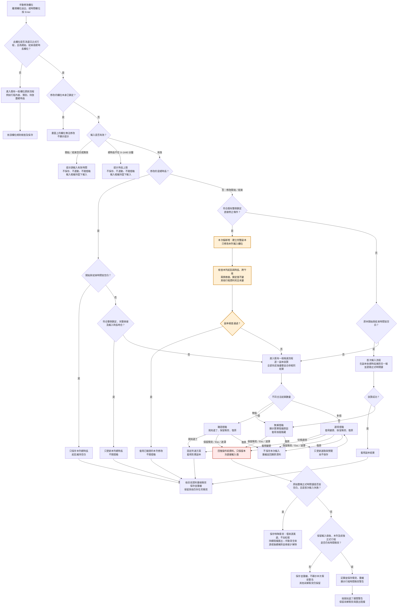
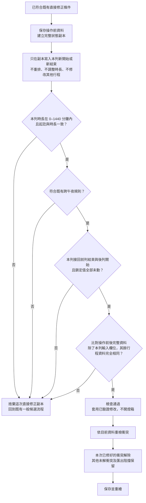
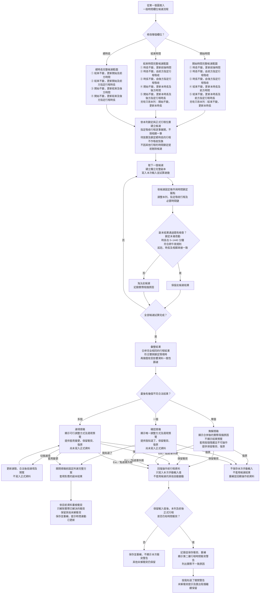
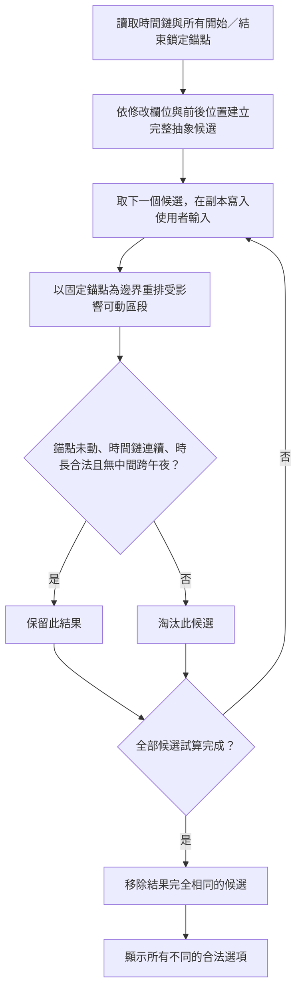

# TickBrick 時間變動功能與衝突檢核流程

- 更新日期：2026-10-22（核心流程集中維護；第 1–11 節保留原盤點紀錄）
- 盤點基準：目前工作目錄的 `script.js` 與規格版本紀錄 1.3.21；包含完整候選矩陣、指定單筆吸收、前後時間鏈重排及鎖定錨點副本試算。
- 目的：整理所有時間相關入口、資料變動步驟，以及衝突檢核、保留、復原與解除發生的位置。
- 性質：第 1–11 節為先前現行行為盤點；第 12 節為使用者逐輪核對的三張核心圖；第 13 節收錄候選範例；第 14 節集中原情境矩陣 P1–P6 的詳細流程。各節區分已確認敘述、歷史盤點、尚未實作與待討論事項；文件記錄不代表已完成實作或逐項驗收。
- 參考：[專案規格書.md](專案規格書.md)、[DESIGN.md](DESIGN.md)、[情境矩陣.md](情境矩陣.md)。

<a id="flow-navigation"></a>
## 0. 從操作情境找流程：先讀這裡

本文件集中維護產品核心流程與詳細步驟，其他文件以連結引用；**不代表每個動作都已有完整 Mermaid 圖**。工作規範中的實際教學範例經使用者指定同時保留於兩份文件，須同步維護。下面先依實際操作分類，再說明集中後的文件分工。圖一是入口總圖，圖二、圖三是它的分支展開，不是三個互不相關的功能。

### 0.1 我做了什麼操作，應看哪個流程？

| 實際操作／目前情境 | 應從哪裡看 | 接下來去哪裡／範圍 |
|---|---|---|
| 手動編輯行程欄位並送出，想知道這次會不會時間連動 | [第一張：從手動修改欄位開始](#manual-edit-entry) | 先分辨正式時間欄位與其他欄位，再處理有效性、總時長、首次輸入、直接修正或一般候選。 |
| 開始、結束皆空白，只改總時長 | [第一張](#manual-edit-entry) | 「修改總時長 → 起訖皆空白 → 只保存時長」；不進圖二、圖三。 |
| 起訖皆空白，首次填開始或結束 | [第一張](#manual-edit-entry)及[首次輸入失敗案例](#first-input-kept-conflict) | 補另一端並試算全鏈；成功直接套用，失敗進無解燈箱；不先列一般候選。 |
| 總時長輸入剛好修復本列時長，且兩側鎖定與時間完全接上 | [第一張](#manual-edit-entry) | 直接只改本列總時長；本次圖二不包含總時長。 |
| 修改開始／結束，前一正式列鎖結束、後一正式列鎖開始，輸入後本列既有時長與兩側恰好吻合 | [第一張](#manual-edit-entry) → [第二張：副本檢查](#direct-edit-snapshot-check) | 第二張已實作；通過後免燈箱，不做全鏈重排。 |
| 原本起訖已有時間，改總時長但不符合直接修正 | [第一張](#manual-edit-entry) → [第三張：一般候選與燈箱](#candidate-dialog-flow) | 試算全部候選，彙整合法結果，使用者確認才套用。 |
| 原本起訖已有時間，改開始／結束但不符合直接修正 | [第一張](#manual-edit-entry) → [第三張](#candidate-dialog-flow) | 不是首次補時間，改由候選流程決定可行調整方式。 |
| 第二張的直接修正副本檢查未通過 | [第二張](#direct-edit-snapshot-check) → [第三張](#candidate-dialog-flow) | 不套用該直接修正副本，回到既有一般候選。 |
| 在時間欄位燈箱選方案、確認、保留衝突、復原，或按 Esc／點外側遮罩 | [第三張](#candidate-dialog-flow) | 含三種合法結果數量與所有按鈕後續；首次輸入無解燈箱也有相同的保留／復原處理。 |
| 拖曳排序、放置待放置、刪除或移至暫存／其他日期 | [第 6 節：結構操作](#structural-operations) | 是不同操作的重算及時長候選流程，不是第三張的手動欄位候選；目前只有文字流程與表格，未有完整 Mermaid 圖。 |
| 刪除／移走的是帶黃色來源的原始衝突行程 | [第 7 節：移除原始黃色衝突來源](#remove-conflict-origin) | 依來源兩側鎖定選時間基準，有自己的特殊處理；目前為編號文字步驟。 |
| 某個操作完成後，想知道為何重檢或保留衝突 | [第 1 節：成功後共用流程](#shared-conflict-refresh) | 共用收尾，不是決定如何重新安排時間的入口。 |
| 想對照某個具體排序、鎖定、輸入或交叉情境的規則 | [情境矩陣](情境矩陣.md) | 該文件保留情境與預期結果；P1–P6 的詳細流程集中於本文件第 14 節，情境矩陣只放對應入口。 |

### 0.2 核心流程集中維護與文件分工

**產品核心流程統一讀本文件。** 規格書保留業務規則及欄位規格，情境矩陣保留情境與預期結果，兩者引用本文件的詳細流程；不另維護獨立版本的流程圖。

| 本文件位置 | 情境與內容 | 其他文件如何使用 |
|---|---|---|
| [第 12 節](#manual-time-core-flows) | 手動欄位入口、直接修正副本檢查方案、一般候選與燈箱三張完整圖 | 規格書與情境矩陣引用對應分支，不複製另一套完整流程。 |
| [第 13.1 節](#candidate-worked-example) | 有固定時間錨點時，逐筆試算候選、淘汰與合併的完整範例圖、步驟及案例 | 經使用者指定，VIBE_CODING_RULES.md 第 9.1 節也保留相同範例，作實際工作規範示範；兩處須同步。 |
| [第 13.2 節](#shiro-candidate-example) | 原規格書的 SHIRO 指定吸收案例 | 規格書原位置改連結；不再另外維護同一案例流程。 |
| [第 14 節](#shared-process-details) | 原情境矩陣 P1–P6 詳細流程：時間輸入、套用衝突、排序、移出刪除、放置、上限 | 情境矩陣保留穩定代號與連結，逐案規則狀態不變。 |

集中後本文件有 **4 張 Mermaid 圖**（三張完整圖及一張候選範例）；VIBE_CODING_RULES.md 保留 **1 張相同範例**，專案共 5 個 Mermaid 區塊，代表 4 張不同圖。原規格書未展開迴圈的候選簡圖已合併至第三張完整圖，不再保留另一份局部版本。這是文件整理，不是修改程式計算或新增產品規則。

其他既有文字流程與步驟：

- 本文件[第 1 節](#shared-conflict-refresh)：操作成功後的共用衝突重檢文字箭頭流程。
- 本文件[第 4 節](#manual-edit-historical-summary)：手動時間欄位與保留衝突兩段歷史文字流程；最新完整圖看第 12 節，不用舊摘要取代新圖。
- 本文件[第 6 節](#structural-operations)：排序、放置、刪除與移出的文字箭頭流程，含操作差異表。
- 本文件[第 7 節](#remove-conflict-origin)：移除原始黃色來源的編號步驟，沒有 Mermaid 圖。
- [VIBE_CODING_RULES.md 第 16 節](VIBE_CODING_RULES.md#16-核心工作模式)：Agent 從理解需求到實作驗證的文字流程，與產品使用者操作不同。
- `行程表結構重構計畫.md` 的文字區塊是測試指令清單，不是操作流程圖。

<a id="shared-conflict-refresh"></a>
## 1. 先看檢核與解除的位置

**操作試算／重算時，檢查能不能成立；操作成功後，依實際資料重檢並解除已修復的衝突；匯出前，再檢查是否仍有阻擋。**

| 階段 | 檢查內容 | 是否變動正式資料／解除衝突 |
|---|---|---|
| 輸入驗證 | 欄位是否鎖定、時間是否可解析、時長是否在 0–1440 分鐘 | 驗證失敗不套用，不因拒絕輸入解除衝突 |
| 候選試算 | 實際連動是否改到鎖定值、吸收後時長是否合法、是否產生不允許的中間列跨午夜 | 在副本試算，不保存、不重繪、不解除正式資料的衝突 |
| 滾輪選取／預覽 | 從已試算的可行候選選出合法組合，更新預覽 | 不寫入正式資料，不解除衝突 |
| 套用／完成操作 | 寫入選定時間結果，或完成結構操作 | 接著呼叫共用重檢，只有實際已解決的衝突才移除 |
| 匯出入口 | 所有日期與暫存區是否仍有未解衝突 | 重檢可清理已解紀錄；仍有衝突就阻擋匯出 |

成功後共用流程：

```text
寫入結果／完成操作
  → clearConflictsAfterSuccess()
  → refreshConflicts()
  → 保留仍成立的來源／操作紀錄，重建目前資料的自動衝突
  → persist() 排程保存
  → 重繪黃底、紅框及資料
```

`clearConflictsAfterSuccess()` 不是全部清空衝突，也不負責把時間接好；時間計算由各操作完成，它負責重檢與保存。

## 2. 共用規則與衝突種類

### 2.1 正式時間鏈

- 正式行程是日期表中 `pending === false` 的列；待放置列不參與正式時間串接。
- 暫存行程不參與日期時間鏈，開始／結束時間為空白。
- 一般連動保留其他列時長；指定吸收候選會另外改動被選取列的時長。
- 時間以 24 小時循環推算，例如 `23:30 + 60 分鐘 = 00:30`。
- 跳過待放置列後，只有首筆、末筆與唯一正式行程可作為正常跨午夜特例；中間正式列結束早於開始，或開始／結束相同且總時長為 `1440` 分鐘，均是跨午夜衝突；`0` 分鐘同時刻合法。
- 每列最多鎖定開始、結束、總時長其中一欄。連動不得自行改寫鎖定值。

### 2.2 成功後重檢的項目

| 衝突類型 | 現行判斷 | 解除條件 |
|---|---|---|
| 單列起訖／時長不一致 | 正式列已有開始、結束且時長有效，但循環起訖差不等於總時長 | 目前資料不再符合這個不一致條件 |
| 相鄰正式行程未串接 | 前列結束與後列開始都有值，且不相等 | 斷點不再成立，或相關列已移除／退出正式相鄰關係 |
| 時長範圍不合法 | 日期列或暫存列的分鐘值不在 0–1440 範圍內 | 改回範圍內，或移除該列 |
| 中間正式列跨午夜 | 中間正式行程結束早於開始，或開始／結束相同且總時長為 `1440` 分鐘 | 時間修復，或結構改變後不再是中間正式列 |
| 直接修改來源紀錄 | 本列自身問題、依來源欄位相關的前後斷點，或特殊來源情境仍存在 | 來源相關問題全部解除；原始整鏈空白的首次輸入例外在直接來源清空時解除，其他一般直接來源依目前本列與相關相鄰正式列判定 |
| 保存的操作／鎖定紀錄 | 依紀錄種類檢查目前鎖定、鄰接關係，或重試原排序意圖 | 對應阻擋已不成立；不只比較當時保存的必要值 |

注意：自動「單列不一致／相鄰未串接」檢核需要相關時間有值，並不把所有空白正式列都視為衝突。直接來源紀錄則會檢查相關列的缺少時間問題。

## 3. 最新時間欄位滾輪燈箱

### 3.1 現行候選

候選先依本列鎖定建立完整矩陣，再在完整狀態副本依所有時間錨點試算；實際連動失敗的候選不提供套用。

| 修改欄位 | 保持不變 | 更新內容 | 吸收方向／限制 |
|---|---|---|---|
| 開始時間 | 時長 | 前後行程時間 | 建立完整候選；由錨點副本試算判定是否可套用 |
| 開始時間 | 時長 | 本列結束時間＋指定行程時長 | 前方或後方正式行程各自建立候選 |
| 開始時間 | 結束時間 | 本列時長 | 完整抽象候選；錨點副本試算判定是否可套用 |
| 開始時間 | 結束時間 | 本列時長＋指定行程時長 | 只取前方正式行程 |
| 開始時間 | 結束時間 | 本列時長＋前方行程時間 | 完整抽象候選；錨點副本試算判定是否可套用 |
| 結束時間 | 時長 | 前後行程時間 | 建立完整候選；由錨點副本試算判定是否可套用 |
| 結束時間 | 時長 | 本列開始時間＋指定行程時長 | 前方或後方正式行程各自建立候選 |
| 結束時間 | 開始時間 | 本列時長 | 完整抽象候選；錨點副本試算判定是否可套用 |
| 結束時間 | 開始時間 | 本列時長＋指定行程時長 | 只取後方正式行程 |
| 結束時間 | 開始時間 | 本列時長＋後方行程時間 | 完整抽象候選；錨點副本試算判定是否可套用 |
| 總時長 | 結束時間 | 本列開始時間＋指定行程時長 | 每一筆前方正式行程各自建立候選 |
| 總時長 | 結束時間 | 本列開始時間＋之前行程時間 | 向前連動；首筆沒有前方列時只更新本列開始時間 |
| 總時長 | 開始時間 | 本列結束時間＋指定行程時長 | 每一筆後方正式行程各自建立候選 |
| 總時長 | 開始時間 | 本列結束時間＋之後行程時間 | 向後連動；末筆沒有後方列時只更新本列結束時間 |

指定吸收行程必須是其他正式列且未鎖定總時長；開始／結束鎖定是否阻擋，依實際試算判斷。中間連動列保留時長，只調整起訖。總時長修改的指定列吸收值為「原時長減本列時長差額」：本列增加，吸收列縮短；本列縮短，吸收列增加。

### 3.2 滾輪呈現與選取

- 第一道位置選「什麼不變」，第二道選「更新什麼」，必要時第三道選吸收行程或連動方向。
- 只有多值位置顯示滾輪；唯一值顯示靜態文字，第三段不需要時隱藏。
- 指定吸收候選的第三段只顯示 `前方／後方：「行程名稱」`，`的時長` 放在滾輪外固定句尾。
- 更新之前／之後行程時間的候選不加 `的時長`。
- 切換前段時，優先保留相容的後段組合；不能保留時改選可行組合。
- 支援滑鼠滾動、點選、拖曳及鍵盤。切換只讀取先前候選副本並更新預覽，不重新寫入行程。
- 指定吸收時固定預覽本列與吸收列；未列出的連動列以一次 `＊其餘行程自動連動` 提示。
- 開始／結束的全鏈平移不顯示結果預覽；其他方式依現行預覽邏輯顯示。

### 3.3 按鈕與衝突時點

| 動作 | 資料結果 | 檢核／解除時點 |
|---|---|---|
| 套用變更 | 將選定且已試算的完整副本設為目前狀態 | 設定狀態後呼叫共用重檢，解除已修復衝突 |
| 保留衝突 | 保留操作前其他資料，只寫入使用者直接修改欄位 | 寫入直接值後檢查實際不一致；有問題才記錄來源並開第二層警告 |
| 復原 | 不寫入候選，重繪原保存值 | 不主動重算、不因復原清除原有衝突 |
| Esc／確實點在外側遮罩 | 等同保留衝突 | 同保留衝突分支，不等同復原 |
| 警告的「我知道了」 | 只關閉警告 | 不解除黃底、紅框或匯出阻擋 |

一個或多個可行方式都開啟燈箱；唯一候選以「我知道了」確認後套用，多個候選以「套用變更」確認後套用。零個可行方式時顯示合併原因，套用按鈕隱藏且不可操作。若依本列鎖定篩選後連候選都沒有，則顯示「目前鎖定條件下無法調整此欄位」並拒絕，不進零候選燈箱。

**時間欄位燈箱的套用直接採用已試算副本；結構操作燈箱則在確認時重新執行原操作並檢查結果。兩者套用步驟不同。**

<a id="manual-edit-historical-summary"></a>
## 4. 手動時間欄位的完整流程

> 以下保留原盤點摘要。最新逐輪確認的三張完整核心流程圖、步驟、案例及現況差異見[第 12 節](#manual-time-core-flows)。不得將下列歷史摘要當成第 12 節擬新增副本檢查已完成的證據。

```text
提交開始／結束／總時長
  → [檢核 A] 欄位鎖定、輸入格式、時長範圍
  → 判斷直接修正／首次輸入／補齊／一般候選
  → [檢核 B] 在副本執行補齊或候選連動
  → 特定雙側鎖定情境再檢查相關列自身一致與鄰接串接
  → 一個或多個合法結果都進入燈箱
  → 選取只預覽
  → 使用者確認後套用副本
  → [檢核 C／解除] 成功後共用重檢
  → 保存、重繪
```

特殊入口：

1. 起訖都空白：先依時長補另一端並串接；試算成功直接套用，失敗進無解燈箱。
2. 缺少另一端：副本補齊並串接；成功與失敗處理同上。
3. 正式列起訖不完整時改總時長：只寫入分鐘，再共用重檢，不啟動一般候選流程。
4. 最近前列鎖結束、後列鎖開始，且本列輸入剛好使時間吻合：符合條件可直接修正本列；成功後仍重檢。
5. 雙側鎖定的開始／結束輸入若已直接使兩側完全串接：額外檢查受影響正式列起訖完整、自身時長一致與相鄰串接；這是既有的直接修正入口，不是候選燈箱的唯一候選自動套用。
6. 開始／結束清空或無可解析時間：不保存、不連動、不開燈箱、不立即重繪，提示「請輸入有效時間」。

保留分支：

```text
保留衝突
  → 還原其他自動連動修改
  → 只寫入直接輸入值
  → [檢核] 目前相關列是否真的不一致
  → 無問題：共用重檢、保存、重繪
  → 有問題：記錄來源／必要的邊界、保存、重繪、開衝突警告
```

## 5. 所有時間相關功能總表

「完成後重檢」均指 `clearConflictsAfterSuccess()`；重檢會掃描全部日期及暫存區，但不代表本次重算會改動全部日期。

| 功能 | 主要資料／計算步驟 | 衝突檢核位置 | 解除位置 |
|---|---|---|---|
| 開始時間修改 | 建立完整候選矩陣（全鏈、本列時長、前方重排、指定單筆吸收）→ 錨點副本連動 → 使用者確認套用 | 輸入、候選試算、特定雙側鎖定驗證 | 套用後重檢 |
| 結束時間修改 | 建立完整候選矩陣（全鏈、本列時長、後方重排、指定單筆吸收）→ 錨點副本連動 → 使用者確認套用 | 同上 | 套用後重檢 |
| 正式總時長修改 | 建立前／後方吸收或方向連動候選 → 試算 → 套用 | 輸入、候選試算 | 套用後重檢；特殊直接更新分支也重檢 |
| 首次輸入／補齊時間 | 依時長補另一端 → 向前後串接 | 副本補齊與串接時 | 成功後重檢 |
| 鎖定／解鎖／換鎖定欄 | 改 `lock`，不重算時間 | 改鎖定後共用重檢 | 只有實際阻擋解除才清理；解鎖不保證串接恢復 |
| 正式排序 | 邊界檢查 → 必要鎖定確認 → 暫時重排 → 重算 → 必要時長候選 | 排序前邊界、重算、候選試算與確認執行 | 排序成功後重檢 |
| 待放置排序 | 改位置；尚未加入正式鏈 | 日期表排序入口仍檢查跨未解邊界 | 完成後重檢 |
| 放置待放置列 | 決定區段／邊界接入 → 試算 → 必要候選 → 加入正式鏈 | 接鏈／區段重算、候選試算與確認執行 | 放置成功後重檢 |
| 刪除正式列 | 確認 → 暫時移除 → 來源區段重算 → 必要增加時長 | 移除重算、候選試算與確認執行 | 成功後重檢；黃色來源另走第 7 節 |
| 移至暫存 | 移出 → 清空起訖、解除鎖定 → 來源重算 | 來源重算、候選試算與確認執行 | 成功後重檢；黃色來源另走第 7 節 |
| 移至其他日期 | 來源移出重算 → 目標清空起訖、解除鎖定、置頂待放置 | 來源重算、候選試算與確認執行 | 整個移動完成後重檢；目標待放置不接鏈 |
| 暫存拖回日期 | 插在指定位置成為待放置，解除鎖定 | 不做正式時間重算 | 移入後共用重檢 |
| 暫存移至指定日期 | 目標清空起訖、解除鎖定、置頂待放置 | 不做來源正式時間重算 | 移入後共用重檢 |
| 待放置／暫存改總時長 | 範圍驗證 → 只保存分鐘 | 輸入範圍檢查、更新後共用重檢 | 更新後重檢，不連動其他行程 |
| 刪除待放置／暫存列 | 確認 → 直接移除 | 不做正式時間重算 | 移除後共用重檢 |
| 暫存排序 | 只改暫存順序 | 不做時間重算 | 完成後共用重檢 |
| 新增行程 | 置頂、60 分鐘；可用首筆開始時間時往前推算新列 | 此入口沒有成功後共用重檢 | 不立即清理既有衝突；保留原紀錄 |
| 刪除整個日期 | 確認 → 刪日期及全日行程 | 此入口沒有立即共用重檢 | 下次重檢（如匯出前）才清理對應紀錄 |
| 載入既有／舊版資料 | 正規化 → 補來源／邊界 → 重建自動衝突 | 正規化時 | 重建自動項目；不自動修復時間，來源紀錄保留待後續重檢 |
| JSON 匯入 | 格式／上限／中間跨午夜檢查 → 正規化 → 確認覆蓋 | 覆蓋前檢查並重建自動衝突 | 重建自動項目；不保證匯入後全鏈無衝突 |
| 圖片／PDF／JSON 匯出 | 全部衝突重檢 → 通過才匯出 | 匯出入口 | 清理已解紀錄；仍有任一未解衝突就阻擋 |

<a id="structural-operations"></a>
## 6. 結構操作：排序、放置、刪除與移出

```text
保存操作前狀態
  → 暫時執行排序／放置／移除
  → [檢核 A] 依該操作錨點與區段重算
  → 直接成立：完成後共用重檢
  → 不成立：回到操作前資料，副本試算單列時長候選
  → [檢核 B] 候選必須讓原操作可成立
  → 滾輪選取只預覽
  → 確認後重新執行原操作＋時長調整
  → [檢核 C] 再次檢查執行結果
  → 成功後共用重檢、保存、重繪
```

### 6.1 各操作的錨點、範圍與候選

| 操作 | 重算範圍／基準 | 可調整時長方向 |
|---|---|---|
| 排序 | 所在未解邊界切出的時間鏈；有時間鎖以鎖定為約束，無時間鎖保留該鏈操作前首筆開始時間 | 依鎖定區間超額／不足縮短或增加 |
| 放置 | 位置前後最近時間鎖定區段；無鎖定時接前列結束或後列開始，沒有可接時間就留空白 | 縮短單列吸收實際差額，或試算保留既有時長重排 |
| 刪除 | 最近時間鎖定區段；遇未解邊界時按所在側時間鏈處理。有鎖定依鎖定，無鎖定保留原首筆開始 | 增加，且必須等於被刪行程時長 |
| 移至暫存／其他日期 | 來源最近時間鎖定區段；遇未解邊界按所在側處理。有鎖定依鎖定，無鎖定保留原首筆開始 | 增加來源區段單列時長 |

候選不可改總時長鎖定列；搜尋遇總時長鎖定可略過該列繼續，時間鎖定則依各操作作為區段邊界。放置的差額計算不能直接套用到刪除、移出或排序。

### 6.2 取消與無候選

- 一般候選流程取消或沒有可行候選：完整復原這次操作，不新增本次持續衝突；原有未解衝突仍保留。
- 移至新日期若來源失敗，新建的目標日期也隨狀態備份一起復原。
- 程式仍有 `recordConflict()` → `presentOperationConflict()` 的一般失敗處理分支，會保存操作紀錄；不能把它與零候選復原流程混為一談。
- 拖曳來源本身鎖開始／結束時，先開「確認時間連動」，確認才排序；只鎖總時長不觸發這個確認。
- 未解邊界的排序阻擋發生在操作前，並非完成排序後才建立新衝突。

### 6.3 放置在既有直接來源邊界間

待放置列位於保存的邊界兩端之間時，另走單側接鏈：來源在右，接左鏈；來源在左，接右鏈。加入後移動原邊界端點，再完成後重檢。這不等於將原來左右兩鏈的衝突解除。

<a id="remove-conflict-origin"></a>
## 7. 移除原始黃色衝突來源

刪除、移至暫存、移至其他日期，若對象是帶邊界的原始黃色來源，採特殊流程：

1. 操作前辨識原來源紀錄與左右時間鏈。
2. 掃描兩側最近開始／結束鎖定。
3. 恰好一側有鎖定：告知將以該側為基準，確認才繼續。
4. 兩側都有或都沒有鎖定：提供時間基準選擇，套用才繼續。
5. 移除來源，並移除原來源紀錄。
6. 以選定側錨點向前、向後重算；此處檢查仍不相容的鎖定與時間結果。
7. 若仍不相容，記錄新的來源／邊界衝突；不是把原問題直接全部清空。
8. 完成後共用重檢，保存與重繪。
9. 若產生新衝突，顯示「已完成移除；部分行程時間仍有衝突，請確認紅色標示。」

這條流程允許移除完成後仍有新的未解衝突，與一般結構操作零候選時完整復原不同。

## 8. 黃底、紅框與匯出阻擋何時消失

| 呈現／限制 | 意義 | 消失時點 |
|---|---|---|
| 來源欄位黃底 | 使用者直接保留的修改仍有相關問題 | 重檢確認來源相關問題全部解除 |
| 本列紅框 | 本列自身不一致，或其他適用的衝突 | 目前自身問題消失後重繪；鄰接問題可能仍在 |
| 相關相鄰列紅框 | 與來源相接處仍不一致 | 實際斷點解除後重繪 |
| 匯出阻擋 | 所有資料中還有未解衝突紀錄 | 匯出前重檢後，衝突清單為空才開放 |

直接來源紅框規則：修改開始時間的鄰接問題標前方；修改結束時間標後方；修改總時長可分別涉及兩側。來源列紅框只表達自身問題，來源黃底則可比自身紅框保留更久。

例如本列已恢復起訖／時長一致，但還接不上下一列，本列自身紅框可以消失，相關列紅框、來源黃底及匯出阻擋仍保留。

解除鎖定不主動重算時間，關閉警告也不修復時間；必須讓資料真正一致，或讓對應衝突條件不再成立，再經重檢才解除。

## 9. 不改時間但會觸發重檢的操作

- 行程內容、類別與待確認欄位更新經 `updateRow()`，成功後也會重檢。
- 日期切換、建立空日期、日期頁籤排序、類別顏色調整、單純重繪，以及自動保存本身，不等於時間重算或共用重檢。
- 新增行程與刪除整個日期是目前沒有立即共用重檢的入口，不能概括成「每次任何操作都會檢核」。

## 10. 程式入口索引

行號以本次盤點快照為準；後續編輯可能移動，查找時以 function 名稱為主。

| 功能 | function | script.js 行號 |
|---|---|---|
| 載入正規化 | `normalizeState` | 32 |
| 中間跨午夜／首尾完整一天判定 | `isInvalidMiddleCrossDay`、`isAllowedBoundaryFullDay` | 206、208 |
| 首次空白鏈來源是否仍阻擋 | `blankFirstInputConflictStillBlocks`、`directConflictStillBlocks` | 361、368 |
| 單列／相鄰自動檢核 | `timelineAtomicConflicts` | 220 |
| 載入／匯入重建 | `rebuildAutomaticConflicts` | 234 |
| 來源相關問題判定 | `directConflictRowIds` | 254 |
| 來源移除基準／執行 | `chooseOriginRemovalAnchor`、`resolveOriginRemoval` | 311、317 |
| 連動安全寫入 | `setTimeValue` | 345 |
| 共用衝突重檢／完成後保存 | `refreshConflicts`、`clearConflictsAfterSuccess` | 420、433 |
| 非正式時間／一般欄位更新 | `updateRow` | 437 |
| 排序入口／執行 | `requestReorder`、`reorderRow` | 480、498 |
| 結構候選與重新套用 | `offerStructuralDurationAdjustment` | 491 |
| 時間候選產生 | `timeOptions` | 543 |
| 指定總時長吸收 | `applyDurationAbsorbOption` | 635 |
| 時間候選計算／副本試算 | `applyTimeOption`、`previewTimeOption` | 653、680 |
| 保留直接輸入 | `keepTimeEditConflict` | 762 |
| 滾輪段落／預覽／燈箱 | `timeOptionParts`、`timeOptionPreviewSummary`、`openTimeOptionWheel` | 772、806、817 |
| 正式時間修改入口 | `handleTimeEdit` | 832 |
| 新增 | `addRow` | 854 |
| 移至暫存／拖回日期 | `moveRowToStaging`、`moveStagingRowToDay` | 868、877 |
| 刪除 | `deleteRowWithAdjustment` | 892 |
| 跨日期移動 | `moveToDate` | 915 |
| 刪除／移出來源重算 | `recalculateDeleteStructuralChain`、`recalculateMoveSourceChain` | 986、990 |
| 結構調整滾輪 | `openDurationAdjustmentDialog` | 1018 |
| 放置 | `placePending` | 1039 |
| 刪除日期 | `deleteDate` | 1071 |
| 匯出前重檢 | `hasUnresolvedConflicts` | 1078 |
| JSON 匯出／匯入 | `exportJSON`、`importJSON` | 1080、1088 |
| 圖片／PDF 匯出入口 | `openExportDialog` | 1096 |

## 11. 核對範圍與限制

- 本文件已對照目前程式、規格中時間候選與衝突處理章節，同步完整候選矩陣、指定單筆吸收、前後時間鏈重排、唯一候選確認與第三段滾輪文案。
- 試算檢核與成功後重建是不同階段；「完整副本試算」不代表每個候選都先呼叫整套 `refreshConflicts()`。一般候選透過實際計算回傳阻擋，特定雙側鎖定情境另驗證串接。
- 載入／匯入用 `rebuildAutomaticConflicts()` 重建自動衝突，與操作後 `refreshConflicts()` 同時篩除已解來源紀錄的行為不同。
- 這次只建立 Markdown 文件，未修改執行程式、資料、樣式或設定；依純文件例外未執行自動回歸。
- 未進行真實瀏覽器互動、視覺或每一分支的端到端驗證。


<a id="manual-time-core-flows"></a>
## 12. 手動時間欄位的三張核心流程圖

- 記錄日期：2026-10-22。
- 用途：保存使用者逐輪確認的核心動作，後續修改、回歸與需求核對應先讀本節；重述時須給完整流程圖，不能只截取片段而遺漏其他分支。
- 圖一整理手動修改的入口與分流；圖二展開開始／結束直接修正前的副本檢查；圖三展開一般候選與燈箱的完整後續操作。
- **本次只記錄文件，不修改程式、測試、資料、樣式或設定，不代表批准實作。**

### 12.0 狀態、閱讀方式與共同限制

| 狀態 | 本節範圍 |
|---|---|
| 已確認的流程敘述 | 欄位判斷文字、鎖定欄位不可操作且不提示、無效輸入維持當下內容、總時長與開始／結束先分流、起訖皆空白、唯一候選仍須確認、保留衝突／復原／Esc／遮罩、只解除實際已修復衝突。 |
| 已實作 | 圖一橘色區塊與圖二：開始／結束既有直接修正先建立完整副本並檢查，再套用；副本只改目標欄位，其他既有未解衝突不作為本地檢查失敗。 |
| 已實作的首次失敗例外 | 原始整條正式時間鏈起訖皆空白，首次輸入失敗後保留衝突時，只保存直接輸入來源；來源黃底、全列不加紅框，衝突與匯出阻擋持續保存並可跨重新載入。使用者手動清空該黃底來源，或後續正常時間修改已補齊並串接時間鏈時，均解除這筆特殊衝突；其餘清空規則不變。 |
| 程式防守分支，非正常操作主線 | 單端缺值的補齊分支仍保留；完全沒有建立候選的提示分支，在目前正常可編輯欄位及單一鎖定狀態下不會觸發，故不畫入第三張主線，不代表授權刪除程式。 |

共同限制：

1. 「完整副本」用來避免試算改到正式資料並比對其他資料未變，**不代表要求整天、所有日期原有衝突全數解除**。
2. 圖二只針對開始／結束既有的本列直接修正，不改總時長直接修正、首次輸入或一般候選規則；一般候選既有的整天原子一致性篩選仍存在，不因圖二而一併改成局部篩選。
3. 每列只有一種鎖定狀態：未鎖定、開始、結束或總時長。最近前後正式行程搜尋跳過待放置列。
4. 正常成功流程中，正式時間鏈尚未設定時起訖皆空白；首次有效輸入會補齊另一端並連動。不得拿「B 已有時間、A 起訖皆空白」的任意測試資料當成正常可達性證據。
5. 第一張圖以正常成功狀態分流；首次失敗保留衝突留下單端空白的已批准例外另見 12.4。舊資料／外部 JSON 的不完整狀態不據此宣稱不存在。
6. 已確認的輸入提示與不重繪敘述是本次討論紀錄，不替代當前工作目錄的實作驗收；若程式與本節不同，須另行核對並取得實作批准，不可默默改程式或把圖改回舊敘述。

<a id="manual-edit-entry"></a>
### 12.1 第一張圖：從手動修改欄位開始

**何時進入這張圖？** 你在行程畫面手動編輯欄位並送出，想判斷這次操作會如何保存、是否連動及是否開燈箱時，先看本圖。

| 入口說明 | 內容 |
|---|---|
| 觸發動作 | 欄位值變更後離開欄位，或可操作的正式時間欄位按 Enter；不是打每個字就立即套用。 |
| 操作位置 | 目前日期行程區，或其他行程欄位入口；圖中第一個判斷負責將待放置／暫存及非時間欄位分出去。 |
| 不屬於本圖的動作 | 拖曳排序、按放置此處、刪除、移至暫存／其他日期、匯入／匯出；各有自己的入口流程。 |
| 直接例子 | 正式行程 A 09:00–10:00、60 分鐘、無鎖定，手動把總時長改成 90 分鐘；先從本圖進入，再分流至第三張。 |
| 下一步 | 符合開始／結束直接修正條件 → 第二張；一般時間修改 → 第三張；起訖皆空白的首次輸入或只改時長 → 在第一張本身處理。 |




對應步驟：

1. 正式時間欄位才進入本圖的時間主線；待放置總時長、內容、類別等走各自更新入口。
2. 鎖定欄位在畫面上不可修改，不顯示提示；無效時間或超限時長不保存、不連動、不開燈箱，保留當下輸入。
3. 先分流總時長與開始／結束。總時長在起訖皆空白時只保存時長；已有時間且符合雙側鎖定、串接及時長吻合時，只更新本列時長；否則進圖三。
4. 開始／結束符合既有直接修正條件時，依擬新增圖二先驗證副本；通過才免燈箱套用，失敗交回一般候選流程。
5. 其他開始／結束輸入若原起訖皆空白，補另一端並試算時間鏈，成功套用，失敗進無解燈箱；其餘走圖三。
6. 候選確認、保留衝突、復原與關閉方式均有後續處理，不以「顯示燈箱」當作流程終點。所有重檢只解除實際修復的衝突，其他未解衝突及匯出阻擋仍保留。

案例：A、B 皆正式行程、無鎖定、開始與結束皆空白，各 60 分鐘。將 A 總時長改成 90 分鐘，走「總時長 → 起訖皆空白 → 只保存時長」。操作後 A 為起訖空白、90 分鐘，B 仍為起訖空白、60 分鐘，沒有自行指定時間。

<a id="direct-edit-snapshot-check"></a>
### 12.2 第二張圖：副本到底檢查什麼

**何時進入這張圖？** 你修改的開始／結束時間剛好能接回兩側已鎖定的時間，原本只需修正本列一個欄位、不必動其他行程。第一張「符合既有雙側鎖定直接修正條件？」的「是」才進來。

| 入口說明 | 內容 |
|---|---|
| 必要條件 | 正式本列、輸入欄未鎖定；前一正式列鎖結束、後一正式列鎖開始；輸入後兩個接點與既有時長全部吻合。完整條件如下。 |
| 具體開始時間案例 | A 06:00–07:00、60 分鐘、鎖結束；B 07:10–09:30、150 分鐘、無鎖；C 09:30–14:05、275 分鐘、鎖開始。把 B 開始改為 07:00，即可只修 B。 |
| 具體結束時間案例 | 同一組 A、C；B 原為 07:00–09:20、150 分鐘、無鎖，把 B 結束改為 09:30，即可只修 B。 |
| 不會進入 | 修改總時長、起訖皆空白的首次輸入、只有單側鎖定、輸入後時長仍不吻合，或需要改其他行程才能完成。 |
| 處理完去哪裡 | 通過 → 套用本列修改並共用重檢；未通過 → 不套用這份副本，進第三張一般候選。 |
| 實作狀態 | 已實作：開始／結束既有直接修正會先做本圖完整副本檢查；總時長直接修正、首次輸入及一般候選維持各自既有流程。 |


**狀態：已實作；只對開始／結束既有直接修正入口增加驗證，未擴大至其他操作。**

進入條件：本列非待放置、輸入欄未鎖定；最近前一正式列鎖結束、最近下一正式列鎖開始。修改開始須新開始接前列結束、既有結束接後列開始，且新開始加既有時長等於既有結束；修改結束採對稱條件。這次副本只改輸入欄，不自行改時長或重排行程。



對應步驟：

1. 在完整副本只寫入使用者的本列開始或結束，不呼叫全鏈重排來修其他行程。
2. 驗證本列時長範圍、自身一致、既有跨午夜規則與兩側接點。
3. 比對鎖定與其他所有行程資料，包括其他日期及暫存，確認沒有意外變動。
4. 通過才套用；失敗不寫入這份副本，交回原有候選流程。其他地方本來就有的衝突不是本分支的阻擋條件。
5. 重檢後僅清除實際已解除的衝突；沒有清掉整份資料所有衝突的權限。

案例（已由時間欄位回歸測試覆蓋直接修正與既有其他衝突不阻擋的情境）：

| 行程 | 操作前時間 | 時長 | 鎖定 |
|---|---|---|---|
| A | 06:00–07:00 | 60 分鐘 | 結束 07:00 |
| B | 07:10–09:30 | 150 分鐘 | 無 |
| C | 09:30–14:05 | 275 分鐘 | 開始 09:30 |
| D | 14:05–15:05 | 60 分鐘 | 無 |
| E | 15:15–16:15 | 60 分鐘 | 無 |

將 B 開始改為 07:00。副本結果為 B 07:00–09:30、150 分鐘，07:00 加 150 分鐘吻合 09:30，接回 A、C 且未跨午夜。A、C、D、E 的時間、時長及鎖定皆不變。檢查通過才套用 B 開始；D、E 原有 10 分鐘空檔仍保留衝突並阻擋匯出，不因這次 B 修正而解除，也不阻止這次直接修正。

<a id="candidate-dialog-flow"></a>
### 12.3 第三張圖：沒有走直接修正時的既有候選與燈箱

**何時進入這張圖？** 起訖已有時間，你手動改開始、結束或總時長，但不能用第一張的「只修正本列」直接完成，需要試算可行方式並讓你確認。它從第一張的一般候選分支進入，不是先出燈箱才開始這張圖。

| 入口說明 | 內容 |
|---|---|
| 改總時長的入口 | 已有起訖且未符合雙側鎖定直接修正；例：唯一 A 09:00–10:00、60 分鐘、無鎖，改總時長為 90。 |
| 改開始的入口 | 已有起訖且未符合直接修正；例：唯一 A 09:00–10:00、60 分鐘、無鎖，改開始為 09:10，需要決定如何安排時長與時間。 |
| 改結束的入口 | 已有起訖且未符合直接修正；例：唯一 A 09:00–10:00、60 分鐘、無鎖，改結束為 10:10，需要決定如何安排時長與時間。 |
| 方案中的另一入口 | 第二張新增副本檢查未通過時，回到本圖；這條新增銜接尚未實作。 |
| 不會先走本圖 | 起訖皆空白只改總時長、首次有效輸入時間、直接修正成功、無效輸入、已鎖定不可編輯欄位、拖曳／刪除／移出／放置。 |
| 處理完去哪裡 | 確認套用 → 保存副本並重檢；保留衝突 → 只存直接值並判斷是否警告；復原 → 回顯原值。其他未解衝突始終保留。 |
| 首次輸入失敗的銜接 | 第一張直接開無解燈箱，沿用本圖相同的保留／復原後續；不代表首次輸入也先枚舉一般候選。 |


適用於圖一中不符合直接修正的總時長修改，以及非首次輸入、未走直接修正的開始／結束修改；亦承接圖二未通過的副本。正常可編輯欄位至少會建立一種候選，是否成立交由試算，不將「完全沒有建立候選」防守提示畫成正常主線。



對應步驟與候選限縮：

1. 先完整列出圖中開始五類、結束五類、總時長四類，以及兩個只改本列的既有候選；不得只列推薦結果。指定吸收行程一次由一筆吸收全部差額，中間列只移動時間，不分攤時長。
2. 本列鎖定會排除需要改動其鎖定欄位的候選；指定方向無對象時不建立指定候選。待放置及鎖定總時長的列不作吸收對象。其餘方向符合資格的每筆正式行程各自展開，不限相鄰列。
3. 其他行程的開始／結束鎖定不在候選建立時提前刪除，而在副本的錨點、時長、跨午夜、起訖一致與串接檢核淘汰。一般候選仍沿用現有整天原子一致性篩選；本文件不改其範圍。
4. 每筆試算獨立，不保存、不重繪；全部候選完成後才彙整，完全相同結果合併，再依剩餘合法結果數量開燈箱。
5. 零個：套用隱藏；一個：按「我知道了」才套用；多個：切換只更新預覽，按「套用變更」才寫資料。全鏈平移沿用不顯示結果預覽的既有規則。
6. 套用前先固定仍掛載滾輪的完整選項，關閉後套用對應副本，不重新讀取已關閉滾輪的捲動位置。
7. 保留衝突／Esc／外側遮罩只保存本次直接值，不套用其他自動變動；「復原」不保存本次輸入並回顯原資料。
8. 「本列及前後正式行程是否仍有時間衝突」檢查相關起訖缺值、自身時長不符、兩側未串接及本列中間跨午夜；不是詢問整天是否全無衝突。否分支的完整語意固定為：**保存並重繪，不顯示本次衝突警告；其他未解衝突仍保留。**

案例：當日只有 A 一筆正式行程，09:00–10:00、60 分鐘、無鎖定。改總時長為 90 分鐘。

| 完整候選 | 狀態 | 試算或不建立原因 |
|---|---|---|
| 結束不變，更新開始及前方時間 | 保留 | A 08:30–10:00、90 分鐘；沒有前方行程需要移動。 |
| 結束不變，前方指定行程吸收 | 未建立 | 前方無正式行程，沒有可展開對象。 |
| 開始不變，更新結束及後方時間 | 保留 | A 09:00–10:30、90 分鐘；沒有後方行程需要移動。 |
| 開始不變，後方指定行程吸收 | 未建立 | 後方無正式行程，沒有可展開對象。 |

兩個不同合法結果均保留，顯示選項燈箱。選取不保存；確認後才分別變成 08:30–10:00 或 09:00–10:30、90 分鐘。若改按保留衝突，A 為原起訖 09:00–10:00、90 分鐘，09:00 加 90 分鐘不等於 10:00，故顯示第二層警告；復原則維持原起訖與 60 分鐘。

<a id="first-input-kept-conflict"></a>
### 12.4 首次輸入失敗與單端空白的已實作例外

操作前 A、B、C 都是正式行程，起訖皆空白，各 60 分鐘，皆鎖定總時長。輸入中間 B 開始 23:30，副本計算如下：

| 行程 | 操作前 | 副本試算 | 時長／鎖定 | 按保留衝突後的現行資料 |
|---|---|---|---|---|
| A | 起訖皆空白 | 22:30–23:30 | 60 分鐘／總時長 | 起訖皆空白 |
| B | 起訖皆空白 | 23:30–00:30 | 60 分鐘／總時長 | 開始 23:30、結束空白 |
| C | 起訖皆空白 | 00:30–01:30 | 60 分鐘／總時長 | 起訖皆空白 |

1. 時長鎖定未改動；但 B 是中間正式行程，不可跨午夜，試算失敗，不套用整條副本。
2. 首層無解燈箱會列出實際跨日或鎖定阻擋原因；套用隱藏，提供保留衝突、復原；Esc／遮罩等同保留衝突。
3. 因操作前整條正式時間鏈皆空白，保留衝突回復原資料後只寫入 B 開始並保存特殊來源紀錄：B 的開始欄維持黃色，A、B、C 均不加紅框，衝突與匯出阻擋持續存在並會隨資料重新載入。
4. 使用者再手動清空 B 的黃色開始欄並送出時，系統保存空白並解除這筆特殊來源紀錄與匯出阻擋；若後續正常時間修改已補齊 B 並串接時間鏈，也會在重檢時解除。這只適用於本節的原始整鏈空白首次失敗情境；一般時間欄位清空仍提示有效時間且不保存。
5. 正常成功輸入會同時保存兩端；首次輸入結束有對稱的特殊保留路徑。此例不涵蓋舊資料或外部 JSON 的不完整輸入。

### 12.5 維護與版本紀錄

- 後續修改上述任一核心動作，須同步對應完整圖、文字步驟、實際案例及規格書；有選項時須保留最大候選與逐項限縮原因，不只改局部節點。
- 不得將討論圖、模型測試起始資料或文件狀態當成實作及可達性驗收證據。
- 本批僅修改 Markdown，核對三圖連線、文字一致性、引用連結、狀態及文件差異；依純文件例外未執行自動回歸測試，未做瀏覽器視覺驗證。

| 版本 | 日期 | 異動 |
|---|---|---|
| 核心流程 1.0.4 | 2026-10-22 | 中間跨午夜統一為結束早於開始，或同時刻且總時長 1440 分鐘；首尾／唯一正式行程的 1440 分鐘與所有 0 分鐘同時刻維持合法。流程圖加入原始整鏈空白首次失敗的特殊保留分支：僅來源黃底、不加紅框、跨重新載入阻擋匯出，手動清空來源才解除。跨午夜規則已套用到候選、直接修正、結構重算、重建與匯入檢核；相關回歸通過。 |
| 核心流程 1.0.3 | 2026-10-22 | 開始／結束雙側鎖定的直接修正已實作完整 state 副本檢查：副本只寫目標欄位，確認本列合法、目標中間列不跨午夜、兩側串接、鎖定值與其餘資料不變，且只拒絕本次新增的其他中間跨午夜；成功沿用重檢、保存、重繪與 toast，其他既有衝突保留。總時長直接修正、首次輸入、一般候選、結構流程與 UI 不變；相關時間與下游回歸通過。 |
| 核心流程 1.0.2 | 2026-10-22 | 集中產品核心流程：以第三張完整圖取代規格書局部簡圖，移入 SHIRO 案例及情境矩陣 P1–P6 詳細步驟；候選核對範例完整收錄於第 13.1 節，並依使用者要求在 VIBE_CODING_RULES.md 保留同一實際範例、建立同步維護說明。三張已確認完整圖與產品邏輯不變。 |
| 核心流程 1.0.1 | 2026-10-22 | 補上按操作情境查找的總索引、各圖明確入口條件／排除情境／例子／後續銜接；盤點專案 5 張 Mermaid 與既有文字流程的位置及用途，標示簡化圖與完整圖關係。僅文件導航與說明，未變更三張圖及執行邏輯。 |
| 核心流程 1.0.0 | 2026-10-22 | 記錄三張完整核心流程圖、對應步驟與案例；納入逐輪確認的欄位文字、分流、候選及燈箱後續、其他未解衝突保留；區分未實作副本檢查與首次失敗保留衝突的單端空白待討論事項。 |


<a id="candidate-examples"></a>
## 13. 候選試算流程與實際範例

<a id="candidate-worked-example"></a>
### 13.1 時間欄位候選流程的核對範例

何時閱讀：已進入第三張圖的一般候選流程，想了解「有時間鎖定時，為何部分候選保留、部分淘汰」。它是第三張中候選試算階段的展開範例，不取代第一張入口或第三張完整按鈕後續。

本範例與 [VIBE_CODING_RULES.md 第 9.1 節](VIBE_CODING_RULES.md#91-核心邏輯與功能的固定核對格式) 同時保留：工作規範以它示範討論格式，本文件以它說明產品流程。變更流程、數值、候選或結果時必須同步兩處。以下圖、文字步驟、案例及表格由原範例完整收錄，未因搬整文件更改計算；收錄不另外宣稱範例每個細節都曾逐項驗收。



正確流程應為：

1. **讀取時間鏈與固定錨點**：所有已鎖定的開始／結束時間先建立為不可移動的邊界。
2. **建立完整抽象候選**：只依修改欄位、前後行程位置與「一筆指定行程吸收全部差額」建立候選意圖；此步不因鎖定而刪除候選。完整候選種類依專案規格書第 7.2.1 節。
3. **逐一試算候選**：帶入使用者輸入，在第 1 步已知的固定錨點之間重排可動區段。
4. **驗證結果**：確認錨點未動、時間鏈連續、時長合法、無中間跨午夜；不符合者淘汰，直到全部候選試算完成。
5. **保留不同的合法結果**：去除結果完全相同的候選，顯示其餘選項。

實際案例：將 B 的時長從 60 分鐘改為 70 分鐘。只有 A 的開始與 C 的結束鎖定，其餘欄位皆未鎖定。

| 行程 | 操作前時間 | 時長 | 鎖定條件 |
|---|---|---|---|
| A | 09:00–10:00 | 60 分鐘 | 開始 09:00 |
| B | 10:00–11:00 | 60 分鐘 | 無 |
| C | 11:00–12:00 | 60 分鐘 | 結束 12:00 |

B 的總時長修改，先列出全部四類候選，再依本案例討論限縮：

| 完整候選 | 本案例對應方式 | 試算結果與限縮原因 |
|---|---|---|
| 結束時間不變，更新開始時間及前方行程時間 | B 結束維持 11:00，A 維持 60 分鐘並向前移動 | 淘汰：A 變成 08:50–09:50，移動了已鎖定的開始 09:00 |
| 結束時間不變，更新開始時間及前方指定行程的時長 | 前方指定行程為 A，單獨縮短 10 分鐘 | 保留：A 開始仍為 09:00，完整接回 B |
| 開始時間不變，更新結束時間及後方行程時間 | B 開始維持 10:00，C 維持 60 分鐘並向後移動 | 淘汰：C 變成 11:10–12:10，移動了已鎖定的結束 12:00 |
| 開始時間不變，更新結束時間及後方指定行程的時長 | 後方指定行程為 C，單獨縮短 10 分鐘 | 保留：C 結束仍為 12:00，完整接回 B |

B 增加 10 分鐘後，兩個保留結果分別由 A 或 C 單獨縮短 10 分鐘以吸收全部差額：

| 合法選項 | A 的結果 | B 的結果 | C 的結果 |
|---|---|---|---|
| B 結束不變，A 吸收差額 | 09:00–09:50（50 分鐘） | 09:50–11:00（70 分鐘） | 11:00–12:00（60 分鐘） |
| B 開始不變，C 吸收差額 | 09:00–10:00（60 分鐘） | 10:00–11:10（70 分鐘） | 11:10–12:00（50 分鐘） |

只移動前方／後方時間而不調整其他行程時長的候選，會分別使 A 的開始變成 08:50 或 C 的結束變成 12:10，因此在副本驗證時淘汰。表中兩個結果皆維持 09:00 與 12:00 的固定錨點、時間鏈連續、時長合法且無中間跨午夜，結果也不同，因此都保留供選擇。

<a id="shiro-candidate-example"></a>
### 13.2 SHIRO 指定單筆吸收案例

何時閱讀：修改開始時間，想了解前方指定行程吸收差額，以及較遠的既有時間鎖定是否排除此候選。以下由原規格書案例移入，保留原內容；這是候選範例，不是自動直接套用入口，也不是本批新增或驗收的產品規則。

SHIRO 例：將「SHIRO → 砂川站」開始時間從 `12:15` 改為 `13:15` 時，「時長不變，更新結束時間及前方『SHIRO CAFE』的時長」候選把 CAFE 從 `11:15–12:15` 改為 `11:15–13:15`，本列改為 `13:15–13:25`，後方可動行程順延 60 分鐘。較早「JR 砂川站 → SHIRO」的開始時間 `08:20` 若已鎖定，仍固定為錨點但不阻擋此候選，因該結果沒有改動 `08:20`。若後方存在鎖定錨點，試算必須剛好接回該錨點，否則只淘汰這個候選。

<a id="shared-process-details"></a>
## 14. 共用流程 P1–P6：原情境矩陣詳細步驟

以下由情境矩陣原 P1–P6 表逐項移入，**保留原盤點文字及限制，不因集中而改寫計算或宣稱重新驗收**。情境矩陣各列仍以穩定 P 代號引用本節。

P1／P2 是先前現行實作盤點，其中輸入超限、補齊等敘述可能與第 12 節後續確認敘述不同；讀取最新確認的入口、輸入呈現及保留衝突行為，應以第 12 節的狀態標記為準。不得將歷史盤點當成覆蓋已確認規則的依據，也不得據此擅改程式。結構操作保留各自規則，不套用圖二的開始／結束直接修正檢查。

<a id="process-p1"></a>
### 14.1 P1 直接時間欄位修改

進入情境：手動送出正式時間欄位。

1. 拒絕本欄鎖定或直接輸入超過 1440；保留原有效值。
2. 起訖不完整走補齊時間；完整起訖先依本列鎖定建立完整抽象候選矩陣。其他行程的開始／結束鎖定不會在建立階段刪除候選。
3. 開始／結束時間皆包含時長不變的全鏈候選、固定另一端的本列時長候選、指定前／後方單筆吸收，以及前方／後方時間鏈重排；總時長包含固定結束的前方候選與固定開始的後方候選。每個候選在完整副本以所有時間鎖定為錨點重排可動區段，再淘汰鎖定衝突、負／超限時長、未串接或中間正式行程跨午夜結果。
4. 零個開無解欄位燈箱；一個或多個合法候選都開句中燈箱。唯一候選以「我知道了」確認才套用，多個候選以「套用變更」確認才套用。

<a id="process-p2"></a>
### 14.2 P2 時間欄位套用／衝突

進入情境：確認套用時間方案或處理保留衝突。

1. 依選項更新本列、指定的一筆吸收行程或前／後時間鏈；所有開始／結束鎖定都是固定錨點，試算不得改寫。需改鎖定欄位、超限或使中間正式行程結束早於開始即衝突。
2. 選取只預覽，確認才寫資料；保留衝突及遮罩／Esc 保留直接輸入，其他自動變更回復，保存實際未解衝突；復原不套用本次直接值。第二層警告會列出「結束時間不可早於開始時間」及實際未串接接點。
3. 成功只解除實際已解決的衝突，其他既有衝突不清除；相同值再次提交時仍依最新鎖定條件重試。

<a id="process-p3"></a>
### 14.3 P3 日期內排序

進入情境：拖曳改變同日正式行程順序。

1. 入口 requestReorder 僅拖曳列鎖定開始／結束時先確認，確認才排序；若跨未解時間鏈邊界則直接復原，不進入排序重算。
2. 實際移動列後只重算所在鏈；有時間鎖定用該鏈鎖定基準，無則保留該鏈原首筆開始時間。
3. 衝突時從衝突兩端鎖定區間取候選，依欄位及方向逐筆在完整副本試算單列時長；中間正式行程跨午夜的結果也淘汰。
4. 無候選先回復，再開共用結構性「時間衝突」燈箱，文案為「目前沒有任一筆行程能單獨調整並符合安排，您的行程修改將復原。」；套用仍失敗同樣回復並開無候選版本，不保存本次衝突。不是 openConflictModal 或欄位的「保留衝突」。

<a id="process-p4"></a>
### 14.4 P4 結構性移出／刪除

進入情境：刪除或移出正式行程後重算來源區段。

1. 先保存操作前完整副本，再在目前陣列移除列及重算；不是先在獨立副本完成整個操作。待放置刪除直接移除、不加入正式鏈。
2. 從操作位置找最近開始／結束時間鎖定，只重算包含邊界列的區段；時長鎖定不是邊界，略過候選但繼續找。
3. 移出用來源專用重算，刪除用刪除專用重算；候選只從對應區段取得並在完整操作副本試算。刪除增加精確等於被刪正式列時長。
4. 原因只列實際區段時間鎖定。取消／無候選回復，不新增本次衝突；第一／最後正式列的衝突燈箱另有 minor「只刪除不連動」，只刪本列、不改其他列。

<a id="process-p5"></a>
### 14.5 P5 放置待放置行程

進入情境：按放置此處，將待放置加入正式時間鏈。

1. 先保存目前日期列副本，再嘗試保留原時長放置：將本列轉正式，取位置相關最近鎖定區段；有鎖定就在區段重算，右鎖向上反推、只有左鎖向下串接。無鎖定才取前方結束或後方開始，無時間維持空白。
2. 初次嘗試後再依操作前副本取相關區段；若衝突，或該區段有時間鎖且既有正式起訖被更動，先回復副本再開候選燈箱；其餘直接完成。
3. 縮短候選＝原時長－實際超額：雙側鎖以換算後可用區間與中間正式列（含本次放置）總分鐘求差，單側以放置列時長為差。候選不得鎖時長；目標嚴格縮短、0–1440、完整區段試算成功，且保留區段原首筆正式開始時間；不枚舉任意短值、不提供增加候選。
4. 「既有時長不變，更新相關行程時間」另在完整副本試算，無衝突才列入。
5. 選取只預覽；套用從操作前副本重做，成功才保存；取消／無候選回復，保留原既有衝突。
6. 現行搜尋委派 deleteTimeBoundaryScope，沒有先獨立掃完整條正式鏈；現行步驟差異不代表撤回已確認規則。

<a id="process-p6"></a>
### 14.6 P6 衝突與上限

進入情境：檢查或修正時長上限、衝突及匯出阻擋。

1. 舊資料超過 1440 保留原值並建立可保存上限衝突。
2. 超限正式列不參與連動；匯出前重檢未解衝突並阻擋。
3. 修回合法時長／成功操作只清除實際解開的衝突，其他既有衝突保留。
