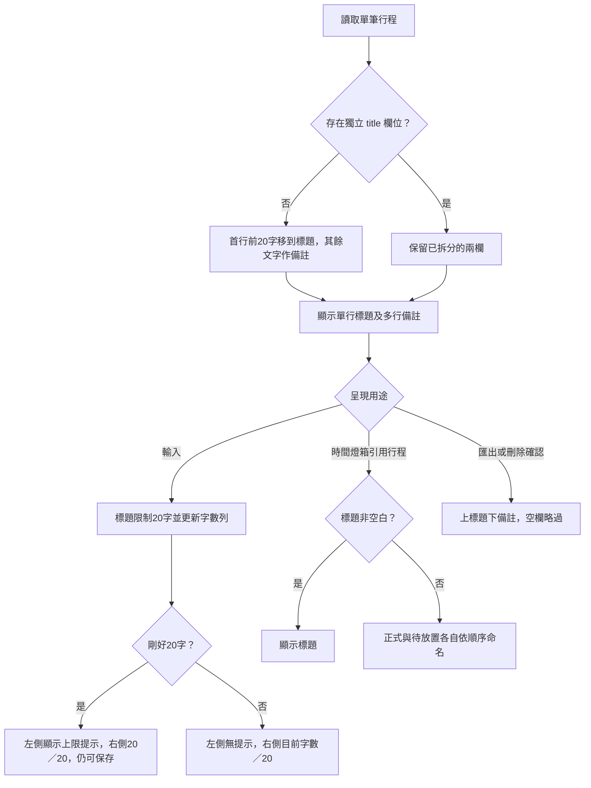

# 行程標題與備註拆分：接手執行方案

日期：2026-10-24。專案：TickBrick。

## 1. 接手狀態與授權界線

- 使用者已逐項確認需求，並於最新正式行程頁面模擬後表示「畫面看起來正確」。
- 本次指令是「提出修改成這樣的執行方案，讓其他 agent 可以接手」。**尚未取得依本方案修改產品程式的明確批准。** 接手後先呈現本方案摘要，取得「照本方案開始修改」等明確批准，才進入產品實作；不用重問已確認的產品問題。
- 本輪只建立接手方案並同步待辦，沒有修改產品 JavaScript、HTML、CSS 或測試。
- 先讀 `AGENTS.md`、`VIBE_CODING_RULES.md`、`專案規格書.md`、`DESIGN.md`，再核對當時實際程式；本文件的行號只供定位。
- 現有工作目錄已有大量未提交修改，包含產品程式、測試、規格與設計文件。開始前保存「本批開始時」的差異基準，不能回復、覆蓋或把先前差異當成本批成果；不自行提交。

### 最終 UI 參考

已確認的正式行程頁面互動模擬：

`/Users/wh/.codex/visualizations/2026/10/23/01a168f6-717c-7a32-8441-99e9ce9dc6f2/schedule-page-preview.html`

這是獨立模擬，不是產品程式。以輸入區結構、上下對齊、操作置中與字數提示作為視覺依據。模擬的 table、行內樣式、停用按鈕、假資料、自訂品牌副標、固定時間、新增列時間及狀態欄位命名都不是實作依據。**產品保留現有 div + CSS Grid、既有按鈕功能、品牌及資料行為。** 模擬內 `pending` 只是「待確認」視覺變數，產品必須繼續使用 `confirmed`；不得混淆產品 `pending` 的待放置狀態。

## 2. 已確認需求

### 2.1 輸入與畫面

- 保留八欄：排序、開始時間、結束時間、總時長、類別、行程內容、移動、刪除。
- 在「行程內容」欄內拆成上方單行標題、下方多行說明／備註；不是新增兩個表格欄位。
- 「標題」「說明／備註」只放在 placeholder，框外不顯示欄位名稱；保留 `aria-label` 或隱藏 label。
- 「待確認」核取方塊仍在最上方；勾選時標題與備註兩框均用既有深粉紅外框，不改資料旗標或可編輯性。
- 標題最多 20 字，輸入／貼上超出只接受前 20 字；空白可保存。下方字數為 `X／20` 靠右。
- **剛好 20 字**：同一行左側顯示「標題最多 20 字」，右側為 `20／20`；屬於有效值，可自動保存，不顯示錯誤狀態、不阻擋保存。少於 20 字左側不顯示提示。
- 備註保留換行、自動增高與既有中英文折行規則，沒有本次新增的字數上限。
- 開始、結束、總時長、類別、標題的第一排控制項高度一致且上緣對齊；「待確認」在標題上方，不得因此讓時間欄比標題高一排。
- 拖曳圖示與刪除圖示相對整筆行程列垂直置中；「移至其他日期／移至暫存」作為整組垂直置中，兩按鈕仍上下排列。
- 套用共用行程編輯器至正式、待放置、暫存。保留待放置與暫存原有的可操作欄位和專用動作。
- 既定欄寬不變：50／120／120／140／100／彈性／150／50 px。不要順便進行卡片化或 RWD 重構。

### 2.2 資料與轉換

建議資料契約：新增 `title` 保存標題，保留 `content` 保存說明／備註，減少既有內容路徑改名的影響。此契約是本執行方案的一部分，待整份方案批准後實作。

- 舊資料缺少 `title` 欄位時才進行一次轉換：第一行前 20 字作為標題；第一行超出部分接上後續各行作備註。
- 第一行未超限時，備註只保留後續各行，不保留已移入標題的第一行，不製造開頭空白行。
- 第一行有超出文字時，超出文字與原第二行之間保留換行。內容本身的空白與後續空行不要擅自清理。
- 第一行空白時不向後尋找非空白行作標題。
- 已有 `title` 欄位，即使是空字串，都視為已拆分，重新載入不能再次把備註第一行搬進標題。
- 覆蓋現有 localStorage、舊版保存鍵、舊陣列備份、新版物件備份、各日期正式／待放置及共用暫存；初始示範資料也須正確建立兩欄。
- 新增空行程：標題與備註皆空白。不要以順序名稱回填標題。
- JSON 匯出包含兩欄；匯入後再匯出、重新載入及跨區移動都要保留兩欄。
- 不改 localStorage key，不引入另一份儲存來源或手動儲存按鈕。是否更新資料版本號須保持與既有讀取契約一致，不能藉此拒絕舊備份。

### 2.3 燈箱行程名稱

「時間燈箱名稱」指所有需要提到行程的名稱位置：燈箱標題、滾輪選項、說明、鎖定／衝突原因與結果預覽，不是只改燈箱最上方標題。

- 有標題時優先使用標題，名稱判斷沿用去除前後空白的顯示習慣，備註不參與名稱回退。
- 空標題正式行程：只按**所屬日期正式行程**順序顯示「第一個行程」「第二個行程」；略過所有待放置列。
- 空標題待放置行程：只按**所屬日期待放置行程**順序顯示「第一個待放置行程」「第二個待放置行程」。
- 有標題行程仍占對應群組的一個位置；順序是目前排列，不是建立時固定編號。
- 排序、放置、刪除、跨日期移動後，依當下所屬清單重新計算；放置成功的列成為正式行程，不再沿用待放置編號。
- 共用暫存區沒有時間連動候選燈箱，不新增「第幾個暫存行程」規則。仍保留既有刪除確認與日期選擇燈箱。
- 名稱 helper 必須能使用正確日期與試算副本清單；不能只在 `state.activeDate` 找 row 物件參照，因為候選持有 structuredClone、未套用副本或移除前資料。
- 沿用既有名稱 DOM、安全文字處理、滾輪寬度、title 與結果預覽規則；本次不重寫候選、鎖定或時間運算。

### 2.4 匯出與刪除確認

- 圖片／PDF、刪除確認：標題在上、備註在下，空白欄位略過，標題以粗體／既有較重字級區分。
- 刪除確認保留原時間與確認／取消流程，適用正式、待放置、暫存。
- 順序替代名稱只供時間燈箱辨識，不自動填進標題，也不額外印在匯出／刪除內容。
- 圖片／PDF 繪製高度與 PDF 分頁使用同一套標題／備註高度計算；長備註不能截斷、重疊或造成分頁高度不一致。
- 保留既有待確認標記、日期、類別、時間／時長、LOGO、待放置排除與衝突匯出阻擋規則。

## 3. 決策完整候選與取捨

| 決策 | 完整候選 | 最終狀態與理由 |
|---|---|---|
| 舊資料拆分 | A 標題取首行且保留完整內容；B 首行前 20 字到標題、其餘到備註；C 標題空白、完整內容作備註 | B 保留；A 因重複文字淘汰，C 因需手動補標題淘汰 |
| 空標題 | 必填；回讀備註首行；通用「此行程」；目前順序名稱 | 使用者指定順序名稱；前三者淘汰，不增加必填限制 |
| 順序範圍 | 全畫面混編；只計正式／待放置各自計算；建立時固定編號 | 各自計算保留，符合正式時間鏈；混編、固定編號淘汰 |
| 待放置空標題 | 此待放置行程；第幾個待放置行程；此行程 | 使用者選順序名稱，以辨識多筆待放置行程 |
| 暫存空標題 | 另建暫存編號；通用名稱 | 不建立新的時間燈箱名稱規則：無對應使用入口 |
| 超限處理 | A 只接受前 20 字；B 保留超限草稿、修正後保存；C 超出移入備註 | A 保留，操作直接；B、C 淘汰。舊資料轉換仍依拆分 B 保留超出文字 |
| 匯出／刪除 | A 上標題下備註；B 接成相同樣式多行；C 只有標題 | A 保留以區分層次；B、C 淘汰 |
| 資料實作 | 新增 title、content 作備註；改名 content 為 notes 並全面替換 | 建議前者，降低既有匯出與資料路徑改名範圍；必須更新所有名稱讀取點，不能只改輸入框 |

## 4. 核心流程與案例

文字步驟：

1. 檢查欄位是否存在，對缺少 title 的舊列轉換一次；不以標題是否空白判斷是否重轉。
2. 輸入更新標題與字數列；0–20 字均有效，20 字提示不是驗證錯誤。
3. 時間燈箱取標題；空標題按正確日期及狀態群組計算順序。
4. 匯出與刪除確認分別呈現原始兩欄，不使用燈箱的替代名稱。

### 案例一：舊資料無損轉換

操作前：缺少 title，content 為 `ABCDEFGHIJKLMNOPQRSTU\n攜帶護照`（此處 `\n` 表示實際換行）。

使用者操作：載入舊資料，或確認匯入舊 JSON。

試算：首行 21 字，前 20 字 `ABCDEFGHIJKLMNOPQRST`，超出 `U`。

結果：title 為 `ABCDEFGHIJKLMNOPQRST`；content 為 `U\n攜帶護照`。左提示「標題最多 20 字」、右 `20／20`，保存有效。再次載入保持相同，不重複拆分。

### 案例二：正式與待放置分開計算

| 畫面位置 | 狀態 | 標題 | 燈箱名稱 |
|---|---|---|---|
| 1 | 正式 | 早餐 | 早餐 |
| 2 | 待放置 | 空白 | 第一個待放置行程 |
| 3 | 正式 | 空白 | 第二個行程 |
| 4 | 待放置 | 空白 | 第二個待放置行程 |

使用者將位置 4 的待放置列拖到最上方但尚未放置：它改稱「第一個待放置行程」，原位置 2 改稱「第二個待放置行程」；空白正式列仍稱「第二個行程」。僅重新排序名稱，不因本次顯示規則調整任何時間。

### 案例三：20 字輸入邊界

操作前：標題 `ABCDEFGHIJKLMNOPQRS`（19 字），備註 `記得帶護照`。

操作：再輸入 `T` → 20 字提示出現，20 字有效；再輸入／貼上 `U` → 標題仍保留前 20 字，備註不變；刪除 `T` → 回到 19 字，左提示消失。

## 5. 分步實作順序（取得批准後）

### A. 基準與資料契約

1. 核對目前差異與 12 種責任分類；不重排函式或另做拆檔。
2. 新增統一的標題字數／截取及舊列拆分工具；先讓新建、載入與匯入資料得到一致兩欄。
3. 建議用 Unicode code point 計數／截取（例如 Array.from），避免 UTF-16 截斷成半個字元；中文、英文、數字、標點各計一字。這是本方案技術建議，非新增中文雙倍計數或類別名稱的 16 單位規則。
4. 輸入法組字期間不要截斷，完成組字後限制 20 字；paste 與一般輸入共用限制。不要只用原生 maxlength=20 造成中文字元與 emoji 計數不一致。
5. 工具若被 `loadState()` 初始化過程呼叫，注意目前 `let state=loadState()` 的執行順序與常數暫時性死區，不能要求先初始化後方宣告。

### B. 共用編輯器與保存

1. 在既有 `rowMarkup` 加入標題 input、字數列與備註 textarea；保留 `[data-field]` 的既有編輯入口與資料身分。
2. 在 `bindRows` 綁定即時限制、字數提示及 textarea 增高，與現有 change／自動保存流程協作，避免重繪吃掉尚未提交的另一欄。
3. `updateRow` 或共用寫入工具處也套用相同標題限制，避免畫面與實際保存值不同；不新增保存按鈕、toast 或未保存草稿規則。
4. `confirmed` 外觀擴至兩框；不更動產品 `pending`。

### C. 名稱引用

1. 改造 `dialogRowName` 及其呼叫處，以 title 或相應群組序號回傳名稱。
2. 逐一查核 timeOptions、timeOptionParts、時間編輯標題、結果預覽、鎖定原因、排序確認、移除衝突來源基準、放置時長候選與衝突敘述。
3. 需要副本／移除前清單的呼叫處明確傳入上下文，不為了找名稱而改變全域 state 或試算結果。
4. 不更改候選數目、順序、過濾、時間運算、錨點、衝突保留／復原與按鈕流程。

### D. 行程列樣式

1. 保留 Grid 欄寬與現有色彩 token、圓角、字型及按鈕樣式，不複製模擬全頁 CSS。
2. 統一第一排控制項高度，依內容區待確認列高度／間距對齊時間、時長、類別及標題；不要照抄模擬固定 46px padding，應依實際 Grid 結構及字型計算。
3. 字數列以左右排版，提示不把右側數字推到下一列；19→20→19 字切換避免版面跳動。
4. 拖曳、刪除及移動操作整組置中。檢查長備註使列增高後仍置中，且不影響拖曳命中與預覽。
5. 確認正式、待放置、暫存、窄畫面與列印沒有新增遮蔽或重疊；本批不承諾完成既有 RWD 待辦。

### E. 刪除、匯出與分頁

1. 刪除確認以安全 DOM 分開輸出標題與多行備註，保留原刪除時間和動作。
2. Canvas 增加標題及備註的各自量測／繪製；備註沿用原折行方式。
3. 共用量測結果到 `rowsByPdfPage` 與 `renderScheduleCanvas`，檢查合併／分日、多日期、續頁與待確認列高。
4. JSON 路徑保存兩欄且不重複轉換；不得更動匯出衝突檢查與現有檔案下載流程。

## 6. 修改檔案與責任分類

| 檔案／入口（接手時重新確認行號） | 工作 | 責任分類 |
|---|---|---|
| script.js：makeRow 約 46、loadState 約 48、normalizeState 約 57 | 新建、舊資料一次轉換、初始資料與載入相容 | 資料保存 |
| script.js：rowMarkup 約 208、bindRows 約 227 | 兩欄結構、字數即時回饋、無障礙與增高 | 行程畫面；事件入口標出對應處理責任 |
| script.js：updateRow 約 526 | 標題保存限制與兩欄更新 | 行程操作 |
| script.js：dialogRowName 約 641 及所有呼叫點 | 標題／群組序號與副本上下文 | 共用工具；呼叫所在分類沿用既有區段 |
| script.js：confirmDeleteRow 約 1005 | 兩層內容確認 | 行程操作 |
| script.js：renderScheduleCanvas 約 1304、rowsByPdfPage 約 1344、JSON 匯出入 | 兩欄備份、圖片／PDF 量測繪製與分頁 | 匯出備份 |
| style.css：schedule-row、content-editor 約 814、content-input 約 870、row-actions 約 888 及列印 | 輸入區與各欄對齊、置中、待確認外觀 | 既有樣式區段 |
| tests/content-confirmation-regression.test.js 及名稱相關既有測試；必要時新增標題回歸檔 | 新契約、遷移、名稱與顯示驗證 | 測試 |
| 專案規格書.md、DESIGN.md、待辦清單.md；情境矩陣.md 如涉及現有對應情境 | 實際行為、版本、函式盤點／行號與驗收結果 | 文件 |

原則上不需修改 index.html 的八欄表頭；只有發現與此功能直接相關的必要結構才調整。不改歷史未分拆 HTML 或 process 歷史檔。新增函式均附中文用途、資料副作用及限制說明，置於既有責任相符的 `#region`，檢查 region 配對並更新函式盤點。不得新增第 13 種分類。

## 7. 驗收清單

| 類別 | 必驗條件 |
|---|---|
| 標題輸入 | 空白、19／20／21 字、貼上、中文組字；20 字仍保存有效，21 字只留前 20 字；提示左右同列 |
| 備註 | 多行、空行、中文與英文、長單字／網址、自動增高；編輯標題不把超出輸入移到備註 |
| 舊資料 | 首行短／剛好20／超過20、多行、首行空白、CRLF；文字無遺漏；已有空 title 不重轉 |
| 入口 | 現有 key、legacy key、初始資料、陣列／物件 JSON、正式／待放置／暫存；重載／往返不重轉 |
| 群組名稱 | 有標題也占序號、正式略過待放置、待放置獨立編號、多日期、排序與放置後更新、副本或移除前上下文 |
| 所有名稱位置 | 時間標題、滾輪、說明、預覽、鎖定與衝突原因、排序確認、移除基準與放置候選均不回讀備註 |
| 資料保留 | 移至暫存、回日期待放置、跨日期、放置、排序、確認／取消刪除、重載、JSON 往返保留兩欄與 confirmed |
| 畫面 | 五種第一排控制項等高／上緣對齊；拖曳、刪除及兩移動按鈕組相對整列垂直置中；長備註、20字提示與待確認狀態不破版 |
| 匯出與刪除 | 標題在上備註在下、空欄略過、安全文字、標題視覺區分；PNG 與單／多日期 PDF 的列高及分頁一致 |
| 既有行為 | 時間候選、鎖定、衝突、拖曳、待放置與類別維持原規則，不出現額外的時間或匯出行為變更 |

測試建議：

- 必跑 `node tests/downstream-invalid-conflict.test.js`（VIBE 第 14 節固定要求）。
- 本批直接涉及內容、名稱與列結構，執行 content-confirmation、time-option-dialog-copy、time-field-wheel、time-operation-conflict、touch-drag、reorder-time-anchor 相關回歸；其他既有回歸依實際差異與失敗關注決定。
- 補充有價值的行為回歸：一次轉換與冪等、群組序號與上下文、20 字有效保存、兩欄移動／JSON 往返及匯出量測一致性。不要只測新 helper 自己複製的規則。
- 既有 VM 測試會擷取具名函式，新增依賴後須同步測試 harness，不能將缺少依賴誤判為產品錯誤，也不能刪除原斷言來讓測試通過。
- `node --check script.js`、`git diff --check`；瀏覽器實際操作標題／備註／待確認，視覺核對正式／暫存／待放置；實際產生圖片與 PDF 查看內容及分頁。
- 使用隔離測試資料／儲存空間，不覆蓋使用者現有 localStorage。未能實測的項目明列限制，不把模擬或靜態檢查寫成瀏覽器通過。

## 8. 文件完成條件與排除範圍

- 實作後同步規格書第 2 章欄位、第 3／4 章移動與備份、第 6 章匯出、第 7／10 章名稱說明、第 8 章函式及行號、第 9 章測試與版本紀錄；更新 DESIGN 的內容欄／待確認／對齊規則。
- 待辦中本次標題與備註事項，只有完成實作與驗收才改成已完成；現階段是方案已整理、待實作批准。
- 未確認且會影響實作的產品例外，按 VIBE 規範停止相關工作、一次問一題；不影響本批的另記待辦，不能新增規則或測試期待。
- 非本批範圍：時間候選與計算重構、多筆時長分配、類別管理規則、複製行程、RWD／卡片化、部署、提交、歷史檔同步、重寫整頁。
- 模擬外的裝飾、日期、初始標題、鎖定圖示樣式及按鈕停用不應照搬。

## 9. 本輪文件檢查

本輪僅修改本方案與待辦 Markdown，核對已確認決策、範圍、模擬路徑、入口名稱與文字一致性，依 VIBE 第 14 節免跑自動回歸；未修改或驗證產品功能。
